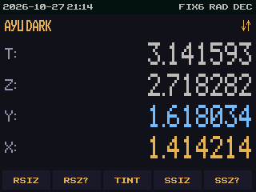

# rpnCE 0.8.0


An RPN calculator for the TI-84 Plus CE, written in C. It turns the CE into
an HP-style RPN calculator: a 4-level stack (up to 12), numbered registers
in the style of the HP-32SII, and a full menu tree of functions along the
bottom of the screen, on a dot-matrix LCD-style display.

## Features

- **HP RPN stack:** X, Y, Z, T with standard HP stack-lift rules, LASTX,
  and an optional deeper stack of up to 12 levels.
- **Keyboard-first:** the keys do what they say, including their 2ND
  functions; everything else is in the menu row, opened with MATH.
- **Registers:** A-Z, i, indirect (i), the statistics registers, and up to
  100 extra numbered registers, with STO/RCL arithmetic, x<>, and a VARS
  catalog of stored registers and all seven TVM values. Unit values retain
  their units in ordinary
  registers and convert compatible units during arithmetic.
- **Accurate numbers:** the calculator's 14-digit decimal math, shown with
  up to 12 digits, thousands separators, and FIX/SCI/ENG/ALL formats.
- **Functions:** MATH, NUM, PROB, HYP, CONV (polar, H.MMSS), STAT with
  curve fits, TVM (shared with TI's TVM Solver), 169 unit conversions,
  BASE (HEX/OCT/BIN words up to 44 bits, logic, shifts, rotates, bit
  operations), and DATE
  (dates, times, time zones, durations, epochs, and the CE's clock).
- **Complex numbers:** one value per stack level, mixed real/complex arithmetic,
  roots, powers, logarithms and exponentials; rectangular and polar entry,
  LINK/unlink, RRES/CRES and RECT/PRAD/PDEG modes.
- **Compact status bar:** ALL/FIX/SCI/ENG stays visible. DEG, DEC, RRES and
  RECT are implicit; RAD, CRES, polar modes, nondecimal bases, carry and
  pending modifiers appear when active. Fresh calculators start in DEG.
- **Remembers everything:** the stack, registers, statistics, and settings
  are saved when you quit and restored next time.
- **Screen tints:** LCD, LCD+ (for real screens), GRAY, INVERTED, AYU DARK,
  MONOKAI, PASTEL, and COMMODORE.

The **[User Guide](docs/USER_GUIDE.md)** describes rpnCE 0.8.0,
with operating procedures, worked keystroke examples, and a
[function index](docs/guide/20-reference.md#appendix-d-alphabetical-function-index).
[docs/KEYS.md](docs/KEYS.md) is a compact key and menu reference.
Start with the illustrated [complex-number tutorial](docs/guide/11-complex-numbers.md)
for entry, arithmetic, CPLX functions and LINK.

## Installing

1. Build version 0.8.0 as described below and use `bin/rpnCE.8xp` (the program)
   and `bin/rpnCEres.8xv` (its menus and unit tables). Packaged versions are
   available from [releases](https://github.com/jacober-calc/rpnCE/releases);
   use the documentation supplied with that version. Also get the
   [CE C libraries](https://github.com/CE-Programming/libraries/releases)
   (`clibs.8xg`) if you don't already have them.
2. Send all three to the calculator with TI Connect CE. They can all stay
   in archive memory.
3. Use the native-program launch method supported by your OS or installed
   launcher. On OS versions that support it, use `Asm(prgmRPNCE)`.
   For newer OS versions, follow the current
   [arTIfiCE instructions](https://yvantt.github.io/arTIfiCE/) for your
   exact model and OS. See the manual's
   [installation chapter](docs/guide/02-installation.md).

The program and `RPNCEres` must come from the same release; if the appvar
is missing or doesn't match, rpnCE says so at startup. rpnCE saves its own
data in `RPNCEdat` (complete values, statistics and calculator modes) and
`RPNCEcfg` (display and DATE settings). Saved data uses version 6 and includes
units with each value. Version-5 saves and their optional `RPNCEunt` metadata
can be imported; a successful save removes that sidecar. Back up
saved data before upgrading; older program versions cannot read version 6.

## Quick start

| Keys | Result |
| --- | --- |
| `2 ENTER 3 +` | 5 |
| `2 ENTER 3 ÷` then `2ND ENTRY` | shows all 14 digits of 0.666... |
| `5 STO→ MATH`, later `2ND RCL MATH` | stores and recalls register A |
| `MODE`, then `FIX`, `4` | 4 decimal places |
| `MATH`, then a menu key | opens the menu tree; `ON` goes back |
| `2ND MODE` (QUIT) | saves and exits |

## Building

1. Install the [CE C/C++ toolchain](https://github.com/CE-Programming/toolchain/releases)
   (developed against v15.0).
2. Run `make` in this folder. It writes `bin/rpnCE.8xp` (stored compressed
   and archived; it unpacks itself into RAM when started) and
   `bin/rpnCEres.8xv` (archived). Intermediate files stay in `obj/`.

The version is set in `src/core/version.h`.

The release files in [cem/](cem/) use versioned filenames. TI-OS still lists
the program as `RPNCE`; its resource and saved-data appvar names are unchanged
so existing calculator data remains available.

To try a source build without a calculator, load both files from `bin/`
and `clibs.8xg` into the
[CEmu](https://ce-programming.github.io/CEmu/) emulator.

### Memory

The menu tree, unit tables and 26 HELP pages (about 18 KB) live in `RPNCEres`
and are read straight from archive, so they use no RAM. Stack and ordinary
register values use 20 bytes each on the CE. See the linker map for program
and static-storage sizes; runtime
stack and library allocations also need RAM.

## Tests

The calculator logic is kept free of screen and keypad code, so it can be
tested on a PC. With a C compiler installed:

```
sh tests/run_tests.sh
```

This builds and runs eighteen suites (number formatting, decimal rounding,
math, BASE, statistics, TVM and units, DATE, the RPNCEres appvar reader,
menu actions, keyboard shortcuts, dot-font rendering, saved state, the
calculator core, typed values and complex arithmetic, quantities, entry
sequences, display redraws, and brightness controls), using
stand-ins for the calculator's number routines.

The [native tests](tests/README.md#native-ce-checks) additionally compile
the real core with the CE toolchain and run 196 checks in CEmu using TI-OS
number routines. They cover CE execution, CTZ/ATZ conversions, unit round trips and all
four curve-fit models and numeric boundaries. Twenty-two further checks exercise
the program's keyboard loop and saving/reopening in CEmu. Known numerical
checks and coverage limits are described in [tests/README.md](tests/README.md#numeric-limit-checks).

## Layout

```
src/main.c   entry point and main loop
src/core/    calculator logic: stack, registers, math, formatting, rounding,
             TVM, statistics, units, BASE (no screen or key code)
             calc_entry.c handles editing; calc_date.c integrates DATE
             with the stack; calc.c dispatches commands and runs math
src/ui/      display, dot-matrix font, keypad, menus, VARS catalog,
             res.c (reads the RPNCEres appvar)
src/sys/     saving and loading state, the hardware clock
menus/       menus.txt: menu tree and calculator command/argument bindings
help/        help.txt: the HELP pages as editable text
data/        rpnCEres.bin: the RPNCEres appvar's contents (generated)
tools/       guide_appendix.py: regenerates the manual's menu map, unit list
             and function index; genres.py: builds RPNCEres and the matching headers from
             menus.txt (via genmenu.py) and the unit definitions
             (genunits.py);
             screenshots/: makes the user guide's screenshots
tests/       PC test suites and run_tests.sh
docs/        USER_GUIDE.md: manual contents; guide/: chapters and reference
             tables; key reference and install notes
```

## Editing menus and units

Change `menus/menus.txt`, `help/help.txt` (or the unit definitions in
`tools/genunits.py`), then run `python3 tools/genres.py` and rebuild. It regenerates
`data/rpnCEres.bin`, the layout headers and `src/ui/menu_actions.h`.
The program checks the appvar's resource-content stamp. Generated files
are committed, so building doesn't need Python.
Add optional `CMD_*` and argument fields to an item or alt line to define
its calculator action. Define each ID's binding once; other menu entries
reuse that ID. Unit indexes are generated automatically from unit order.
After changing the menus or units, also run `python3 tools/guide_appendix.py`
to refresh the menu map, unit list, and function index in
`docs/guide/20-reference.md`. Update the operating instructions and examples
in the corresponding chapter when behavior changes; generated tables do
not replace those explanations. Both generators need the `mpmath` package.

The user guide's screenshots are made by running rpnCE's real code on a PC:
`python3 tools/screenshots/run.py` rebuilds every image in `assets/guide/`
from the keystroke scripts in `tools/screenshots/shots.py`. It needs a C
compiler and Pillow, and downloads the CE system font from the CE toolchain
once. Run it after changes that affect what the screen shows, then run
`tools/guide_appendix.py` so the menu map uses the new images.

## License

MIT. See [LICENSE](LICENSE). The menu definitions in `menus/menus.txt`
are adapted from Brian T. Park's [RPN83P](https://github.com/bxparks/rpn83p),
also licensed under MIT. The applicable copyright notice is retained in
the menu source and LICENSE.
