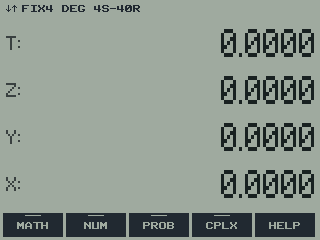

# RPNCE


An RPN calculator for the TI-84 Plus CE, written in C. It turns the CE into
an HP-style RPN calculator: a 4-level stack (up to 12), numbered registers
in the style of the HP-32SII, and a full menu tree of functions along the
bottom of the screen, on a dot-matrix LCD-style display.

## Features

- **HP RPN stack:** X, Y, Z, T with standard HP stack-lift rules, LASTX,
  and an optional deeper stack of up to 12 levels.
- **Keyboard-first:** the keys do what they say, including their 2ND
  functions; everything else is in the menu row, opened with MATH.
- **Registers:** A-Z, i, indirect (i), the statistics registers, and up to
  100 extra numbered registers, with STO/RCL arithmetic, x<>, and a VARS
  catalog of stored registers and all seven TVM values. Unit values retain
  their units in ordinary
  registers and convert compatible units during arithmetic.
- **Accurate numbers:** the calculator's 14-digit decimal math, shown with
  up to 12 digits, thousands separators, and FIX/SCI/ENG/ALL formats.
- **Functions:** MATH, NUM, PROB, HYP, CONV (polar, H.MMSS), STAT with
  curve fits, TVM (shared with TI's TVM Solver), 169 unit conversions,
  BASE (HEX/OCT/BIN words up to 44 bits, logic, shifts, rotates, bit
  operations), and DATE
  (dates, times, time zones, durations, epochs, and the CE's clock).
- **Remembers everything:** the stack, registers, statistics, and settings
  are saved when you quit and restored next time.
- **Screen tints:** LCD, LCD+ (for real screens), GRAY, INVERTED, AYU DARK,
  MONOKAI, PASTEL, and COMMODORE.

The **[User Guide](docs/USER_GUIDE.md)** is a chapter-based manual for 0.7.0,
with operating procedures, worked keystroke examples, and a
[function index](docs/guide/19-reference.md#appendix-d-alphabetical-function-index).
[docs/KEYS.md](docs/KEYS.md) is a compact key and menu reference, and
[docs/ROADMAP.md](docs/ROADMAP.md) shows what's done and what's next.

## Installing

1. Download the latest `RPNCE-<version>.zip` from the releases and unzip
   it, or take the two files straight from the [`prod/`](prod) folder,
   which always holds the current build. You need `RPNCE.8xp` (the program)
   and `RPNCEres.8xv` (its menus and unit tables). Also get the
   [CE C libraries](https://github.com/CE-Programming/libraries/releases)
   (`clibs.8xg`) if you don't already have them.
2. Send all three to the calculator with TI Connect CE. They can all stay
   in archive memory.
3. Use the native-program launch method supported by your OS or installed
   launcher. On OS versions that support it, use `Asm(prgmRPNCE)`.
   For newer OS versions, follow the current
   [arTIfiCE instructions](https://yvantt.github.io/arTIfiCE/) for your
   exact model and OS. See the manual's
   [installation chapter](docs/guide/02-installation.md).

The program and `RPNCEres` must come from the same release; if the appvar
is missing or doesn't match, RPNCE says so at startup. RPNCE saves its own
data in up to three more appvars: `RPNCEdat` (calculator state), `RPNCEcfg`
(display and DATE settings) and `RPNCEunt` (units on registers, only when
some register has one). Deleting them resets RPNCE; upgrading keeps them.

## Quick start

| Keys | Result |
| --- | --- |
| `2 ENTER 3 +` | 5 |
| `2 ENTER 3 ÷` then `2ND ENTRY` | shows all 14 digits of 0.666... |
| `5 STO→ MATH`, later `2ND RCL MATH` | stores and recalls register A |
| `MODE`, then `FIX`, `4` | 4 decimal places |
| `MATH`, then a menu key | opens the menu tree; `ON` goes back |
| `2ND MODE` (QUIT) | saves and exits |

## Building

1. Install the [CE C/C++ toolchain](https://github.com/CE-Programming/toolchain/releases)
   (developed against v15.0).
2. Run `make` in this folder. It writes `bin/RPNCE.8xp` (stored compressed
   and archived; it unpacks itself into RAM when started) and
   `bin/RPNCEres.8xv` (archived).
3. For a release, run `sh tools/release.sh`: it builds and bundles both
   files with install notes as `release/RPNCE-<version>.zip`. The version
   is set in `src/core/version.h`.

To try it without a calculator, load both files and `clibs.8xg` into the
[CEmu](https://ce-programming.github.io/CEmu/) emulator.

### Memory

The menu tree, unit tables and HELP pages (about 17 KB) live in `RPNCEres`
and are read straight from archive, so they use no RAM. The 0.7.0 build has
an 82,968-byte program image and 3,855 bytes of static variables, excluding
runtime stack and library allocations. See the
[refactor measurements](docs/REFACTOR.md) for the comparison with the original.

## Tests

The calculator logic is kept free of screen and keypad code, so it can be
tested on a PC. With a C compiler installed:

```
sh tests/run_tests.sh
```

This builds and runs fifteen suites (number formatting, decimal rounding,
math, BASE, statistics, TVM and units, DATE, the RPNCEres appvar reader,
menu actions, keyboard shortcuts, dot-font rendering, saved state, the
calculator core, reported bug regressions, and display redraws), using
stand-ins for the calculator's number routines.

To compare the refactored core against the original in a Git checkout:

```
sh tests/check_core_equivalence.sh
```

This checks 22,848 command/state combinations, including DATE and BASE
arguments, both stack depths, unit tags, errors, TVM variables and the clock,
plus 8,568 entry-sequence steps. Intentional quantity behavior, PRIM's stack
push and percentage DATE type checks are covered separately by regression
tests. A baseline from before the core was split can also be passed as an
argument (for example, `2e29e01`).

## Layout

```
src/main.c   entry point and main loop
src/core/    calculator logic: stack, registers, math, formatting, rounding,
             TVM, statistics, units, BASE (no screen or key code)
             calc_entry.c handles editing; calc_date.c integrates DATE
             with the stack; calc.c dispatches commands and runs math
src/ui/      display, dot-matrix font, keypad, menus, VARS catalog,
             res.c (reads the RPNCEres appvar)
src/sys/     saving and loading state, the hardware clock
menus/       menus.txt: the whole menu tree as editable text
help/        help.txt: the HELP pages as editable text
data/        RPNCEres.bin: the RPNCEres appvar's contents (generated)
tools/       guide_appendix.py: regenerates the manual's menu map, unit list
             and function index; genres.py: builds RPNCEres and the matching headers from
             menus.txt (via genmenu.py) and the unit definitions
             (genunits.py); release.sh: packages a release
tests/       PC test suites and run_tests.sh
docs/        USER_GUIDE.md: manual contents; guide/: chapters and reference
             tables; key reference, roadmap, and install notes
prod/        the current build: RPNCE.8xp, RPNCEres.8xv, INSTALL.txt
```

## Editing menus and units

Change `menus/menus.txt`, `help/help.txt` (or the unit definitions in
`tools/genunits.py`), then run `python3 tools/genres.py` and rebuild. It regenerates
`data/RPNCEres.bin` and the headers that go with it, with a new version
stamp, so a program and appvar built from different sources can't be mixed
up. The generated files are committed, so building doesn't need Python.
After changing the menus or units, also run `python3 tools/guide_appendix.py`
to refresh the menu map, unit list, and function index in
`docs/guide/19-reference.md`. Update the operating instructions and examples
in the corresponding chapter when behavior changes; generated tables do
not replace those explanations. Both generators need the `mpmath` package.

## License

MIT. See [LICENSE](LICENSE). The menu tree in `menus/menus.txt` carries
its own credit notice.
