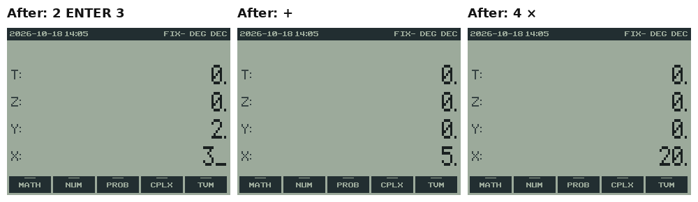
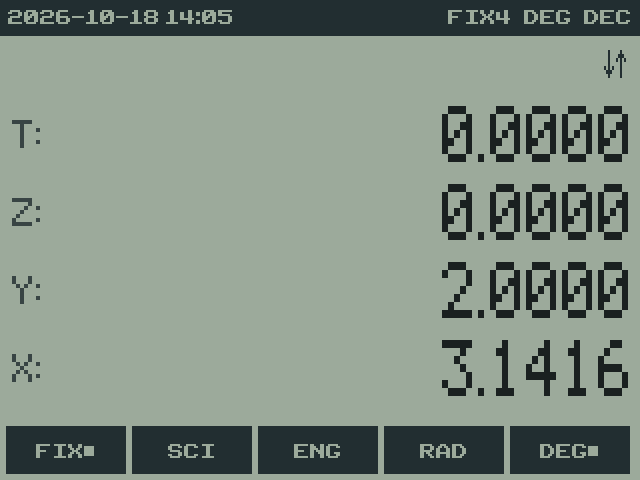
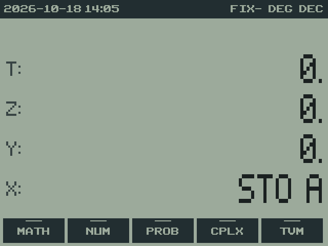
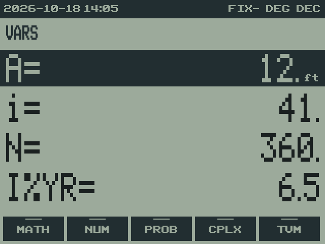
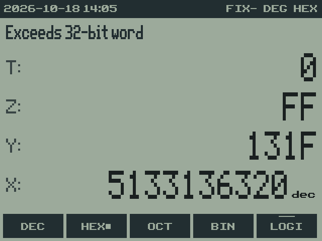
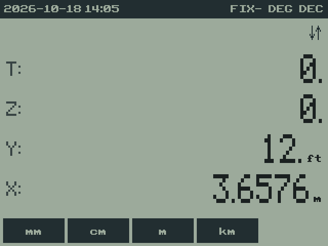
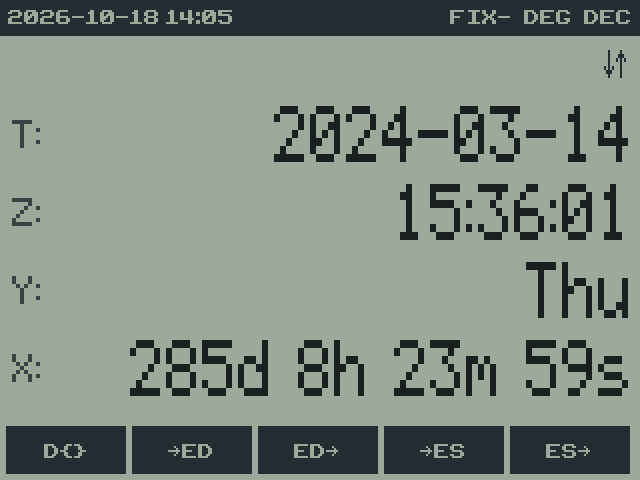

# RPNCE User Guide

An RPN calculator for the TI-84 Plus CE.

**Version:** 0.7.0\
**Project home:** https://github.com/jacober-calc/rpnce

## Contents

1. [Introduction](#1-introduction)
2. [Installing RPNCE](#2-installing-rpnce)
3. [A quick tour](#3-a-quick-tour)
4. [The screen](#4-the-screen)
5. [Entering numbers](#5-entering-numbers)
6. [The RPN stack](#6-the-rpn-stack)
7. [The menus](#7-the-menus)
8. [Registers](#8-registers)
9. [Display formats and MODE settings](#9-display-formats-and-mode-settings)
10. [Math functions](#10-math-functions)
11. [BASE: hexadecimal, octal and binary](#11-base-hexadecimal-octal-and-binary)
12. [STAT: statistics and curve fitting](#12-stat-statistics-and-curve-fitting)
13. [TVM: time value of money](#13-tvm-time-value-of-money)
14. [UNIT: unit conversions](#14-unit-unit-conversions)
15. [DATE: dates, times and the clock](#15-date-dates-times-and-the-clock)
16. [Messages and errors](#16-messages-and-errors)
17. [Saving, memory and files](#17-saving-memory-and-files)
18. [Limits and differences](#18-limits-and-differences)
19. [Appendix A: Key reference](#appendix-a-key-reference)
20. [Appendix B: Menu map](#appendix-b-menu-map)
21. [Appendix C: Units](#appendix-c-units)

### How keys are written in this guide

Keys are written in capitals as they're printed on the calculator: `ENTER`,
`SIN`, `STO→`. A key's blue second function is written with `2ND` in front,
as in `2ND ENTRY`, meaning press `2ND`, then the key with ENTRY printed above
it. `ALPHA` works the same way for the green letters. A number in a key
sequence, like `25 ENTER`, means type those digits.

The five keys under the screen (`Y=`, `WINDOW`, `ZOOM`, `TRACE`, `GRAPH`) are
the **menu keys**. When this guide says "press **PMT**", it means press the
menu key under the label PMT. Menu labels are written in bold.

## 1. Introduction

RPNCE turns the TI-84 Plus CE into an RPN (Reverse Polish Notation)
calculator in the tradition of Hewlett-Packard's scientific and financial
calculators. Instead of typing an expression and pressing `=`, you put
numbers on a **stack** and then apply operations to them: to add 2 and 3,
press `2 ENTER 3 +`. There are no parentheses to balance, every intermediate
result is visible, and long calculations become a sequence of simple steps.

RPNCE is keyboard-first, like the HP-32SII: the keys do what their labels
say, including their `2ND` functions. Everything else lives in a menu tree
shown along the bottom of the screen, a design borrowed from RPN83P and the
HP-42S.

**Highlights**

- A four-level HP-style stack (`T`, `Z`, `Y`, `X`) with `LASTX`, expandable
  to 12 levels.
- The calculator's own 14-digit decimal arithmetic, shown with up to 12
  digits, thousands separators, and FIX, SCI, ENG and ALL formats.
- Registers numbered as on the HP-32SII: `A` to `Z`, `i` and indirect `(i)`,
  the statistics registers, and up to 100 more, with register arithmetic, a
  register exchange, and a VARS catalog of everything stored.
- Math, number, probability, hyperbolic and conversion functions.
- BASE: hexadecimal, octal and binary integers of up to 44 bits, with logic,
  shift, rotate and bit operations.
- STAT: one- and two-variable statistics with linear, logarithmic,
  exponential and power curve fits.
- TVM: loans, savings and annuities, sharing values with TI's own TVM
  Solver.
- UNIT: 169 units in 12 categories, with unit-aware arithmetic: 6 ft plus
  2 in is 6.1667 ft.
- DATE: dates, times, time zones, durations, epoch seconds, and the CE's
  real-time clock.
- HELP: quick-reference pages on the calculator (`2ND CATALOG`).
- Everything is saved when you quit and restored when you start again.

**Not yet available:** complex numbers. The **CPLX** menu opens, but its
items, and the complex settings in **MODE**, show "Not available yet".

## 2. Installing RPNCE

### What you need

| File | What it is |
| --- | --- |
| `RPNCE.8xp` | the program |
| `RPNCEres.8xv` | its menus and unit tables (required) |
| `clibs.8xg` | the CE C libraries, used by many CE programs |

`RPNCE.8xp` and `RPNCEres.8xv` come together in each release
(`RPNCE-<version>.zip`) and in the project's `prod` folder. If you don't
already have `clibs.8xg`, download it from
https://github.com/CE-Programming/libraries/releases.

### Sending and running

1. Connect the calculator and send all three files with TI Connect CE. They
   can all go to archive memory, which keeps them safe if RAM is cleared.
2. On the home screen, run `Asm(prgmRPNCE)`, or just `prgmRPNCE` on newer
   OS versions. (Press `PRGM`, choose RPNCE, and press `ENTER`.)
3. Calculators with OS 5.5 or newer need the arTIfiCE jailbreak to run C
   programs; see the arTIfiCE project for instructions.

RPNCE starts with a cleared stack the first time. From then on it remembers
everything between runs (see [Saving, memory and files](#17-saving-memory-and-files)).

### Upgrading

Send the new `RPNCE.8xp` and `RPNCEres.8xv` together; they replace the old
ones. Your saved stack, registers and settings are kept. The two files must
come from the same release: if `RPNCEres` is missing or from a different
version, RPNCE shows a notice such as "RPNCEres not found" or "RPNCEres is
the wrong version" and tells you which file to send, rather than starting.

### Leaving RPNCE

Press `2ND QUIT` (on `MODE`) to save and exit. `2ND OFF` also saves and
exits; press `2ND OFF` again on the home screen to turn the calculator off.
After five minutes without a key press, RPNCE saves and exits by itself so
the calculator can power down normally.

## 3. A quick tour

A few things to try in your first minutes. Each line starts from whatever is
on the stack; the result appears in `X`, the bottom line.

| Keys | Result | What happened |
| --- | --- | --- |
| `2 ENTER 3 +` | `5.` | 2 and 3 added |
| `10 ENTER 4 −` | `6.` | 4 taken from 10 (the order is the order you'd write) |
| `3 ENTER 4 + 5 ENTER 6 + ×` | `77.` | (3 + 4) × (5 + 6), no parentheses needed |
| `2 x²` | `4.` | one-number functions act on X right away |
| `2 ENTER 10 ^` | `1,024.` | Y to the power X |
| `2ND π` (on `^`) | `3.14159265359` | π |
| `2ND ENTRY` | message: all 14 digits | SHOW: `3.1415926535898` |
| `MATH`, then **MATH**, then **X^3** | | the menu tree: MATH opens HOME |
| `ON` | | back one menu level |
| `MODE`, then **FIX**, `4` | | four decimal places: `3.1416` |
| `5 STO→ MATH` | | stores 5 in register A |
| `2ND RCL MATH` | `5.0000` | recalls register A |
| `CLEAR CLEAR` | | clears the whole stack |
| `2ND CATALOG` (on `0`) | | the HELP pages; `ON` returns |
| `2ND QUIT` | | saves and exits |

Each part of that is explained in the chapters that follow.

## 4. The screen

RPNCE's screen has four areas, top to bottom.

### Status bar

The dark strip at the top shows the calculator's state.

| Item | Meaning |
| --- | --- |
| `2026-10-18 14:05` | the date and time from the CE's clock, in the clock's own time zone; it updates each minute |
| `FIX4`, `SCI3`, `ENG2` | the display format and its number of digits (see [chapter 9](#9-display-formats-and-mode-settings)) |
| `FIX-` | "as many digits as needed" (all digits, like ALL on an HP) |
| `DEG` / `RAD` | the angle mode for trigonometry and polar conversions |
| `DEC`, `HEX`, `OCT`, `BIN` | the number base (see [chapter 11](#11-base-hexadecimal-octal-and-binary)) |
| `C` after the base | the BASE carry flag is set |
| `2ND` badge | `2ND` was pressed; the next key gives its blue function |
| `A` badge | `ALPHA` was pressed; the next key gives its green letter |

### Message line

Under the status bar, the message line shows the result of the last
command when there's something to say: an error such as "Err: Domain", the
full value from SHOW, a notice such as "TVM Stored", or, in BASE modes, a
warning about X. Messages disappear at the next key. A pair of arrows (↓↑)
at the right end means the current menu has more rows; see
[The menus](#7-the-menus).

### Stack

The middle of the screen shows the four stack registers, `T` at the top and
`X` at the bottom, each with its value right-aligned in a large dot-matrix
font. `X` is where numbers are typed and where results appear.

- A value can have a small label after it: a unit such as `ft` or `kg`
  (chapter 14), or `dec` in BASE modes for a value that can't be shown in
  that base (chapter 11).
- A value too long for its line (a 32-bit binary number, or a long date)
  stays on one line: you see its right end, with a small ◂ where digits are
  hidden. Press ◂ and ▸ (the left and right arrow keys) to scroll through X.
- While you type a number, X shows it with a cursor: `3_`.

### Menu row

The bottom row shows five dark boxes, one for each menu key. A short line
across the top of a box marks a submenu (pressing it opens another menu);
other boxes are functions. A ■ after a label marks the active choice in a
setting, such as **DEG■**. An empty slot has no box.

### Screen colors

`MODE`, then row 3, **TINT**, cycles through eight color schemes; the
message line names each one as you go, and the choice is remembered:

| Tint | Look |
| --- | --- |
| **LCD** | gray-green, like a classic calculator LCD (the default) |
| **LCD+** | a stronger green that holds up better on the CE's real screen, which tends to wash colors out |
| **GRAY** | warm gray, like the SwissMicros calculators |
| **INVERTED** | light digits on a near-black panel |
| **AYU DARK** | a deep blue-gray background with amber and blue accents |
| **MONOKAI** | charcoal, with purple, cyan, green and pink stack values |
| **PASTEL** | a light background with distinct row colors and pastel menu keys |
| **COMMODORE** | phosphor greens on near-black, with brighter X digits |

## 5. Entering numbers

| Keys | Effect |
| --- | --- |
| `0`-`9`, `.` | type a number into X |
| `,` | EE: start the exponent (`6.02 , 23` is 6.02 × 10²³); `2ND EE` does the same |
| `(−)` | change the sign: of the number, or of the exponent after EE |
| `DEL` | while typing: delete the last character; otherwise CLX (clear X) |
| `CLEAR` | CLX: clear X to 0 (or abandon what's being typed) |
| `CLEAR CLEAR` | twice in a row: clear the whole stack ("Stack cleared") |
| `ENTER` | finish the number and push a copy up the stack |

A number has up to 12 digits, plus a two-digit exponent from −99 to 99.
Typing ends as soon as you press anything other than an entry key: an
operation, `ENTER`, a menu key and so on all use the number you typed.

`(−)` changes the sign; `−` subtracts. Pressing `(−)` when you're not
typing negates X.

### How numbers are shown

- Up to 12 significant digits are shown, with commas between thousands:
  `1,264.136046985`.
- A number too large or too small to show that way switches to scientific
  notation automatically, with up to 10 digits beside a small floating E:
  `6.02214076 ᴇ23`.
- The decimal point is always shown, as on HP calculators: `3.` and `0.`
- The calculator stores 14 significant digits; to see all of them, press
  `2ND ENTRY` (SHOW), which writes X in full on the message line.

The display format (FIX, SCI, ENG) changes only what you see, never the
stored value. See [chapter 9](#9-display-formats-and-mode-settings).

## 6. The RPN stack

### The idea

The stack is a pile of numbers. You put numbers on it, and operations take
their inputs from the bottom of the pile and leave their result there. The
four levels you see are named `X` (the bottom, where you type), `Y`, `Z`
and `T` (the top).

- A **one-number function** such as `x²`, `SIN` or `LN` replaces X with its
  result.
- A **two-number function** such as `+`, `×` or `^` uses Y and X, in that
  order, as you'd write them: `Y + X`, `Y − X`, `Y ÷ X`, `Y ^ X`. The
  result goes in X and the stack drops by one level: Z moves into Y, T into
  Z, and T keeps its value (so a constant in T stays available).
- `ENTER` finishes a number and copies X into Y, so you can type the next
  one.

To work out (2 + 3) × 4: `2 ENTER 3 +` leaves 5, then `4 ×` gives 20. You
never need parentheses; you just do the inner parts first, and the stack
holds the pieces until you need them. A longer example, (3 + 4) × (5 + 6):

| Keys | X | Y | Notes |
| --- | --- | --- | --- |
| `3 ENTER 4 +` | 7 | | first bracket |
| `5 ENTER 6 +` | 11 | 7 | second bracket; 7 waits in Y |
| `×` | 77 | | 7 × 11 |

### Stack lift

RPNCE follows the standard HP rules about when a new number pushes the
stack up ("stack lift"):

- Typing a number after most operations pushes the old X up into Y, so
  results are kept: `5 x²` then `3 +` gives 28.
- After `ENTER` (and after CLX), the next number you type **replaces** X
  instead of pushing, because ENTER already made a copy. That's why
  `5 ENTER 6 ×` gives 30 and not 5 × 5 with 6 left over.
- `ENTER ENTER` is a quick way to fill the stack with copies of a number:
  `3 ENTER ENTER ENTER` puts 3 in every level, and `× ×` then gives 3³.
- STO, CHS (`(−)` on X), SHOW and mode changes leave the stack lift
  setting as it was.

### Moving things around

| Keys | Name | Effect |
| --- | --- | --- |
| `(` | R↓ (roll down) | X goes to the top; everything else moves down one |
| `)` | X⇄Y | swap X and Y |
| `2ND ANS` (on `(−)`) | LASTX | recall the X from before the last operation |
| `2ND INS` (on `DEL`) | DUP | copy X into Y (the same as ENTER) |
| `2ND }` (on `)`) | DROP | remove X; everything above moves down |
| **STK** menu | DUP, R↑, R↓, DROP, X⇄Y, and X<> (exchange X with a register) |

LASTX is useful for correcting mistakes and reusing a value. If you meant
`×` but pressed `÷`, press `2ND ANS ×` to undo the division (multiplying the
divisor back), then `2ND ANS ×` again to do the multiplication you meant.
It's also handy for using a number twice: `3 ENTER 4 + 2ND ANS ×` gives
(3 + 4) × 4 = 28.

### A deeper stack

The standard stack has 4 levels. `MODE`, row 3, **SSIZ** sets it from X,
from 4 to 12 (a value below 4 means 4): `8` **SSIZ**. The screen still
shows T, Z, Y and X; the extra levels sit above T, out of sight, and come
into view as the stack drops. Rolls move through every level, and on a drop
the top level is copied down, as with T on a 4-level stack. **SSZ?** puts
the current depth in X. CLEAR CLEAR and **CLST** clear every level.

## 7. The menus

### The menu tree

Everything that isn't on the keyboard is in a tree of menus. `MATH` goes to
its top, **HOME**, which has three rows:

| Row | Menus |
| --- | --- |
| 1 | **MATH** **NUM** **PROB** **CPLX** **TVM** |
| 2 | **BASE** **HYP** **STAT** **CONV** **HELP** |
| 3 | **CLR** **MODE** **STK** **UNIT** **DATE** |

[Appendix B](#appendix-b-menu-map) lists every menu and item.

### Using menus

- **Menu keys:** the five keys under the screen choose the item above them.
  A submenu (a box with a short line across its top) opens that menu; a
  function runs at once.
- **More rows:** when the message line shows ↓↑ at its right end, the menu
  has more rows. Use the up and down arrow keys to move between them.
- **Back:** `ON` goes back one level, to the menu you came from. At HOME it
  does nothing.
- **Shortcuts:** some keys jump straight to a menu from anywhere (below).
- **The menu stays put.** After you choose a function, the same menu is
  still showing, so you can use it again. This makes repeated work fast:
  in UNIT, for example, you can convert one value after another.
- **Settings** show which choice is active with a ■: **FIX■**, **DEG■**,
  **BEG■**, **HEX■**.

### Menu shortcuts

| Key | Opens |
| --- | --- |
| `MATH` | HOME |
| `MODE` | MODE |
| `STAT` | STAT |
| `X,T,θ,n` | UNIT |
| `APPS` | BASE |
| `PRGM` | HYP |
| `2ND MEM` (on `+`) | CLR |
| `2ND LIST` (on `STAT`) | STK |
| `2ND CATALOG` (on `0`) | HELP |

Inside a STO or RCL prompt, and after `ALPHA`, these keys still give their
letters, so the shortcuts never get in the way of naming a register.
`2ND LINK` and `2ND ANGLE` are left unassigned on purpose: they're reserved
for complex numbers.

### HELP

**HELP** (HOME row 2, or `2ND CATALOG`) shows three quick-reference pages:
keys, the stack and registers, and units. The up and down arrows change
pages; `ENTER`, `CLEAR`, `DEL` or `ON` returns to the calculator.

## 8. Registers

### The registers

Registers store numbers, numbers with units, and DATE objects. They are
numbered as on the HP-32SII:

| Number | Register |
| --- | --- |
| 001-026 | `A` to `Z` |
| 027 | `i`, the index register |
| 028-033 | `n`, `Σx`, `Σy`, `Σx²`, `Σy²`, `Σxy`: the statistics registers |
| 034-040 | `Σlnx`, `Σlnx²`, `Σlny`, `Σlny²`, `Σlnxlny`, `Σxlny`, `Σylnx`: sums for curve fits |
| 041-140 | extra registers, when you add them (below) |

### Storing and recalling

Press `STO→`, then the key whose green ALPHA letter names the register: the
prompt shows `STO _` in the X row, and the next key completes it. So
`STO→ MATH` stores X in **A**, `STO→ SIN` in **E**, and so on. `2ND RCL`
works the same way.

When you complete a prompt, it shows the full command, such as `STO A`, for
a moment before it runs.

| In the prompt | Means |
| --- | --- |
| a letter key | that register, A to Z |
| `.` | register `i` |
| `2ND .` | `(i)`: the register whose number is in `i` |
| `+ − × ÷` first | register arithmetic (below) |
| `ALPHA`, then the key | the letter, for `− × ÷` (W, R, M) |
| `CLEAR`, `DEL` or `ON` | cancel |

- **STO** copies X into the register and never moves the stack.
- **RCL** brings the register's value into X like typing a number: it
  lifts the stack, except right after ENTER, when it replaces the copy.
- A value's **unit** goes with it: store `12 ft` in A, and RCL A gives
  back `12 ft`. Register arithmetic follows the unit rules in
  [chapter 14](#14-unit-unit-conversions).

### Register arithmetic

Press `+ − × ÷` straight after `STO→` or `2ND RCL`, then the register:

| Keys | Effect |
| --- | --- |
| `STO→ + MATH` | A = A + X (STO+ A) |
| `STO→ × MATH` | A = A × X |
| `2ND RCL + MATH` | X = X + A (RCL+ A); LASTX keeps the old X |
| `2ND RCL ÷ MATH` | X = X ÷ A |

Because `−`, `×` and `÷` are also the letters W, R and M, press `ALPHA`
before them to name those registers: `STO→ ALPHA ×` stores in R.

### Exchanging X with a register

**STK** row 2, **X<>**, swaps X with a register: **X<>** then a register
key, with the same register choices as STO.

### Indirect registers: i and (i)

`(i)` means "the register whose number is in `i`", using the whole-number
part of `i`. This reaches any register by number, including the extra
ones:

| Keys | Effect |
| --- | --- |
| `1 STO→ .` | i = 1 |
| `2ND RCL 2ND .` | recalls register 001, which is A |
| `28 STO→ .`, `2ND RCL 2ND .` | recalls register 028, n (the number of stat points) |
| `41 STO→ .`, `123 STO→ 2ND .` | stores 123 in register 041 (if it exists) |

If `i` doesn't name an existing register, the result is "Err: Index". A
value with a unit can't be used as an index.

### Adding registers

The standard 40 registers are A to Z, i, and the 13 statistics registers.
`MODE`, row 3, **RSIZ** sets the total from X, from 40 to 140 (a value
below 40 means 40): `60` **RSIZ** adds registers 041 to 060, which you
reach through `(i)`. **RSZ?** puts the total in X. Reducing the size
discards the removed registers' values.

### The statistics registers

The statistics functions keep their running sums in registers 028 to 040,
so you can read them with `(i)` or the **STAT** > **Σ** menu. You can also
store into them. Changing one of the first six by hand (n, Σx, Σy, Σx²,
Σy², Σxy) leaves the other sums out of step, so only the linear curve fit
stays available until you clear the statistics with **CLΣ**.

### The VARS catalog

`VARS` lists, across the four stack lines:

1. every register that holds a value other than zero, or a unit, by name
   (`A`, `i`, `n`, `R041` and so on);
2. the seven TVM values: `N`, `I%YR`, `PV`, `PMT`, `FV`, `P/YR` and
   `C/YR`, always, even when zero ([chapter 13](#13-tvm-time-value-of-money));
3. `LASTX`, always, as the last entry.

The up and down arrows move through the list; `ENTER` copies the selected
value to X (with the usual stack lift) and closes the catalog; `ON`,
`CLEAR` or `VARS` closes it without copying.

### Clearing registers

**CLR** > **CLRG** clears A to Z, i and the extra registers. The
statistics are kept; clear them with **CLΣ**.

## 9. Display formats and MODE settings

`MODE` opens the MODE menu.

| Row | Items |
| --- | --- |
| 1 | **FIX** **SCI** **ENG** **RAD** **DEG** |
| 2 | **RRES** **CRES** **RECT** **PRAD** **PDEG** (complex numbers: not yet available) |
| 3 | **RSIZ** **RSZ?** **TINT** **SSIZ** **SSZ?** |
| 4 | **{..}** **".."** (how DATE objects are shown) |

### FIX, SCI and ENG

Each asks for a number of digits: the prompt shows `FIX _`.

- A digit 0-9 completes it straight away: **FIX** `4` gives four decimal
  places.
- `.` then a digit means 10 to 19, as on the HP-32SII: **FIX** `. 1` is FIX
  11.
- 12 or more (`. 2` to `. 9`) means "as many digits as needed", shown in
  the status bar as `FIX-`. This is the default, and the same as ALL on an
  HP calculator.

| Format | 1234.5678 shows as | 0.000012345 shows as |
| --- | --- | --- |
| FIX- | `1,234.5678` | `0.000012345` |
| FIX 2 | `1,234.57` | `1.23 ᴇ-5` |
| SCI 3 | `1.235 ᴇ3` | `1.235 ᴇ-5` |
| ENG 2 | `1.23 ᴇ3` | `12.3 ᴇ-6` |

FIX switches to scientific notation by itself when a number is too large
for 12 digits, or so small that it would show as zero. ENG is like SCI but
keeps the exponent a multiple of 3, to match prefixes like kilo and micro.
The formats change only the display: the full value is kept, and SHOW
(`2ND ENTRY`) displays it.

### Angle mode

**RAD** and **DEG** set the unit for SIN, COS, TAN, their inverses, ATN2
and the polar conversions. The status bar shows which is on. In DEG mode,
exact quarter turns give exact answers: `180 SIN` is exactly 0.

### Sizes and tint

**RSIZ** and **RSZ?** set and show the number of registers
([chapter 8](#adding-registers)); **SSIZ** and **SSZ?** the stack depth
([chapter 6](#a-deeper-stack)); **TINT** cycles the screen colors
([chapter 4](#screen-colors)).

### DATE display

**{..}** shows DATE objects as you'd type them, like `D{2024,3,14}`;
**".."** shows them as readable text, like `2024-03-14`. See
[chapter 15](#15-date-dates-times-and-the-clock).

## 10. Math functions

### On the keyboard

| Keys | Function |
| --- | --- |
| `+ − × ÷` | Y + X, Y − X, Y × X, Y ÷ X |
| `^` | Y^X (Y to the power X) |
| `x²`, `2ND √` | X², √X |
| `x⁻¹` | 1/X |
| `LOG`, `2ND 10ˣ` | common log, 10^X |
| `LN`, `2ND eˣ` | natural log, e^X |
| `SIN COS TAN` | trigonometry (in the current angle mode) |
| `2ND SIN⁻¹ COS⁻¹ TAN⁻¹` | inverse trigonometry |
| `2ND π` (on `^`), `2ND e` (on `÷`) | the constants π and e |

**Negative numbers and powers** follow the HP rule (as on the HP-32SII and
DM32): Y^X with a negative Y needs a whole-number X, and a root of a
negative number needs an odd whole-number index. So `8 (−) ENTER 3 ^` is
−512, but (−8)^0.4 is "Err: Domain", even though it has a real value. To
get such values, work with the positive number and apply the sign yourself.

### MATH menu

| Item | Function | Example |
| --- | --- | --- |
| **X^3** | X³ | `3` **X^3** → 27 |
| **³√X** | cube root (works for negatives) | `8 (−)` **³√X** → −2 |
| **X√Y** | the X-th root of Y | `81 ENTER 4` **X√Y** → 3 |
| **ATN2** | the angle of the point (x, y): y in Y, x in X, in −180° to 180° | `1 ENTER 1 (−)` **ATN2** → 135 (DEG) |
| **2^X** | 2 to the power X | `10` **2^X** → 1,024 |
| **LOG2** | log base 2 | `1024` **LOG2** → 10 |
| **LOGB** | log of Y in base X | `8 ENTER 2` **LOGB** → 3 |
| **E^X-** | eˣ − 1, accurate for tiny X | |
| **LN1+** | ln(1 + X), accurate for tiny X | |

**X√Y** follows the negative-number rule above: `8 (−) ENTER 3` **X√Y** is
−2, but an even or fractional index of a negative number is "Err: Domain".
**ATN2** of (0, 0) is 0. **E^X-** and **LN1+** matter in finance and
science where X is very small: for X = 0.00000000000001, ordinary
ln(1 + X) loses every digit, but **LN1+** gives the right answer.

### NUM menu

| Item | Function |
| --- | --- |
| **%** | X% of Y: `200 ENTER 15` **%** → 30 (Y is kept) |
| **%CH** | percent change from Y to X: `80 ENTER 100` **%CH** → 25 |
| **GCD**, **LCM** | greatest common divisor and least common multiple of Y and X |
| **PRIM** | the smallest prime factor of X (2 to 4,294,967,295), or 1 if X is prime, leaving X in Y: `91` **PRIM** → 7, with 91 in Y |
| **IP**, **FP** | integer part and fractional part |
| **FLR**, **CEIL**, **NEAR** | round down, round up, round to the nearest whole number |
| **ABS**, **SIGN** | absolute value; −1, 0 or 1 |
| **MOD** | Y mod X, taking the sign of X |
| **MIN**, **MAX** | the smaller or larger of Y and X |
| **RNDF** | round X to what the display shows (in FIX 2, 3.14159 becomes 3.14) |
| **RNDN** | round X to a number of decimal places: **RNDN** `2` |
| **RNDG** | round X to a number of significant digits: **RNDG** `3` |

**RNDN** and **RNDG** ask for their digits the same way as FIX (a digit, or
`.` then a digit for 10-19). Rounding is exact decimal rounding, so 2.675
rounded to 2 places is 2.68, not the 2.67 a computer often gives.

To factor a number completely, divide out each factor that **PRIM** finds.
Because PRIM leaves the original number in Y, `÷` straight after it divides
the factor out: `91` **PRIM** gives 7 (with 91 in Y), `÷` gives 13, and
**PRIM** again gives 1, so 13 is prime and 91 = 7 × 13. The same works for
longer factorizations: `1981` **PRIM** gives 7, `÷` gives 283, and
**PRIM** gives 1.

### PROB menu

| Item | Function |
| --- | --- |
| **COMB** | combinations: Y things taken X at a time, `52 ENTER 5` **COMB** → 2,598,960 |
| **PERM** | permutations: `5 ENTER 2` **PERM** → 20 |
| **N!** | factorial, for whole numbers 0 to 69 |
| **RAND** | a random number from 0 up to (not including) 1 |
| **SEED** | restart the random sequence from X, so it can be repeated |

### HYP menu

**SINH**, **COSH**, **TANH** and their inverses **ASNH**, **ACSH**,
**ATNH**, all accurate near zero. **ACSH** needs X ≥ 1 and **ATNH** needs
−1 < X < 1.

### CONV menu

| Item | Function |
| --- | --- |
| **→DEG**, **→RAD** | convert an angle between radians and degrees |
| **→POL** | rectangular to polar: x in X and y in Y become r in X and the angle in Y |
| **→REC** | polar to rectangular: r in X and the angle in Y become x in X and y in Y |
| **→HR** | H.MMSS to hours: `1.3045` **→HR** → 1.5125 (1 h 30 min 45 s) |
| **→HMS** | hours to H.MMSS |
| **HMS+**, **HMS−** | add or subtract two H.MMSS values: `1.45 ENTER 0.30` **HMS+** → 2.15 |

Example: in DEG mode, `4 ENTER 3` **→POL** gives r = 5 in X and an angle of
53.1301° in Y.

### STK and CLR menus

**STK** holds the stack operations from [chapter 6](#moving-things-around)
and **X<>** ([chapter 8](#exchanging-x-with-a-register)).

| CLR item | Clears |
| --- | --- |
| **CLX** | X |
| **CLST** | every stack level |
| **CLRG** | registers A-Z, i and the extra registers |
| **CLΣ** | the statistics |
| **CLTV** | the TVM values (chapter 13) |
| **CLD** | the message line |

## 11. BASE: hexadecimal, octal and binary

### Choosing a base

**BASE** row 1 sets how whole numbers are shown and typed: **DEC**
(ordinary numbers), **HEX**, **OCT** or **BIN**. The status bar shows the
base. In HEX, OCT and BIN every stack value that's a whole number within the
word size is shown in that base; the values themselves don't change, so
switching back to DEC shows them as before.

### Typing in a base

- Only the digits of the current base can be typed; others are ignored.
- In HEX, type A to F with `ALPHA` and the key with that green letter:
  `ALPHA MATH` is A, `ALPHA APPS` B, `ALPHA PRGM` C, `ALPHA x⁻¹` D,
  `ALPHA SIN` E and `ALPHA COS` F. The status bar shows an **A** badge while
  ALPHA is pending.
- Digits that would make the number too big for the word size are ignored.

### Word size

Values are unsigned whole numbers ("words") of a fixed number of bits.
**BCFS** > **WSIZ** sets the word size from X, from 1 to 44 bits (the
default is 32), and **WSZ?** shows it. Results are kept within the word
size, wrapping around like an HP-16C: in an 8-bit word, FF + 2 is 01, with
the carry flag set.

A value that isn't a word of the current size (too big, negative, or not a
whole number) stays in decimal with a small `dec` beside it, and when it's
in X the message line says why:

| Message | Meaning |
| --- | --- |
| Exceeds 32-bit word | X needs more bits than the word size (the size is shown) |
| Negative: not a word | words are never negative |
| Not a whole number | words are whole numbers |

BASE operations on a value too big for the word size give "Err: Word Size";
raise WSIZ to work with it.

### Arithmetic

In HEX, OCT and BIN, the `+ − × ÷` keys do word arithmetic (the same as
**BAS+**, **BAS−**, **BAS×** and **BAS/** in **BFCN**), and `(−)` is
**NEG**, the two's complement. Division drops the remainder; **BDIV**
gives the quotient in Y and the remainder in X. Example in HEX:
`ALPHA MATH ALPHA MATH` (AA) `ENTER 1 +` gives AB.

### Operations

| Menu | Items |
| --- | --- |
| **LOGI** | **AND**, **OR**, **XOR** (of Y and X), **NOT**, **NEG** (of X) |
| **ROTS** | **SL**, **SR** shift X one bit; **ASR** shifts right keeping the top (sign) bit; **SLn**, **SRn** shift Y by X bits; **RL**, **RR** rotate; **RLC**, **RRC** rotate through the carry; **RLn**, **RRn**, **RLCn**, **RRCn** rotate Y X times |
| **BITS** | **CB**, **SB**, **B?**: clear, set or test bit X of Y (bit 0 is the lowest); **REVB** reverses the bits of X; **CNTB** counts the 1 bits |
| **BFCN** | **BAS+**, **BAS−** (carry on overflow or borrow), **BAS×**, **BAS/**, **BDIV** |
| **BCFS** | **CCF**, **SCF**, **CF?**: clear, set or test the carry flag; **WSIZ**, **WSZ?** |

Shifts and rotates set the carry to the last bit moved out, and the status
bar shows **C** after the base while the carry flag is set.

## 12. STAT: statistics and curve fitting

### Entering data

Each data point is a pair (x, y). Enter `y ENTER x`, then press **Σ+** in
the **STAT** menu. X then shows the number of points so far, and the next
number you type replaces it, so entering data is quick. For one-variable
data, just type `x` and press **Σ+**.

To remove a point (to fix a mistake), enter it again and press **Σ−**.
**CLΣ** clears all the data, which is kept between runs.

Example, five points: `3.1 ENTER 1` **Σ+**, `4.9 ENTER 2` **Σ+**,
`7.2 ENTER 3` **Σ+**, `8.8 ENTER 4` **Σ+**, `11.1 ENTER 5` **Σ+**.

### Results

| Item | Gives (for the example data) |
| --- | --- |
| **SUM** | Σx in X and Σy in Y (15 and 35.1) |
| **MEAN** | x̄ in X and ȳ in Y (3 and 7.02) |
| **WMN** | the weighted mean: x weighted by y in X, y weighted by x in Y |
| **N** | the number of points (5) |
| **SDEV** | sample standard deviation of x in X and of y in Y (1.5811 and 3.1507) |
| **PDEV** | population standard deviation |
| **SCOV**, **PCOV** | sample and population covariance |
| **Σ** | a submenu that recalls any of the 13 sums |

### Curve fitting

**CFIT** fits a curve to the data. Choose the model in its row 2:

| Model | Curve |
| --- | --- |
| **LINF** | y = a + bx |
| **LOGF** | y = a + b ln x (needs every x > 0) |
| **EXPF** | y = a e^(bx) (needs every y > 0) |
| **PWRF** | y = a x^b (needs every x > 0 and y > 0) |
| **BEST** | picks the model with the strongest correlation and names it |

Then, in row 1: **SLOP** (b), **YINT** (a), **CORR** (the correlation
coefficient), **X→Y** (the y the curve predicts for the x in X) and
**Y→X** (the x for the y in X). For the example data with **LINF**:
**SLOP** 1.99, **YINT** 1.05, **CORR** 0.99865, and `6` **X→Y** gives 12.99.

### ALLΣ and LINΣ

**ALLΣ** (the default) keeps all 13 sums, which the LOG, EXP and PWR fits
need. **LINΣ** keeps only the six linear sums, as on the HP-32SII; then
only **LINF** is available.

## 13. TVM: time value of money

### The idea

The **TVM** menu solves problems with regular payments and compound
interest: loans, mortgages, savings and annuities. It uses five values:

| Item | Meaning |
| --- | --- |
| **N** | the number of payments |
| **I%YR** | the annual interest rate, in percent |
| **PV** | the present value (the loan amount, or what you start with) |
| **PMT** | the payment each period |
| **FV** | the future value (what's left at the end) |

Signs show the direction of money: money you **receive** is positive and
money you **pay out** is negative. Borrowing $200,000 is a PV of +200,000,
and the payments are negative.

### Storing and solving

Like an HP-12C: type a value and press its key to store it; the message
line says "TVM Stored". Press a key straight after another TVM key, without
typing a number, and RPNCE solves for that value ("TVM Calculated"). Any
one of the five can be solved from the other four. To see a stored value
without solving, press `2ND` and then its key.

### Example: a mortgage payment

A $200,000 mortgage at 6.5% for 30 years, paid monthly:

| Keys | Meaning |
| --- | --- |
| `360` **N** | 30 years × 12 payments |
| `6.5` **I%YR** | 6.5% a year |
| `200000` **PV** | the loan |
| `0` **FV** | paid off at the end |
| **PMT** | → −1,264.136… a month |

### Example: savings

$1,000 at 5% a year for 10 years, compounded yearly: set **P/YR** and
**C/YR** to 1 (`1` **P/YR**, `1` **C/YR**, in row 2), then `10` **N**,
`5` **I%YR**, `1000 (−)` **PV**, `0` **PMT**, and **FV** → 1,628.89.

### Example: the rate of a loan

A $25,000 car loan with 60 monthly payments of $480: with P/YR and C/YR at
12, `60` **N**, `25000` **PV**, `480 (−)` **PMT**, `0` **FV**, then
**I%YR** → 5.7138%.

### Settings

| Item | Meaning |
| --- | --- |
| **P/YR** | payments per year (12 for monthly) |
| **C/YR** | compounding periods per year (often the same as P/YR; 2 for Canadian mortgages) |
| **BEG** / **END** | payments at the beginning or end of each period (END is usual for loans) |
| **CLTV** | clear the five values, and set P/YR and C/YR to 12 and END |
| **IYR1**, **IYR2** | starting guesses for solving I%YR (default 0% and 100%) |
| **TMAX** | the most iterations when solving I%YR (default 50) |
| **RSTV** | reset IYR1, IYR2 and TMAX |

The interest rate is the one value without a formula, so RPNCE searches for
it; if no rate fits, it says "TVM Not Found". The five values, P/YR and
C/YR are the calculator's own TVM variables, so they are shared with TI's
TVM Solver (APPS > Finance), and all seven appear in the VARS catalog.

## 14. UNIT: unit conversions

### Attaching and converting units

Type a value, then press a unit in the **UNIT** menu to attach it: X shows
`12. ft`. Press another unit of the same kind to convert: **m** gives
`3.6576 m`. The unit label moves with the value on the stack, into
registers, and through quitting and restarting.

| Example | Result |
| --- | --- |
| `12` **ft**, then **m** (both in **LENG**) | 3.6576 m |
| `100` **°F**, then **°C** (**TEMP**) | 37.7778 °C |
| `30` **mpg**, then **Lkm** (**FUEL**) | 7.8405 L/100 km |
| `1` **acre**, then **m²** (**AREA**) | 4,046.8564224 m² |

Converting between different kinds, such as metres to kilograms, gives
"Err: Unit Mismatch".

### Arithmetic with units

Values with units can be used in arithmetic, following the same rules as
RPN83P:

| Operation | Result |
| --- | --- |
| unit value `+` or `−` unit value | X is converted to Y's unit; the result keeps Y's unit |
| number `×` unit value (either order) | the unit is kept |
| unit value `÷` number | the unit is kept |
| unit value `÷` unit value (same kind) | a plain number, the ratio |

| Example | Result |
| --- | --- |
| `6` **ft** `2` **in** `+` | 6.1667 ft |
| ...then `3 ÷` | 2.0556 ft |
| ...then **in** | 24.6667 in |
| `3` **kg** `4 ×` | 12 kg |
| `6` **ft** `2` **in** `÷` | 36 (6 ft is 36 times 2 in) |

The result of `+` and `−` keeps **Y's** unit, which suits adding up
measurements: put the first one in place, then add the rest in any unit.

Some combinations aren't supported and give "Err: Data Type":

- adding or subtracting a plain number and a unit value (`6` **ft** `2 +`:
  2 what?);
- multiplying two unit values, or dividing a number by a unit value;
- arithmetic on **temperatures** and **fuel economy**, since their offsets
  and reciprocals make ordinary arithmetic misleading. They can still be
  converted and rounded.

Mixing different kinds, such as `5` **m** `1` **kg** `+`, gives
"Err: Unit Mismatch".

### Units and the NUM functions

| Function | With a unit value |
| --- | --- |
| **%** | X percent of Y, keeping Y's unit: `200` **km** `15` **%** → 30 km |
| **%CH** | the percent change from Y to X, after converting X to Y's unit: a plain number |
| **MIN**, **MAX**, **MOD** | X is converted to Y's unit; the result keeps it |
| **ABS**, **IP**, **FP**, **FLR**, **CEIL**, **NEAR**, rounding | the unit is kept |
| **SIGN** | a plain number |

For example, the percent change from 2 kWh to 2000 kcal (about 2.326 kWh):
`2` **kWh** `2000` **kcal** **%CH** → 16.2222 (%).

Temperatures and fuel economy allow only the rounding-type functions (IP,
FP, FLR, CEIL, NEAR, RNDF, RNDN and RNDG); the rest give "Err: Data Type".

Statistics, TVM and the size and format settings take plain numbers only,
and a value with a unit can't be used as a register index.

### UFCN

**UFCN** has **UVAL** (remove the unit, keeping the number shown) and
**UBAS** (convert to the kind's base unit: m, m², m³, K, kg, N, Pa, J, W,
s, m/s or L/100 km).

### Categories

**LENG** (length), **AREA**, **VOL** (volume), **TEMP** (temperature),
**MASS**, **FORC** (force), **PRES** (pressure), **ENER** (energy), **PWR**
(power), **TIME**, **SPD** (speed) and **FUEL** (fuel economy). Some have
submenus: survey, nautical and astronomical lengths; US, imperial and dry
volumes; US, imperial and troy masses. Every unit is listed in
[Appendix C](#appendix-c-units).

Every conversion factor is computed from the unit's exact definition (1 ft
is exactly 0.3048 m, 1 US gallon is 231 in³). Where definitions differ, RPNCE
uses: the US survey foot for survey units, the thermochemical calorie
(4.184 J), the International Table Btu, football fields including the end
zones, and a cable of 120 fathoms.

## 15. DATE: dates, times and the clock

### DATE objects

The **DATE** menu (HOME row 3) works with seven kinds of **DATE objects**:
values that hold a date, a time or a duration in a single stack level.
They go on the stack and in registers just like numbers, and they're saved
when you quit. Dates use the Gregorian calendar from year 1 to 9999, with
time zones as fixed offsets from UTC.

| Object | Typed as | Shown in ".." mode |
| --- | --- | --- |
| Date | `{2024,3,14` | `2024-03-14` |
| Time | `T{15,36,1` | `15:36:01` |
| DateTime | `{2024,3,14,15,36,1` | `2024-03-14 15:36:01` |
| TimeZone | `{-7,0` | `UTC-07:00` |
| ZonedDateTime | `{2024,3,14,15,36,1,-7,0` | `2024-03-14 15:36:01-07:00` |
| DayOfWeek | `DW{4` | `Thu` |
| Duration | `{1,2,3,4` or `1D2H3M4S` | `1d 2h 3m 4s` |

A Duration is days, hours, minutes and seconds; a DayOfWeek is numbered
from Monday (1) to Sunday (7); a TimeZone is hours and minutes in steps of
15 minutes, both with the same sign (`{5,30` is UTC+05:30).

### Typing DATE objects

1. `2ND {` (on `(`) starts a record.
2. Type the fields, separated with `,`. Inside a record the `,` key
   separates fields instead of starting an exponent. `(−)` makes the field
   you're typing negative.
3. Press `ENTER`, or any operation or menu key. The closing brace (`2ND }`)
   is optional.

So the date March 14, 2024 is `2ND { 2024 , 3 , 14 ENTER`, and X shows
`D{2024,3,14}`.

The kind of object comes from the number of fields: 2 is a TimeZone, 3 a
Date, 4 a Duration, 6 a DateTime and 8 a ZonedDateTime. A Time and a
DayOfWeek need their name in front: type it with `ALPHA` (`ALPHA T` for
Time, `ALPHA D ALPHA W` for DayOfWeek) before `2ND {`, or use the first key
of the kind's submenu (**T{}**, **DW{}**, and so on), which starts the
record for you.

A Duration can also be typed compactly: digits followed by `ALPHA D`, `H`,
`M` or `S`. For example `1 ALPHA D 30 ALPHA M` is 1 day 30 minutes.

An impossible record, like February 30 or 23:59:60, shows "Err: Invalid"
and stays open so you can fix it with `DEL`. A record that can't be read
at all, such as one with 5 fields, shows "Err: Syntax".

Outside a record, `2ND }` is still DROP.

### How DATE objects are shown

`MODE`, row 4, chooses the style: **{..}** shows objects as you'd type them
(`D{2024,3,14}`, the default), and **".."** as readable text (`2024-03-14`,
`Thu`, `285d 8h 23m 59s`). Long values, such as a ZonedDateTime in ".."
mode, scroll with ◂ and ▸. SHOW (`2ND ENTRY`) always shows the typed
form.

### Arithmetic with dates

`+` and `−` work on DATE objects, counting in the natural unit for each
kind:

| Kind | Numbers count in | Example |
| --- | --- | --- |
| Date, DayOfWeek | days | `D{2024,3,14}` `20 +` → `D{2024,4,3}` |
| Time, DateTime, ZonedDateTime | seconds | `T{15,36,1}` `3600 +` → `T{16,36,1}` |
| TimeZone | hours, in steps of 0.25 | `TZ{-8,0}` `1 +` → `TZ{-7,0}` |
| Duration | seconds | |

- **Subtracting two of the same kind** gives the difference: two Dates
  give days, two Times, DateTimes or ZonedDateTimes give seconds, two
  TimeZones give hours, and two Durations give a Duration.
- **A Duration** can be added to or subtracted from any kind in place of a
  number: `T{12,58,32}` plus `DR{0,2,33,0}` is `T{15,31,32}`.
- A number minus a DATE object is "Err: Data Type", except for a Duration.
- Times wrap around midnight; DateTimes and ZonedDateTimes move to the
  next or previous day as needed.

Four keys have DATE meanings when X holds a DATE object:

| Key | DATE function | Effect |
| --- | --- | --- |
| `×` | **CVTZ** | converts a Date, DateTime or ZonedDateTime to the time zone in the other level (a TimeZone, or hours) |
| `x⁻¹` | **DCUT** | splits a DateTime into a Date and a Time, or a ZonedDateTime into a DateTime and a TimeZone |
| `√` | **DSHK** | shrinks: a DateTime to its Date, a ZonedDateTime to its DateTime |
| `x²` | **DEXD** | extends: a Date to a DateTime at midnight, a DateTime to a ZonedDateTime in UTC |

Other math on a DATE object gives "Err: Data Type".

### Examples

| Keys | Result |
| --- | --- |
| `2ND { 2024,12,25 ENTER 2ND { 2024,3,14 −` | 286 (days from March 14 to Christmas 2024) |
| `2ND { 2024,3,14 ENTER 100 +` | `D{2024,6,22}` |
| `2ND { 2024,3,14`, then **D** > **DOW** | `DW{4}` (a Thursday) |
| `2ND { 2024,3,14,15,36,1,7 (−) ,0 ENTER 13 ×` | `DZ{2024,3,15,11,36,1,13,0}`: the same moment in Auckland (UTC+13) |
| then `x⁻¹` (DCUT) | X is the TimeZone `TZ{13,0}`, Y the DateTime |
| then **DT** > **DLNK** | joined back into the ZonedDateTime |
| `2ND { 2024,12,25,0,0,0 ENTER 2ND { 2024,3,14,15,36,1 −` | 24,654,239 (seconds) |
| then **DR** > **SEC→** | `DR{285,8,23,59}`: 285 days 8 h 23 min 59 s |

### The DATE submenus

| Menu | Holds |
| --- | --- |
| **D** | Dates: **D{}**, epoch days (**→ED**, **ED→**), epoch seconds (**→ES**, **ES→**), **LEAP** (is it a leap year? 1 or 0; also takes a plain year), **DOW**, **CVTZ**, the parts **.YR**, **.MON**, **.DAY**, and the casting row **DSHK**, **DEXD**, **DCUT**, **DLNK** |
| **T** | Times: **T{}**, **→S** and **S→** (seconds after midnight), **.HR**, **.MIN**, **.SEC** |
| **DT** | DateTimes: as for D, plus **.D{}** and **.T{}** to take out the date or the time |
| **TZ** | TimeZones: **TZ{}**, **→HR** and **HR→** (to and from hours), **.HR**, **.MIN** |
| **DZ** | ZonedDateTimes: as for DT, plus **ES→@** (epoch seconds to the application time zone), **.DT{** and **.TZ{** |
| **DR** | Durations: **DR{}**; **DAY→**, **HR→**, **MIN→**, **SEC→** make a Duration from a number; **→S** gives its seconds; **.DAY**, **.HR**, **.MIN**, **.SEC** |
| **DW** | DayOfWeek: **DW{}**; **→ISO** and **ISO→** (Monday 1 to Sunday 7), **→UNX** and **UNX→** (Sunday 0 to Saturday 6) |
| **EPCH** | the epoch for epoch days and seconds |
| **CLK** | the CE's clock and time zones |

**DLNK** joins a Date and a Time into a DateTime, or a DateTime and a
TimeZone into a ZonedDateTime, in either order in X and Y.

### Epochs

Epoch days and epoch seconds count from a starting date, the **epoch**.
**EPCH** chooses it:

| Item | Epoch |
| --- | --- |
| **UNIX** | 1970-01-01 (the default) |
| **NTP** | 1900-01-01 |
| **GPS** | 1980-01-06 |
| **TIOS** | 1997-01-01 |
| **Y2K** | 2000-01-01 |
| **CEPC** | a custom date, set with **EPC** from a Date in X (and shown with **EPC?**; 2050-01-01 by default) |

For example, `2ND { 2024,3,14,15,36,1,7 (−) ,0`, then **DZ** > **→ES**,
gives 1,710,455,761 with the UNIX epoch, and 3,919,444,561 with NTP.

### The clock and time zones

The CE has a real-time clock (the same one TI-OS sets in MODE). RPNCE uses
two time zones:

- the **clock time zone** (**CTZ**): the zone the CE's clock is set to;
- the **application time zone** (**ATZ**): the zone you want results in.

Both start at UTC. Set each from a TimeZone or from hours in X: if the
clock shows local time in Vancouver in summer, `7 (−)` **CTZ** and
`7 (−)` **ATZ**. **CTZ?** and **ATZ?** show them.

| Item | Gives |
| --- | --- |
| **NOW** | the current time as epoch seconds |
| **NOWD** | today's Date, in the application time zone |
| **NOWT** | the current Time, in the application time zone |
| **NWDZ** | the current ZonedDateTime, in the application time zone |
| **NWUT** | the current ZonedDateTime in UTC |
| **SETC** | sets the CE's clock from a ZonedDateTime (or a DateTime, taken as clock time) |

The date and time in the status bar come from the same clock, shown in the
clock's own time zone.

## 16. Messages and errors

Messages appear on the message line and clear at the next key. After an
error, nothing has changed: the stack and LASTX are as they were before the
key, so you can correct the input and try again.

### Errors

| Message | Meaning |
| --- | --- |
| Err: Division By 0 | a division by zero: `÷` or `x⁻¹` of 0, **MOD** by 0, **%CH** from 0, a root with index 0 |
| Err: Domain | an input the function doesn't accept: √ or LN of a negative number, ASIN of 2, (−8)^0.4, a size out of range, and so on |
| Err: Overflow | a result beyond the calculator's range (about ±9.99 × 10⁹⁹) |
| Err: Math | another math error reported by the calculator |
| Err: Stat | not enough data for a statistic, or a curve fit that doesn't apply to the data |
| Err: Data Type | the wrong kind of value: a DATE object where a number is needed, a number where a DATE object is needed, or an unsupported operation on unit values |
| Err: Unit Mismatch | units of different kinds, such as metres and kilograms |
| Err: Index | `(i)` names a register that doesn't exist |
| Err: Word Size | a BASE operation on a value too big for the word size |
| Err: Invalid | an impossible DATE record (February 30, 23:59:60) |
| Err: Syntax | a DATE record that can't be read |
| Err: Clock | the CE's clock can't be read |
| TVM Not Found | no interest rate fits the TVM values |
| Not available yet | a feature still to come (complex numbers) |

### Notices

| Message | After |
| --- | --- |
| TVM Stored, TVM Calculated | storing or solving a TVM value |
| TVM Cleared, TVM Reset | **CLTV**, **RSTV** |
| Stack cleared, Registers Cleared, Stats Cleared | `CLEAR CLEAR` or **CLST**, **CLRG**, **CLΣ** |
| Stack Size Set, Register Size Set, Word Size Set | **SSIZ**, **RSIZ**, **WSIZ** |
| Time Zone Set, Clock Set, Epoch Set | **ATZ** or **CTZ**, **SETC**, **EPC** |
| VARS | the VARS catalog is open |
| a tint name, such as LCD+ | **TINT** |

### BASE warnings

In HEX, OCT and BIN, the message line explains why X is shown in decimal:
"Exceeds 32-bit word" (with the current word size), "Negative: not a
word", or "Not a whole number". See [chapter 11](#11-base-hexadecimal-octal-and-binary).

### When RPNCE can't start

If its resource appvar is missing or doesn't match the program, RPNCE shows
a notice instead of starting: "RPNCEres not found", "RPNCEres is damaged"
or "RPNCEres is the wrong version". Send `RPNCEres.8xv` from the same
release as `RPNCE.8xp`.

## 17. Saving, memory and files

RPNCE saves automatically when you quit (`2ND QUIT`, `2ND OFF`, or after
five minutes without a key press), and restores everything when it starts:
the stack, LASTX, every register, the statistics and the settings. It
always starts at the HOME menu.

### Files on the calculator

| Appvar | Holds | Made by |
| --- | --- | --- |
| `RPNCEres` | the menus, unit tables and HELP pages | sent by you, from each release |
| `RPNCEdat` | the stack (with units), LASTX, registers, statistics and settings | RPNCE, when you quit |
| `RPNCEcfg` | the screen tint and the DATE settings | RPNCE, when you quit |
| `RPNCEunt` | units on registers | RPNCE, only when a register holds a unit |

All of them are kept in archive memory, so they survive a RAM clear. You
can see them in `2ND MEM` > Mem Management > AppVars.

- **To reset RPNCE**, delete `RPNCEdat`, `RPNCEcfg` and `RPNCEunt` there.
  Don't delete `RPNCEres`: RPNCE needs it to start.
- **Upgrading** keeps all your data.
- **Register units are stored separately on purpose.** `RPNCEunt` carries
  a checksum and a fingerprint of the register values its units belong
  to. If it's ever missing or damaged, or doesn't match, the registers load
  without their units; your values are never lost.

### The TVM values

The TVM values (N, I%YR, PV, PMT, FV, P/YR and C/YR) are the calculator's
own finance variables, shared with TI's TVM Solver, so they're kept by
TI-OS rather than in RPNCE's appvars.

### Memory

RPNCE is stored compressed and unpacks itself into RAM when it starts,
using about 87 KB while it runs. Its menus, unit tables and HELP text stay
in archive memory. If the calculator is low on RAM, archive or delete other
programs and variables.

## 18. Limits and differences

### Limits

| Item | Limit |
| --- | --- |
| Numbers | 14 significant digits; up to about ±9.99 × 10⁹⁹ |
| Typing | 12 digits, and an exponent from −99 to 99 |
| Stack | 4 to 12 levels |
| Registers | 40 to 140 |
| BASE words | 1 to 44 bits, unsigned |
| **PRIM** | 2 to 4,294,967,295 |
| **N!** | 0 to 69 |
| Dates | years 1 to 9999; time zones within ±23:45, in 15-minute steps |

### Compared with HP calculators

RPNCE follows the HP-32SII and DM32 for the stack, LASTX, stack lift,
registers and display formats. Some differences:

- **Roots and powers of negative numbers** follow the HP rule: a negative
  Y needs a whole-number exponent for Y^X, and an odd whole-number index
  for X√Y.
- **ALL** is FIX with "as many digits as needed" (`FIX-`), set with
  **FIX** `. 2` through `. 9`.
- **No equations or programs:** RPNCE is a calculator, not a programmable
  one.

### Compared with RPN83P

RPNCE's menu tree, DATE objects, units and BASE operations follow RPN83P.
Some differences:

- **Registers** are lettered and numbered as on the HP-32SII (A to Z, i,
  and numbered extras) rather than R00 to R99, and all of them, including
  A to Z, can hold DATE objects and values with units.
- **The keyboard** follows the HP-32SII more closely: most keys do what
  their labels say, including their 2ND functions.
- **Roots and powers of negative numbers** follow the HP rule above.
- **BASE words** go up to 44 bits.
- **Not yet available:** complex numbers.

## Appendix A: Key reference

### Numbers and the stack

| Key | Primary | With `2ND` |
| --- | --- | --- |
| `0`-`9`, `.` | type a number | |
| `,` | EE (exponent); inside a DATE record, the field separator | EE |
| `(−)` | change sign (of the exponent after EE) | ANS: LASTX |
| `ENTER` | ENTER | ENTRY: SHOW all 14 digits |
| `DEL` | delete a character while typing; otherwise CLX | INS: DUP |
| `CLEAR` | CLX; twice in a row clears the stack | |
| `(` | R↓ | `{`: start a DATE record |
| `)` | X⇄Y | `}`: close a DATE record; otherwise DROP |
| `STO→` | STO | RCL |

### Math

| Key | Primary | With `2ND` |
| --- | --- | --- |
| `+ − ×` | Y + X, Y − X, Y × X | |
| `÷` | Y ÷ X | e |
| `^` | Y^X | π |
| `x²` | X² | √X |
| `x⁻¹` | 1/X | |
| `LOG`, `LN` | log, ln | 10^X, e^X |
| `SIN COS TAN` | trigonometry | inverse trigonometry |

### Menus and system

| Key | Action |
| --- | --- |
| `Y=` `WINDOW` `ZOOM` `TRACE` `GRAPH` | the five menu keys |
| up and down arrows | the menu's previous and next rows |
| left and right arrows | scroll a long value in X |
| `MATH` | HOME |
| `MODE` | MODE |
| `STAT` | STAT |
| `X,T,θ,n` | UNIT |
| `APPS` | BASE |
| `PRGM` | HYP |
| `2ND MEM` | CLR |
| `2ND LIST` | STK |
| `2ND CATALOG` | HELP |
| `VARS` | the VARS catalog |
| `ON` | back one menu level |
| `ALPHA` | the next key's green letter (HEX digits A-F, DATE record names) |
| `2ND QUIT`, `2ND OFF` | save and exit |

## Appendix B: Menu map

<!-- BEGIN MENU MAP: generated by tools/guide_appendix.py; do not edit by hand -->
Submenus are shown in brackets, such as [NUM]; · is an empty slot.
Each row lists the five menu keys, from Y= to GRAPH.

**HOME**

| Row | Keys |
| --- | --- |
| 1 | [MATH] &nbsp; [NUM] &nbsp; [PROB] &nbsp; [CPLX] &nbsp; [TVM] |
| 2 | [BASE] &nbsp; [HYP] &nbsp; [STAT] &nbsp; [CONV] &nbsp; HELP |
| 3 | [CLR] &nbsp; [MODE] &nbsp; [STK] &nbsp; [UNIT] &nbsp; [DATE] |

**HOME > MATH**

| Row | Keys |
| --- | --- |
| 1 | X^3 &nbsp; ³√√X &nbsp; X√Y &nbsp; ATN2 &nbsp; · |
| 2 | 2^X &nbsp; LOG2 &nbsp; LOGB &nbsp; E^X- &nbsp; LN1+ |

**HOME > NUM**

| Row | Keys |
| --- | --- |
| 1 | % &nbsp; %CH &nbsp; GCD &nbsp; LCM &nbsp; PRIM |
| 2 | IP &nbsp; FP &nbsp; FLR &nbsp; CEIL &nbsp; NEAR |
| 3 | ABS &nbsp; SIGN &nbsp; MOD &nbsp; MIN &nbsp; MAX |
| 4 | RNDF &nbsp; RNDN &nbsp; RNDG &nbsp; · &nbsp; · |

**HOME > PROB**

| Row | Keys |
| --- | --- |
| 1 | COMB &nbsp; PERM &nbsp; N! &nbsp; RAND &nbsp; SEED |

**HOME > CPLX**

| Row | Keys |
| --- | --- |
| 1 | REAL &nbsp; IMAG &nbsp; CONJ &nbsp; CABS &nbsp; CANG |

**HOME > TVM**

| Row | Keys |
| --- | --- |
| 1 | N &nbsp; I%YR &nbsp; PV &nbsp; PMT &nbsp; FV |
| 2 | P/YR &nbsp; C/YR &nbsp; BEG &nbsp; END &nbsp; CLTV |
| 3 | IYR1 &nbsp; IYR2 &nbsp; TMAX &nbsp; · &nbsp; RSTV |

**HOME > BASE**

| Row | Keys |
| --- | --- |
| 1 | DEC &nbsp; HEX &nbsp; OCT &nbsp; BIN &nbsp; · |
| 2 | [LOGI] &nbsp; [ROTS] &nbsp; [BITS] &nbsp; [BFCN] &nbsp; [BCFS] |

**HOME > BASE > LOGI**

| Row | Keys |
| --- | --- |
| 1 | AND &nbsp; OR &nbsp; XOR &nbsp; NOT &nbsp; NEG |

**HOME > BASE > ROTS**

| Row | Keys |
| --- | --- |
| 1 | SL &nbsp; SR &nbsp; ASR &nbsp; SLn &nbsp; SRn |
| 2 | RL &nbsp; RR &nbsp; RLC &nbsp; RRC &nbsp; · |
| 3 | RLn &nbsp; RRn &nbsp; RLCn &nbsp; RRCn &nbsp; · |

**HOME > BASE > BITS**

| Row | Keys |
| --- | --- |
| 1 | CB &nbsp; SB &nbsp; B? &nbsp; REVB &nbsp; CNTB |

**HOME > BASE > BFCN**

| Row | Keys |
| --- | --- |
| 1 | BAS+ &nbsp; BAS- &nbsp; BAS× &nbsp; BAS/ &nbsp; BDIV |

**HOME > BASE > BCFS**

| Row | Keys |
| --- | --- |
| 1 | CCF &nbsp; SCF &nbsp; CF? &nbsp; WSIZ &nbsp; WSZ? |

**HOME > HYP**

| Row | Keys |
| --- | --- |
| 1 | · &nbsp; SINH &nbsp; COSH &nbsp; TANH &nbsp; · |
| 2 | · &nbsp; ASNH &nbsp; ACSH &nbsp; ATNH &nbsp; · |

**HOME > STAT**

| Row | Keys |
| --- | --- |
| 1 | Σ+ &nbsp; Σ- &nbsp; ALLΣ &nbsp; LINΣ &nbsp; CLΣ |
| 2 | SUM &nbsp; MEAN &nbsp; WMN &nbsp; N &nbsp; [Σ] |
| 3 | SDEV &nbsp; SCOV &nbsp; PDEV &nbsp; PCOV &nbsp; [CFIT] |

**HOME > STAT > Σ**

| Row | Keys |
| --- | --- |
| 1 | ΣX &nbsp; ΣX2 &nbsp; ΣY &nbsp; ΣY2 &nbsp; ΣXY |
| 2 | ΣN &nbsp; ΣLX &nbsp; ΣLX2 &nbsp; ΣLY &nbsp; ΣLY2 |
| 3 | ΣLXL &nbsp; ΣXLY &nbsp; ΣYLX &nbsp; · &nbsp; · |

**HOME > STAT > CFIT**

| Row | Keys |
| --- | --- |
| 1 | Y→X &nbsp; X→Y &nbsp; SLOP &nbsp; YINT &nbsp; CORR |
| 2 | LINF &nbsp; LOGF &nbsp; EXPF &nbsp; PWRF &nbsp; BEST |

**HOME > CONV**

| Row | Keys |
| --- | --- |
| 1 | →DEG &nbsp; →RAD &nbsp; · &nbsp; →REC &nbsp; →POL |
| 2 | →HR &nbsp; →HMS &nbsp; HMS+ &nbsp; HMS- &nbsp; · |

**HOME > CLR**

| Row | Keys |
| --- | --- |
| 1 | CLX &nbsp; CLST &nbsp; CLRG &nbsp; CLΣ &nbsp; CLTV |
| 2 | CLD &nbsp; · &nbsp; · &nbsp; · &nbsp; · |

**HOME > MODE**

| Row | Keys |
| --- | --- |
| 1 | FIX &nbsp; SCI &nbsp; ENG &nbsp; RAD &nbsp; DEG |
| 2 | RRES &nbsp; CRES &nbsp; RECT &nbsp; PRAD &nbsp; PDEG |
| 3 | RSIZ &nbsp; RSZ? &nbsp; TINT &nbsp; SSIZ &nbsp; SSZ? |
| 4 | {..} &nbsp; ".." &nbsp; · &nbsp; · &nbsp; · |

**HOME > STK**

| Row | Keys |
| --- | --- |
| 1 | DUP &nbsp; R↑ &nbsp; R↓ &nbsp; DROP &nbsp; X←→Y |
| 2 | X<> &nbsp; · &nbsp; · &nbsp; · &nbsp; · |

**HOME > UNIT**

| Row | Keys |
| --- | --- |
| 1 | [UFCN] &nbsp; [LENG] &nbsp; [AREA] &nbsp; [VOL] &nbsp; [TEMP] |
| 2 | [MASS] &nbsp; [FORC] &nbsp; [PRES] &nbsp; [ENER] &nbsp; [PWR] |
| 3 | [TIME] &nbsp; [SPD] &nbsp; [FUEL] &nbsp; · &nbsp; · |

**HOME > UNIT > UFCN**

| Row | Keys |
| --- | --- |
| 1 | UVAL &nbsp; UBAS &nbsp; · &nbsp; · &nbsp; · |

**HOME > UNIT > LENG**

| Row | Keys |
| --- | --- |
| 1 | ferm &nbsp; angs &nbsp; nm &nbsp; µm &nbsp; · |
| 2 | mm &nbsp; cm &nbsp; m &nbsp; km &nbsp; · |
| 3 | mil &nbsp; in &nbsp; ft &nbsp; yd &nbsp; mi |
| 4 | [TYPO] &nbsp; [SURV] &nbsp; [NAUT] &nbsp; [ASTR] &nbsp; · |

**HOME > UNIT > LENG > TYPO**

| Row | Keys |
| --- | --- |
| 1 | twip &nbsp; pt &nbsp; pica &nbsp; · &nbsp; · |

**HOME > UNIT > LENG > SURV**

| Row | Keys |
| --- | --- |
| 1 | svft &nbsp; rod &nbsp; chai &nbsp; frlg &nbsp; svmi |
| 2 | leag &nbsp; · &nbsp; · &nbsp; · &nbsp; · |

**HOME > UNIT > LENG > NAUT**

| Row | Keys |
| --- | --- |
| 1 | fath &nbsp; cabl &nbsp; nmi &nbsp; · &nbsp; · |

**HOME > UNIT > LENG > ASTR**

| Row | Keys |
| --- | --- |
| 1 | lsec &nbsp; AU &nbsp; ly &nbsp; pc &nbsp; · |

**HOME > UNIT > AREA**

| Row | Keys |
| --- | --- |
| 1 | mm² &nbsp; cm² &nbsp; m² &nbsp; km² &nbsp; · |
| 2 | in² &nbsp; ft² &nbsp; yd² &nbsp; mi² &nbsp; nmi² |
| 3 | acre &nbsp; ha &nbsp; usfb &nbsp; cafb &nbsp; [SURV] |

**HOME > UNIT > AREA > SURV**

| Row | Keys |
| --- | --- |
| 1 | rod² &nbsp; chn² &nbsp; fur² &nbsp; · &nbsp; · |

**HOME > UNIT > VOL**

| Row | Keys |
| --- | --- |
| 1 | mm³ &nbsp; cm³ &nbsp; m³ &nbsp; km³ &nbsp; · |
| 2 | in³ &nbsp; ft³ &nbsp; yd³ &nbsp; mi³ &nbsp; nmi³ |
| 3 | µL &nbsp; mL &nbsp; L &nbsp; mtsp &nbsp; mtbs |
| 4 | [US] &nbsp; [IMP] &nbsp; [DRY] &nbsp; [MISC] &nbsp; · |

**HOME > UNIT > VOL > US**

| Row | Keys |
| --- | --- |
| 1 | tsp &nbsp; tbsp &nbsp; floz &nbsp; gill &nbsp; cup |
| 2 | pint &nbsp; qt &nbsp; gal &nbsp; · &nbsp; · |

**HOME > UNIT > VOL > IMP**

| Row | Keys |
| --- | --- |
| 1 | tsp &nbsp; tbsp &nbsp; floz &nbsp; gill &nbsp; cup |
| 2 | pint &nbsp; qt &nbsp; gal &nbsp; · &nbsp; · |

**HOME > UNIT > VOL > DRY**

| Row | Keys |
| --- | --- |
| 1 | drpt &nbsp; drqt &nbsp; dgal &nbsp; peck &nbsp; bush |
| 2 | dbbl &nbsp; · &nbsp; · &nbsp; · &nbsp; · |

**HOME > UNIT > VOL > MISC**

| Row | Keys |
| --- | --- |
| 1 | bdft &nbsp; bbl &nbsp; olmp &nbsp; acft &nbsp; · |

**HOME > UNIT > TEMP**

| Row | Keys |
| --- | --- |
| 1 | °C &nbsp; °F &nbsp; °R &nbsp; °K &nbsp; · |

**HOME > UNIT > MASS**

| Row | Keys |
| --- | --- |
| 1 | µg &nbsp; mg &nbsp; g &nbsp; kg &nbsp; t |
| 2 | amu &nbsp; [US] &nbsp; [IMP] &nbsp; [TROY] &nbsp; · |

**HOME > UNIT > MASS > US**

| Row | Keys |
| --- | --- |
| 1 | grai &nbsp; dram &nbsp; oz &nbsp; lb &nbsp; slug |
| 2 | scwt &nbsp; ston &nbsp; · &nbsp; · &nbsp; · |

**HOME > UNIT > MASS > IMP**

| Row | Keys |
| --- | --- |
| 1 | lb &nbsp; stne &nbsp; qrtr &nbsp; lcwt &nbsp; lton |

**HOME > UNIT > MASS > TROY**

| Row | Keys |
| --- | --- |
| 1 | grai &nbsp; dwt &nbsp; ozt &nbsp; lbt &nbsp; · |

**HOME > UNIT > FORC**

| Row | Keys |
| --- | --- |
| 1 | dyne &nbsp; N &nbsp; kgf &nbsp; tonf &nbsp; · |
| 2 | pdl &nbsp; lbf &nbsp; stnf &nbsp; ltnf &nbsp; · |

**HOME > UNIT > PRES**

| Row | Keys |
| --- | --- |
| 1 | Pa &nbsp; hPa &nbsp; kPa &nbsp; torr &nbsp; atm |
| 2 | mbar &nbsp; dbar &nbsp; bar &nbsp; psi &nbsp; · |
| 3 | mmH &nbsp; inHg &nbsp; mmw &nbsp; inwg &nbsp; · |

**HOME > UNIT > ENER**

| Row | Keys |
| --- | --- |
| 1 | eV &nbsp; erg &nbsp; J &nbsp; kJ &nbsp; ftlb |
| 2 | Wh &nbsp; kWh &nbsp; cal &nbsp; kcal &nbsp; Btu |
| 3 | tTNT &nbsp; Latm &nbsp; · &nbsp; · &nbsp; · |

**HOME > UNIT > PWR**

| Row | Keys |
| --- | --- |
| 1 | W &nbsp; kW &nbsp; fl/s &nbsp; Bt/h &nbsp; Bt/m |
| 2 | ca/s &nbsp; hp &nbsp; · &nbsp; · &nbsp; · |

**HOME > UNIT > TIME**

| Row | Keys |
| --- | --- |
| 1 | ns &nbsp; µs &nbsp; ms &nbsp; sec &nbsp; min |
| 2 | hour &nbsp; day &nbsp; week &nbsp; mon &nbsp; year |

**HOME > UNIT > SPD**

| Row | Keys |
| --- | --- |
| 1 | m/s &nbsp; ft/s &nbsp; kph &nbsp; mph &nbsp; knot |
| 2 | c &nbsp; · &nbsp; · &nbsp; · &nbsp; · |

**HOME > UNIT > FUEL**

| Row | Keys |
| --- | --- |
| 1 | Lkm &nbsp; mpg &nbsp; · &nbsp; · &nbsp; · |

**HOME > DATE**

| Row | Keys |
| --- | --- |
| 1 | [D] &nbsp; [T] &nbsp; [DT] &nbsp; [TZ] &nbsp; [DZ] |
| 2 | [DR] &nbsp; [DW] &nbsp; [EPCH] &nbsp; [CLK] &nbsp; · |

**HOME > DATE > D**

| Row | Keys |
| --- | --- |
| 1 | D{} &nbsp; →ED &nbsp; ED→ &nbsp; →ES &nbsp; ES→ |
| 2 | LEAP &nbsp; DOW &nbsp; CVTZ &nbsp; · &nbsp; · |
| 3 | .YR &nbsp; .MON &nbsp; .DAY &nbsp; · &nbsp; · |
| 4 | DSHK &nbsp; DEXD &nbsp; DCUT &nbsp; DLNK &nbsp; · |

**HOME > DATE > T**

| Row | Keys |
| --- | --- |
| 1 | T{} &nbsp; →S &nbsp; S→ &nbsp; · &nbsp; · |
| 2 | .HR &nbsp; .MIN &nbsp; .SEC &nbsp; · &nbsp; · |

**HOME > DATE > DT**

| Row | Keys |
| --- | --- |
| 1 | DT{} &nbsp; →ED &nbsp; ED→ &nbsp; →ES &nbsp; ES→ |
| 2 | LEAP &nbsp; DOW &nbsp; CVTZ &nbsp; .D{} &nbsp; .T{} |
| 3 | DSHK &nbsp; DEXD &nbsp; DCUT &nbsp; DLNK &nbsp; · |

**HOME > DATE > TZ**

| Row | Keys |
| --- | --- |
| 1 | TZ{} &nbsp; →HR &nbsp; HR→ &nbsp; .HR &nbsp; .MIN |

**HOME > DATE > DZ**

| Row | Keys |
| --- | --- |
| 1 | DZ{} &nbsp; →ED &nbsp; ED→ &nbsp; →ES &nbsp; ES→ |
| 2 | ES→@ &nbsp; LEAP &nbsp; DOW &nbsp; CVTZ &nbsp; · |
| 3 | .D{} &nbsp; .T{} &nbsp; .DT{ &nbsp; .TZ{ &nbsp; · |
| 4 | DSHK &nbsp; DEXD &nbsp; DCUT &nbsp; DLNK &nbsp; · |

**HOME > DATE > DR**

| Row | Keys |
| --- | --- |
| 1 | DR{} &nbsp; DAY→ &nbsp; HR→ &nbsp; MIN→ &nbsp; SEC→ |
| 2 | →S &nbsp; .DAY &nbsp; .HR &nbsp; .MIN &nbsp; .SEC |

**HOME > DATE > DW**

| Row | Keys |
| --- | --- |
| 1 | DW{} &nbsp; →ISO &nbsp; ISO→ &nbsp; →UNX &nbsp; UNX→ |

**HOME > DATE > EPCH**

| Row | Keys |
| --- | --- |
| 1 | UNIX &nbsp; NTP &nbsp; GPS &nbsp; TIOS &nbsp; Y2K |
| 2 | CEPC &nbsp; · &nbsp; · &nbsp; EPC &nbsp; EPC? |

**HOME > DATE > CLK**

| Row | Keys |
| --- | --- |
| 1 | NOW &nbsp; NOWD &nbsp; NOWT &nbsp; NWDZ &nbsp; NWUT |
| 2 | ATZ &nbsp; ATZ? &nbsp; CTZ &nbsp; CTZ? &nbsp; SETC |

<!-- END MENU MAP -->

## Appendix C: Units

<!-- BEGIN UNITS: generated by tools/guide_appendix.py; do not edit by hand -->
Each unit with its value in the base unit of its kind (the unit UBAS
converts to). Values are exact to the digits shown, from each
unit's definition.

### Length

| Unit | Menu | Value in m |
| --- | --- | --- |
| ferm | UNIT > LENG | 1 × 10⁻¹⁵ |
| angs | UNIT > LENG | 1 × 10⁻¹⁰ |
| nm | UNIT > LENG | 1 × 10⁻⁹ |
| µm | UNIT > LENG | 1 × 10⁻⁶ |
| mm | UNIT > LENG | 0.001 |
| cm | UNIT > LENG | 0.01 |
| m | UNIT > LENG | 1 |
| km | UNIT > LENG | 1000 |
| mil | UNIT > LENG | 2.54 × 10⁻⁵ |
| in | UNIT > LENG | 0.0254 |
| ft | UNIT > LENG | 0.3048 |
| yd | UNIT > LENG | 0.9144 |
| mi | UNIT > LENG | 1609.344 |
| twip | UNIT > LENG > TYPO | 1.76388888889 × 10⁻⁵ |
| pt | UNIT > LENG > TYPO | 0.000352777777778 |
| pica | UNIT > LENG > TYPO | 0.00423333333333 |
| svft | UNIT > LENG > SURV | 0.304800609601 |
| rod | UNIT > LENG > SURV | 5.02921005842 |
| chai | UNIT > LENG > SURV | 20.1168402337 |
| frlg | UNIT > LENG > SURV | 201.168402337 |
| svmi | UNIT > LENG > SURV | 1609.34721869 |
| leag | UNIT > LENG > SURV | 4828.04165608 |
| fath | UNIT > LENG > NAUT | 1.8288 |
| cabl | UNIT > LENG > NAUT | 219.456 |
| nmi | UNIT > LENG > NAUT | 1852 |
| lsec | UNIT > LENG > ASTR | 299792458 |
| AU | UNIT > LENG > ASTR | 149597870700 |
| ly | UNIT > LENG > ASTR | 9.46073047258 × 10¹⁵ |
| pc | UNIT > LENG > ASTR | 3.08567758149 × 10¹⁶ |

### Area

| Unit | Menu | Value in m² |
| --- | --- | --- |
| mm² | UNIT > AREA | 1 × 10⁻⁶ |
| cm² | UNIT > AREA | 0.0001 |
| m² | UNIT > AREA | 1 |
| km² | UNIT > AREA | 1000000 |
| in² | UNIT > AREA | 0.00064516 |
| ft² | UNIT > AREA | 0.09290304 |
| yd² | UNIT > AREA | 0.83612736 |
| mi² | UNIT > AREA | 2589988.11034 |
| nmi² | UNIT > AREA | 3429904 |
| acre | UNIT > AREA | 4046.8564224 |
| ha | UNIT > AREA | 10000 |
| usfb | UNIT > AREA | 5351.215104 |
| cafb | UNIT > AREA | 8152.24176 |
| rod² | UNIT > AREA > SURV | 25.2929538117 |
| chn² | UNIT > AREA > SURV | 404.687260987 |
| fur² | UNIT > AREA > SURV | 40468.7260987 |

### Volume

| Unit | Menu | Value in m³ |
| --- | --- | --- |
| mm³ | UNIT > VOL | 1 × 10⁻⁹ |
| cm³ | UNIT > VOL | 1 × 10⁻⁶ |
| m³ | UNIT > VOL | 1 |
| km³ | UNIT > VOL | 1000000000 |
| in³ | UNIT > VOL | 1.6387064 × 10⁻⁵ |
| ft³ | UNIT > VOL | 0.028316846592 |
| yd³ | UNIT > VOL | 0.764554857984 |
| mi³ | UNIT > VOL | 4168181825.44 |
| nmi³ | UNIT > VOL | 6352182208 |
| µL | UNIT > VOL | 1 × 10⁻⁹ |
| mL | UNIT > VOL | 1 × 10⁻⁶ |
| L | UNIT > VOL | 0.001 |
| mtsp | UNIT > VOL | 5 × 10⁻⁶ |
| mtbs | UNIT > VOL | 1.5 × 10⁻⁵ |
| tsp | UNIT > VOL > US | 4.92892159375 × 10⁻⁶ |
| tbsp | UNIT > VOL > US | 1.47867647813 × 10⁻⁵ |
| floz | UNIT > VOL > US | 2.95735295625 × 10⁻⁵ |
| gill | UNIT > VOL > US | 0.00011829411825 |
| cup | UNIT > VOL > US | 0.0002365882365 |
| pint | UNIT > VOL > US | 0.000473176473 |
| qt | UNIT > VOL > US | 0.000946352946 |
| gal | UNIT > VOL > US | 0.003785411784 |
| tsp | UNIT > VOL > IMP | 5.91938802083 × 10⁻⁶ |
| tbsp | UNIT > VOL > IMP | 1.77581640625 × 10⁻⁵ |
| floz | UNIT > VOL > IMP | 2.84130625 × 10⁻⁵ |
| gill | UNIT > VOL > IMP | 0.0001420653125 |
| cup | UNIT > VOL > IMP | 0.000284130625 |
| pint | UNIT > VOL > IMP | 0.00056826125 |
| qt | UNIT > VOL > IMP | 0.0011365225 |
| gal | UNIT > VOL > IMP | 0.00454609 |
| drpt | UNIT > VOL > DRY | 0.000550610471358 |
| drqt | UNIT > VOL > DRY | 0.00110122094272 |
| dgal | UNIT > VOL > DRY | 0.00440488377086 |
| peck | UNIT > VOL > DRY | 0.00880976754172 |
| bush | UNIT > VOL > DRY | 0.0352390701669 |
| dbbl | UNIT > VOL > DRY | 0.115627123584 |
| bdft | UNIT > VOL > MISC | 0.002359737216 |
| bbl | UNIT > VOL > MISC | 0.158987294928 |
| olmp | UNIT > VOL > MISC | 2500 |
| acft | UNIT > VOL > MISC | 1233.48183755 |

### Temperature

| Unit | Menu | Value in °K |
| --- | --- | --- |
| °C | UNIT > TEMP | (°C + 273.15) |
| °F | UNIT > TEMP | (°F + 459.67) × 5/9 |
| °R | UNIT > TEMP | °R × 5/9 |
| °K | UNIT > TEMP | °K |

### Mass

| Unit | Menu | Value in kg |
| --- | --- | --- |
| µg | UNIT > MASS | 1 × 10⁻⁹ |
| mg | UNIT > MASS | 1 × 10⁻⁶ |
| g | UNIT > MASS | 0.001 |
| kg | UNIT > MASS | 1 |
| t | UNIT > MASS | 1000 |
| amu | UNIT > MASS | 1.66053906892 × 10⁻²⁷ |
| grai | UNIT > MASS > US | 6.479891 × 10⁻⁵ |
| dram | UNIT > MASS > US | 0.00177184519531 |
| oz | UNIT > MASS > US | 0.028349523125 |
| lb | UNIT > MASS > US | 0.45359237 |
| slug | UNIT > MASS > US | 14.5939029372 |
| scwt | UNIT > MASS > US | 45.359237 |
| ston | UNIT > MASS > US | 907.18474 |
| lb | UNIT > MASS > IMP | 0.45359237 |
| stne | UNIT > MASS > IMP | 6.35029318 |
| qrtr | UNIT > MASS > IMP | 12.70058636 |
| lcwt | UNIT > MASS > IMP | 50.80234544 |
| lton | UNIT > MASS > IMP | 1016.0469088 |
| grai | UNIT > MASS > TROY | 6.479891 × 10⁻⁵ |
| dwt | UNIT > MASS > TROY | 0.00155517384 |
| ozt | UNIT > MASS > TROY | 0.0311034768 |
| lbt | UNIT > MASS > TROY | 0.3732417216 |

### Force

| Unit | Menu | Value in N |
| --- | --- | --- |
| dyne | UNIT > FORC | 1 × 10⁻⁵ |
| N | UNIT > FORC | 1 |
| kgf | UNIT > FORC | 9.80665 |
| tonf | UNIT > FORC | 9806.65 |
| pdl | UNIT > FORC | 0.138254954376 |
| lbf | UNIT > FORC | 4.44822161526 |
| stnf | UNIT > FORC | 8896.44323052 |
| ltnf | UNIT > FORC | 9964.01641818 |

### Pressure

| Unit | Menu | Value in Pa |
| --- | --- | --- |
| Pa | UNIT > PRES | 1 |
| hPa | UNIT > PRES | 100 |
| kPa | UNIT > PRES | 1000 |
| torr | UNIT > PRES | 133.322368421 |
| atm | UNIT > PRES | 101325 |
| mbar | UNIT > PRES | 100 |
| dbar | UNIT > PRES | 10000 |
| bar | UNIT > PRES | 100000 |
| psi | UNIT > PRES | 6894.75729317 |
| mmH | UNIT > PRES | 133.322387415 |
| inHg | UNIT > PRES | 3386.38864034 |
| mmw | UNIT > PRES | 9.80665 |
| inwg | UNIT > PRES | 249.08891 |

### Energy

| Unit | Menu | Value in J |
| --- | --- | --- |
| eV | UNIT > ENER | 1.602176634 × 10⁻¹⁹ |
| erg | UNIT > ENER | 1 × 10⁻⁷ |
| J | UNIT > ENER | 1 |
| kJ | UNIT > ENER | 1000 |
| ftlb | UNIT > ENER | 1.35581794833 |
| Wh | UNIT > ENER | 3600 |
| kWh | UNIT > ENER | 3600000 |
| cal | UNIT > ENER | 4.184 |
| kcal | UNIT > ENER | 4184 |
| Btu | UNIT > ENER | 1055.05585262 |
| tTNT | UNIT > ENER | 4184000000 |
| Latm | UNIT > ENER | 101.325 |

### Power

| Unit | Menu | Value in W |
| --- | --- | --- |
| W | UNIT > PWR | 1 |
| kW | UNIT > PWR | 1000 |
| fl/s | UNIT > PWR | 1.35581794833 |
| Bt/h | UNIT > PWR | 0.293071070172 |
| Bt/m | UNIT > PWR | 17.5842642103 |
| ca/s | UNIT > PWR | 4.184 |
| hp | UNIT > PWR | 745.699871582 |

### Time

| Unit | Menu | Value in sec |
| --- | --- | --- |
| ns | UNIT > TIME | 1 × 10⁻⁹ |
| µs | UNIT > TIME | 1 × 10⁻⁶ |
| ms | UNIT > TIME | 0.001 |
| sec | UNIT > TIME | 1 |
| min | UNIT > TIME | 60 |
| hour | UNIT > TIME | 3600 |
| day | UNIT > TIME | 86400 |
| week | UNIT > TIME | 604800 |
| mon | UNIT > TIME | 2629800 |
| year | UNIT > TIME | 31557600 |

### Speed

| Unit | Menu | Value in m/s |
| --- | --- | --- |
| m/s | UNIT > SPD | 1 |
| ft/s | UNIT > SPD | 0.3048 |
| kph | UNIT > SPD | 0.277777777778 |
| mph | UNIT > SPD | 0.44704 |
| knot | UNIT > SPD | 0.514444444444 |
| c | UNIT > SPD | 299792458 |

### Fuel economy

| Unit | Menu | Value in Lkm |
| --- | --- | --- |
| Lkm | UNIT > FUEL | 1 |
| mpg | UNIT > FUEL | 235.214583333 ÷ mpg |

<!-- END UNITS -->
