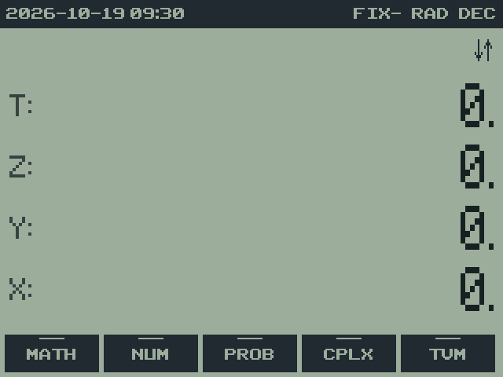

# 2. Installing rpnCE

rpnCE 0.7.0 · User Guide

[Manual contents](../USER_GUIDE.md) · [Previous: 1. Introduction](01-introduction.md) · [Next: 3. First calculations](03-first-calculations.md)

**In this chapter**

- [Required files](#required-files)
- [Prepare the calculator](#prepare-the-calculator)
- [Transfer and start](#transfer-and-start)
- [Upgrade an installation](#upgrade-an-installation)
- [Save and exit](#save-and-exit)

Install the program and its matching resources before the first session.
rpnCE is a native CE program; its launch method depends on the calculator's
operating system and any installed native-program launcher.

## Required files

| File | Purpose | Where it comes from |
| --- | --- | --- |
| `rpnCE-0.7.0.8xp` | Executable program | rpnCE release |
| `rpnCEres-0.7.0.8xv` | Menus, unit tables, and HELP pages; required | The same release as the program |
| `clibs.8xg` | CE C runtime libraries | [CE Programming libraries releases](https://github.com/CE-Programming/libraries/releases) |

An rpnCE release contains the first two files. Install the CE libraries
if they are not already present. A local build writes `rpnCE.8xp` and
`rpnCEres.8xv` to `bin/`; the versioned release files are in `cem/`.
The filenames on your computer do not change their names on the calculator:
the program is `RPNCE` and its resource appvar is `RPNCEres`.

## Prepare the calculator

1. Check that the device is a TI-84 Plus CE. This manual documents the CE
   program, rather than the monochrome TI-84 Plus RPN83P application.
2. Check the installed OS version in the calculator's About screen.
3. If native programs are disabled by that OS, follow the current
   [arTIfiCE installation instructions](https://yvantt.github.io/arTIfiCE/)
   for the exact device and OS before attempting to launch rpnCE.

CE OS 5.4 and earlier do not need arTIfiCE. Later OS versions removed the
normal native-program launch facility; the appropriate arTIfiCE version
and launch procedure depend on the OS. Use the project's compatibility
instructions rather than assuming that selecting a C program in PRGM
will run it on an unmodified newer OS.

## Transfer and start

1. Connect the calculator with USB and open TI Connect CE.
2. Transfer `rpnCE-0.7.0.8xp` and `rpnCEres-0.7.0.8xv`, plus `clibs.8xg` if needed.
   The rpnCE files can be archived.
3. Launch rpnCE using the method supported by the OS or installed
   launcher. On an OS that supports `Asm(`, the home-screen command is
   `Asm(prgmRPNCE)`. With a native-program launcher or hook, use its
   documented program-selection procedure.
4. Confirm that the RPN display appears with T, Z, Y, and X and a menu row.

   

On the first run, the stack and ordinary registers begin at zero. On later
runs, saved values and settings are restored. The shared TI-OS TVM values
can already contain data; use CLTV before a new TVM problem when you intend
to replace them.

## Upgrade an installation

1. Exit rpnCE normally with `2ND QUIT` so current work is saved.
2. Keep the saved appvars in place. For a backup, copy them to your
   computer as described in [chapter 17](17-memory.md#backing-up-your-work).
3. Transfer the new program and resource appvar together, replacing the
   two older files.
4. Start rpnCE and check your saved values.

Both files must be from the same build. A help-text change can change the
resource stamp even when the software version number is unchanged. If
rpnCE reports a missing or mismatched resource, transfer both files again
from one release or build. See [Startup problems](16-troubleshooting.md#when-rpnce-cant-start).

## Save and exit

Press `2ND QUIT` (the second function of MODE). `2ND OFF` also saves and
exits to TI-OS; it does not itself power off the calculator from inside
rpnCE. Press `2ND OFF` again at the TI home screen to switch off.

After five minutes without a key press, rpnCE saves and exits automatically.
Finish any incomplete DATE record before leaving; only completed values
can be restored as valid objects.

---

[Manual contents](../USER_GUIDE.md) · [Previous: 1. Introduction](01-introduction.md) · [Next: 3. First calculations](03-first-calculations.md)
