# 3. First calculations

RPNCE 0.7.0 · User Guide

[Manual contents](../USER_GUIDE.md) · [Previous: 2. Installing RPNCE](02-installation.md) · [Next: 4. The screen](04-display.md)

**In this chapter**

- [Prepare the display](#prepare-the-display)
- [Add, subtract, and multiply](#add-subtract-and-multiply)
- [Calculate a product of sums](#calculate-a-product-of-sums)
- [Use a one-number function](#use-a-one-number-function)
- [Use a menu function](#use-a-menu-function)
- [Store and recall a result](#store-and-recall-a-result)
- [Display the full value](#display-the-full-value)
- [Find help and finish the session](#find-help-and-finish-the-session)

This guided session introduces the keyboard, stack, menu keys, and
registers. Complete [Installation](02-installation.md) first. The values in
the tables are the results to expect, rather than additional keys to type.

## Prepare the display

1. Press `MATH` to open HOME. Press `↓` to reach row 2, choose **BASE**,
   then **DEC**. This ensures ordinary decimal entry and arithmetic.
2. Press `MODE`, choose **FIX**, and press `4` for four decimal places.
3. Choose **DEG** in the same row for degree-mode trigonometry.
4. Press `CLEAR CLEAR` to clear the stack. Existing stored registers remain.

   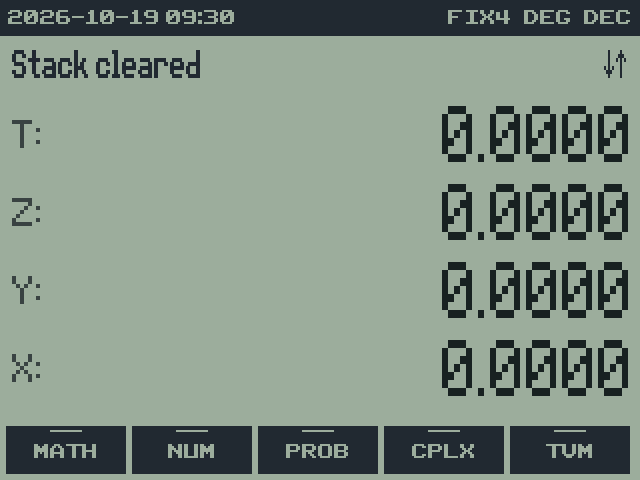

Use these settings for the examples in this chapter. Other chapters state
their own setup so they can be read independently.

## Add, subtract, and multiply

| Keys | X | Explanation | Screen |
| --- | --- | --- | --- |
| `2 ENTER` | `2.0000` | ENTER copies 2 into Y. | 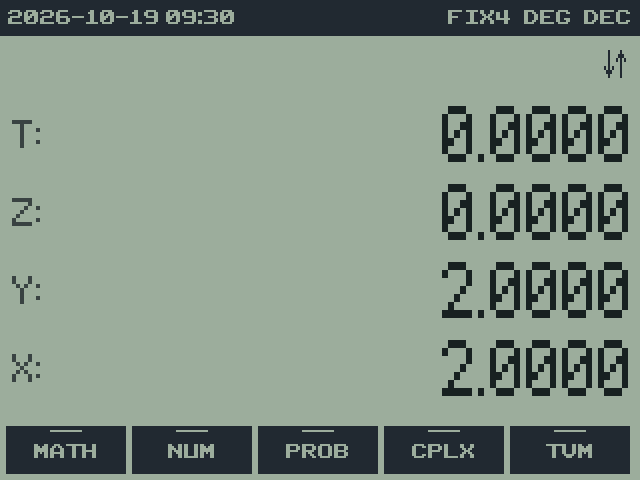 |
| `3 +` | `5.0000` | X and Y are added. |  |
| `4 ×` | `20.0000` | The previous answer is multiplied by 4. | 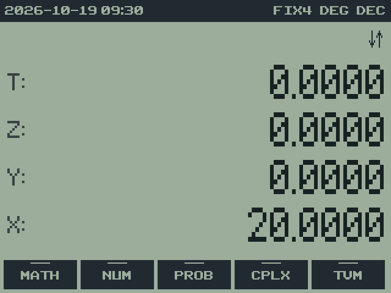 |

A number entered after an operation lifts the old answer into Y. You do
not need ENTER between the answer 5 and the next operand 4.

For a new calculation, enter `10 ENTER 4 −`. The result is `6.0000`.
The operation is Y − X, so the first number is the one from which the
second is subtracted. Similarly, `10 ENTER 4 ÷` gives `2.5000`.

## Calculate a product of sums

Evaluate `(3 + 4) × (5 + 6)`:

| Keys | Y | X | Explanation | Screen |
| --- | --- | --- | --- | --- |
| `3 ENTER 4 +` | — | `7.0000` | First sum. | 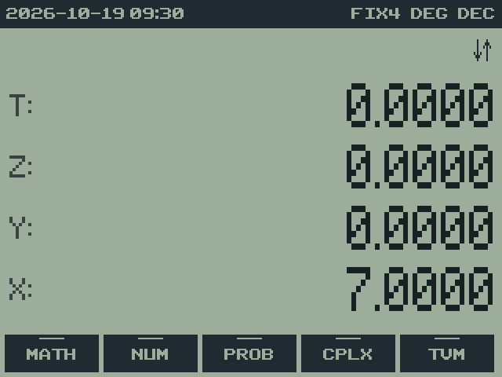 |
| `5 ENTER 6 +` | `7.0000` | `11.0000` | First sum waits in Y. | 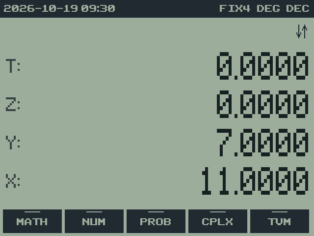 |
| `×` | — | `77.0000` | Multiply the two sums. | 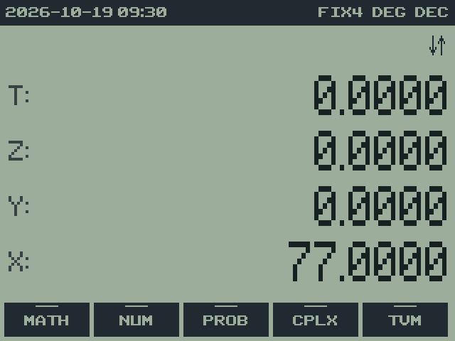 |

A dash means that level is not relevant to this calculation. RPN uses the
stack to preserve intermediate results, so the parentheses are represented
by the order of operations rather than entered as keys.

## Use a one-number function

Enter `30 SIN` to obtain `0.5000` in DEG mode. A function such as SIN or
x² operates directly on X; it does not require a second operand. Enter
`9 2ND √` to obtain `3.0000`.

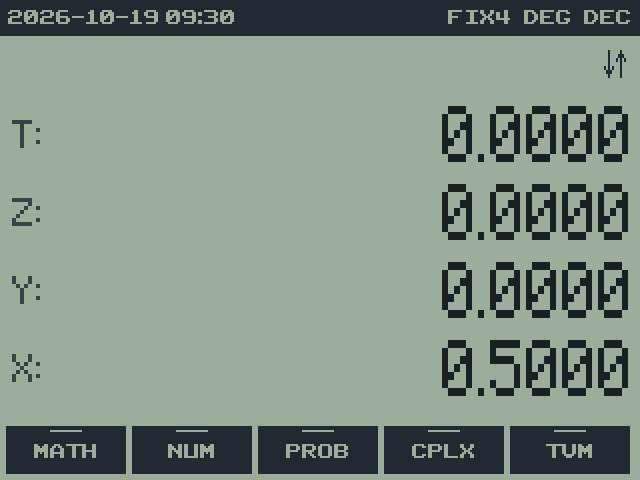 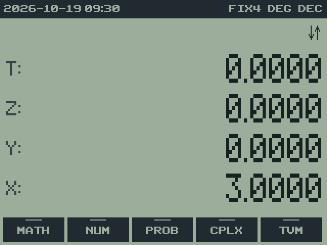

## Use a menu function

1. Press `MATH` to return to HOME row 1.
2. Press the softkey under **MATH** to open the mathematical submenu.
3. Enter `3` and press **X^3**. X becomes `27.0000`.

   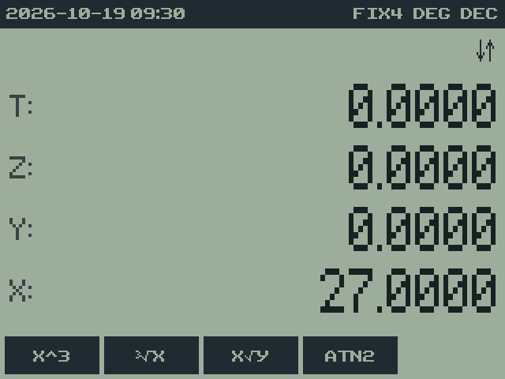

4. Press `ON` to return to the parent menu, or `MATH` to return directly
   to HOME.

A submenu stays open after a function runs. You can enter another number
and use the same function again without reopening it.

## Store and recall a result

The following exercise replaces register A:

| Keys | Result | Screen |
| --- | --- | --- |
| `5 STO→ MATH` | Stores 5 in A, the green letter on MATH. X stays 5. | 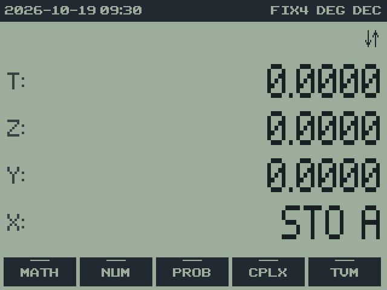 |
| `CLEAR` | Clears X; A is unchanged. | 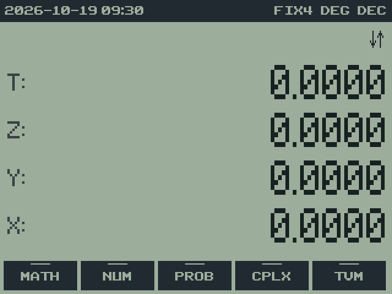 |
| `2ND RCL MATH` | Recalls A to X: `5.0000`. | 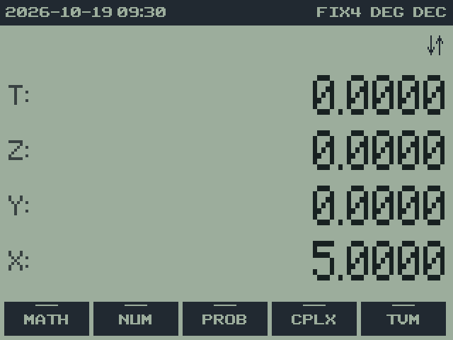 |

Within the STO or RCL prompt, the MATH key selects A rather than opening a
menu. [Registers](08-registers.md) describes arithmetic and indirect access.

## Display the full value

Enter `2ND π`, then `2ND ENTRY`. The ordinary X display is rounded to
FIX 4; SHOW writes all 14 stored digits on the message line. Pressing SHOW
does not round or replace the stored number.

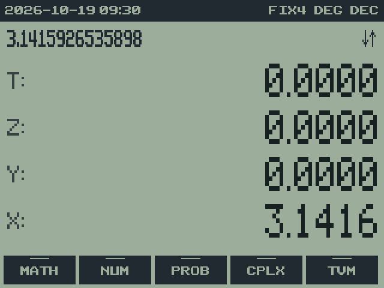

## Find help and finish the session

Press `2ND CATALOG` to open the on-device reference. `↑` and `↓` turn
pages; `ENTER`, `CLEAR`, `DEL`, or `ON` returns to the calculation. Press
`2ND QUIT` to save and exit. Start RPNCE again to confirm that your stack,
registers, and display settings have been restored.

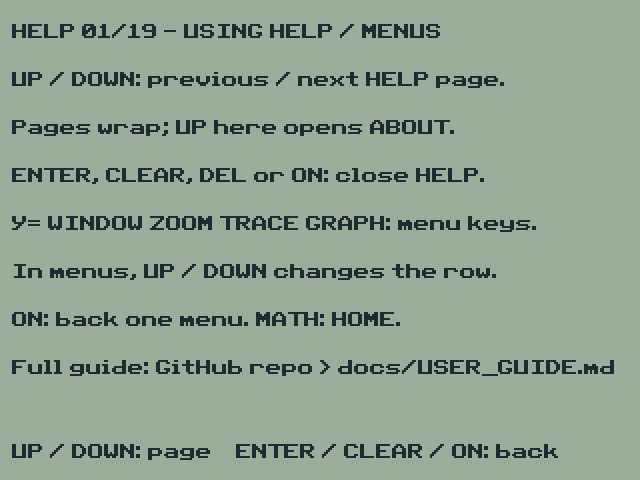

---

[Manual contents](../USER_GUIDE.md) · [Previous: 2. Installing RPNCE](02-installation.md) · [Next: 4. The screen](04-display.md)
