# 4. The screen

rpnCE development build · User Guide

[Manual contents](../USER_GUIDE.md) · [Previous: 3. First calculations](03-first-calculations.md) · [Next: 5. Entering numbers](05-number-entry.md)

**In this chapter**

- [Status bar](#status-bar)
- [Message line](#message-line)
- [Stack](#stack)
- [Menu row](#menu-row)
- [Screen brightness](#screen-brightness)
- [Screen colors](#screen-colors)

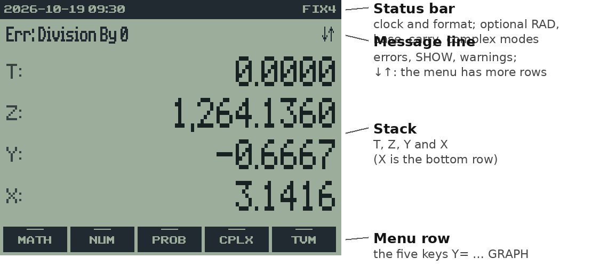

The display has four areas, arranged from top to bottom. The illustration
identifies them; each is described in this chapter.

## Status bar

The dark strip at the top shows the calculator's state.

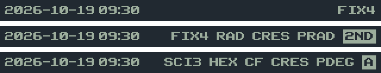

| Item | Meaning |
| --- | --- |
| `2026-10-18 14:05` | the date and time in the application time zone (ATZ), using CTZ to interpret the CE's clock; it updates each minute |
| `HH:MM` | time only when the full timestamp would overlap the mode indicators |
| `FIX4`, `SCI3`, `ENG2` | the display format and its number of digits (see [chapter 9](09-settings.md#9-display-formats-and-mode-settings)) |
| `ALL` | FIX with "as many digits as needed" (all digits, like ALL on an HP) |
| `SCI-` / `ENG-` | scientific or engineering format with all display digits |
| `RAD` | radians for trigonometry and polar conversions; no angle indicator means DEG |
| `HEX`, `OCT`, `BIN` | a nondecimal number base; no base indicator means DEC (see [chapter 12](12-base.md#12-base-hexadecimal-octal-and-binary)) |
| `CRES` | real inputs may produce complex results; absent means RRES |
| `PRAD` / `PDEG` | polar-radian or polar-degree display and LINK mode; absent means RECT; independent of DEG/RAD |
| `CF` | the BASE carry flag is set, including when DEC is implicit |
| `2ND` badge | `2ND` was pressed; the next key gives its blue function |
| `A` badge | `ALPHA` was pressed; the next key gives its green letter |

Format is always shown. DEG, RRES, RECT and DEC are implicit
defaults to keep the bar compact; the MODE menu still marks every active
selection. A fresh calculator starts in DEG, DEC, RRES and RECT, so its
only numeric status label is **ALL**.

## Message line

Under the status bar, the message line shows the result of the last
command when there's something to say: an error such as "Err: Domain", the
full value from SHOW, a notice such as "TVM Stored", or, in BASE modes, a
warning about X. Errors, warnings and SHOW remain until a key is pressed.
`CLEAR` dismisses the message without changing the stack. Other keys dismiss
it and perform their normal action. Routine notices disappear after about
1.5 seconds. A pair of arrows (↓↑)
at the right end means the current menu has more rows; see
[The menus](07-menus.md#7-the-menus).

All text in the message line uses taller letters with the original
horizontal spacing: errors, warnings, confirmations such as "Stack cleared",
TVM and settings notices, theme names, and SHOW. The status bar and menu
arrows retain their original sizes.

## Stack

The middle of the screen shows the four stack registers, `T` at the top and
`X` at the bottom, each with its value right-aligned in a large dot-matrix
font. `X` is where numbers are typed and where results appear.

- A value can have a small label after it: a unit such as `ft` or `kg`
  (chapter 15), or `dec` in BASE modes for a value that can't be shown in
  that base (chapter 12).
- A value too long for its line (a 32-bit binary number, or a long date)
  stays on one line: you see its right end, with a small ◂ where digits are
  hidden. Press ◂ and ▸ (the left and right arrow keys) to scroll through X.
- While you type a number, X shows it with a cursor: `3_`.

  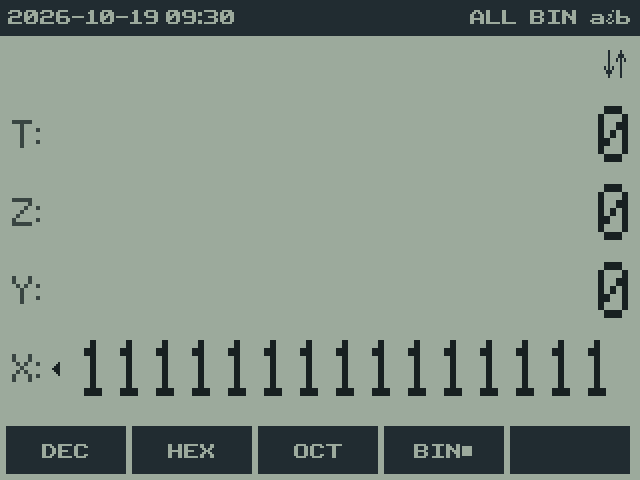

## Menu row

The bottom row shows five dark boxes, one for each menu key. A short line
across the top of a box marks a submenu (pressing it opens another menu);
other boxes are functions. A ■ after a label marks the active choice in a
setting, such as **DEG■**. An empty slot has no box.

## Screen brightness

Press `2ND ↑` to brighten the LCD or `2ND ↓` to dim it. Repeat the
shortcut for further steps. It works while entering numbers, at prompts,
and in HELP or VARS. Brightness does not change stack values or menu rows.
The setting is shared with TI-OS; the dimmest available step keeps the
screen visible.

## Screen colors

`MODE`, then row 3, **TINT**, cycles through eight color schemes; the
message line names each one as you go, and the choice is remembered:

| Tint | Look | Screen |
| --- | --- | --- |
| **LCD** | gray-green, like a classic calculator LCD (the default) | 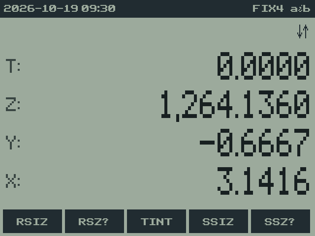 |
| **LCD+** | a stronger green that holds up better on the CE's real screen, which tends to wash colors out | 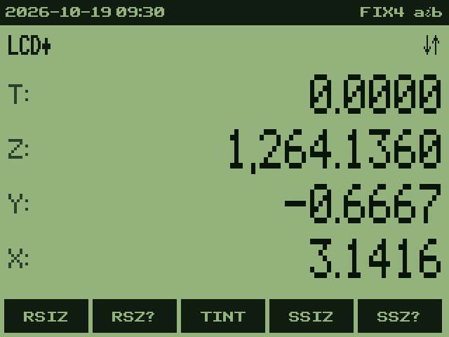 |
| **GRAY** | warm gray, like the SwissMicros calculators | 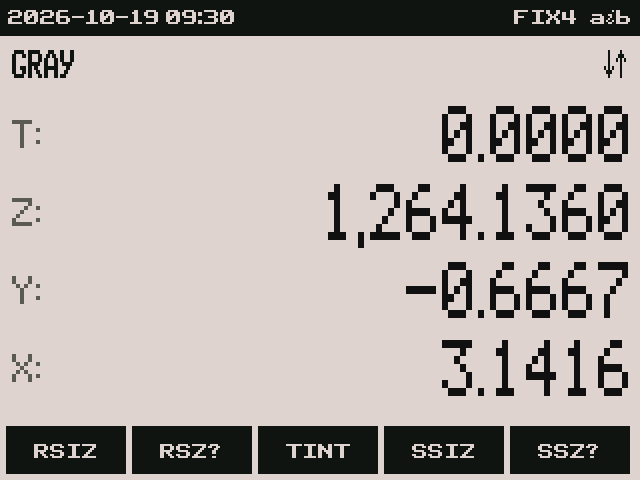 |
| **INVERTED** | light digits on a near-black panel | 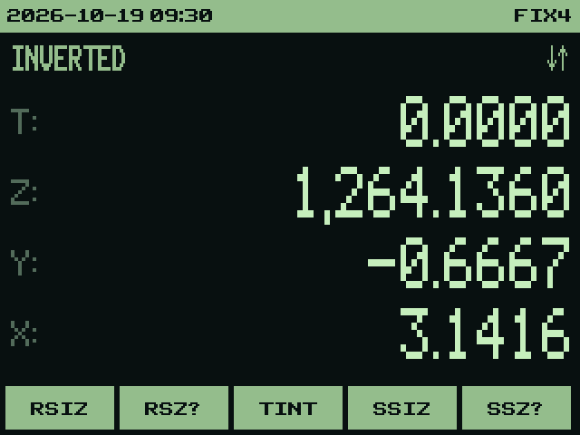 |
| **AYU DARK** | a deep blue-gray background with amber and blue accents | 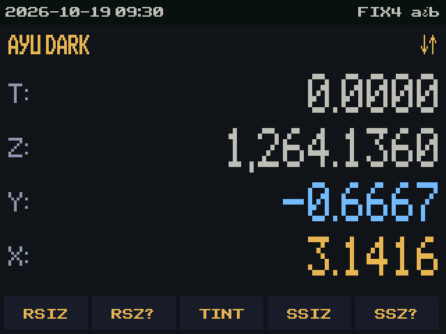 |
| **MONOKAI** | charcoal, with purple, cyan, green and pink stack values | 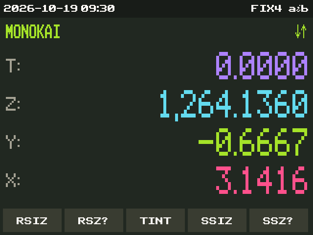 |
| **PASTEL** | a light background with distinct row colors and pastel menu keys | 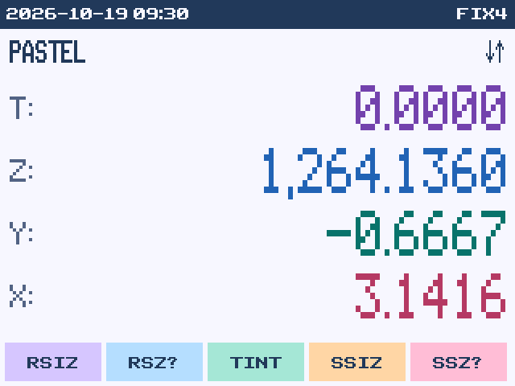 |
| **COMMODORE** | phosphor greens on near-black, with brighter X digits | 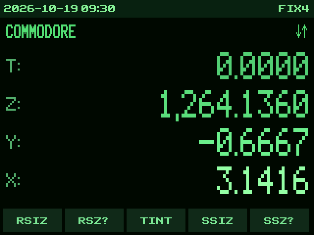 |

---

[Manual contents](../USER_GUIDE.md) · [Previous: 3. First calculations](03-first-calculations.md) · [Next: 5. Entering numbers](05-number-entry.md)
