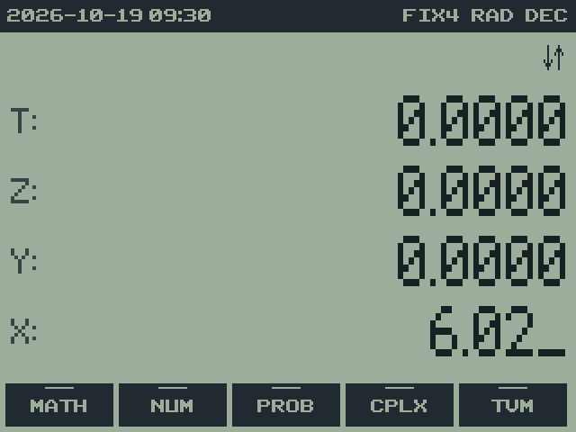
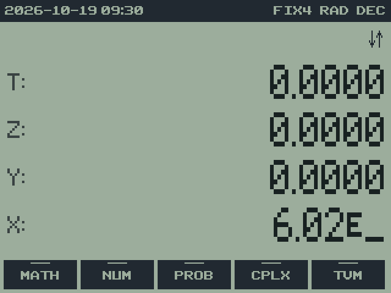
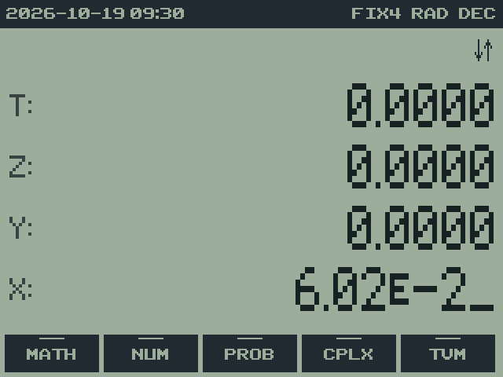
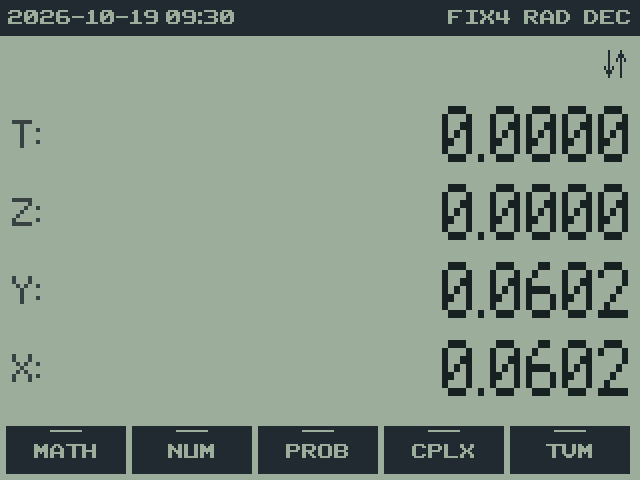

# 5. Entering numbers

rpnCE 0.7.0 · User Guide

[Manual contents](../USER_GUIDE.md) · [Previous: 4. The screen](04-display.md) · [Next: 6. The RPN stack](06-stack.md)

**In this chapter**

- [How numbers are shown](#how-numbers-are-shown)
- [Example: entering a negative exponent](#example-entering-a-negative-exponent)
- [Precision and rounding](#precision-and-rounding)

| Keys | Effect |
| --- | --- |
| `0`-`9`, `.` | type a number into X |
| `,` | EE: start the exponent (`6.02 , 23` is 6.02 × 10²³); `2ND EE` does the same |
| `(−)` | change the sign: of the number, or of the exponent after EE |
| `DEL` | while typing: delete the last character; otherwise CLX (clear X) |
| `CLEAR` | Dismiss a visible message, preserving the stack; otherwise CLX: clear X to 0 (or abandon what's being typed) |
| `CLEAR CLEAR` | twice in a row: clear the whole stack ("Stack cleared") |
| `ENTER` | finish the number and push a copy up the stack |

A number has up to 12 digits, plus a two-digit exponent from −99 to 99.
Typing ends as soon as you press anything other than an entry key: an
operation, `ENTER`, a menu key and so on all use the number you typed.

`(−)` changes the sign; `−` subtracts. Pressing `(−)` when you're not
typing negates X.

While typing a decimal number, the whole-number part is grouped
immediately: entering `1234567.89` shows `1,234,567.89_`. The fraction and
exponent are not grouped. These separators are display aids; DEL removes
typed characters, and the stored value is unchanged. MODE row 4 **,**
switches the same entry to `1.234.567,89_`; **.** restores the default.

## How numbers are shown

- Up to 12 significant digits are shown, with commas between thousands:
  `1,264.13604699`.
- A number too large or too small to show that way switches to scientific
  notation automatically, with up to 10 digits beside a small floating E:
  `6.02214076 ᴇ23`.
- The decimal point is always shown, as on HP calculators: `3.` and `0.`
- The calculator stores 14 significant digits; to see all of them, press
  `2ND ENTRY` (SHOW), which writes X in full on the message line.

The display format (FIX, SCI, ENG) changes only what you see, never the
stored value. See [chapter 9](09-settings.md#9-display-formats-and-mode-settings).

## Example: entering a negative exponent

**Starting settings:** DEC; FIX 4. This example enters 6.02 × 10⁻².

| Keys | Entry or result | Explanation | Screen |
| --- | --- | --- | --- |
| `6.02` | `6.02_` | Enter the mantissa. |  |
| `,` | exponent entry | The comma key acts as EE outside a DATE record. |  |
| `2 (−)` | exponent −2 | CHS changes the exponent's sign after EE. |  |
| `ENTER` | `0.0602` | Finish entry. |  |

Do not use the subtraction key to type a negative sign: subtraction
performs an operation on Y and X. If you enter the wrong digit, use DEL
while the entry is still open. Once you execute an operation, use LASTX
where appropriate or re-enter the operand.

## Precision and rounding

The input limit, arithmetic precision, and display width are different:
number entry accepts 12 mantissa digits; TI-OS real arithmetic carries
14 significant decimal digits; the ordinary display shows up to 12.
SHOW reveals the stored value, including guard digits hidden by the
normal display. Those extra digits help preserve accuracy, but repeated
operations and rounded conversion factors can still introduce rounding.

The supported nonzero range is 1 × 10⁻⁹⁹ through
9.9999999999999 × 10⁹⁹ in magnitude. Results outside it are rejected with
"Err: Underflow" or "Err: Overflow"; underflow is not silently replaced by
zero. A formula can also exceed the range in an intermediate step, even
when another formula could produce a representable answer.

"Err: Precision" means a detected loss of significant information makes
the calculation unreliable. This includes unequal stored operands
subtracting to zero and cancellation in variance calculations. The
operation is rejected and its operands are preserved. This detection does
not eliminate ordinary rounding or guarantee every stored guard digit.

A setting such as FIX 2 does not round a value to cents internally. If a
later calculation must use the rounded amount, select **NUM** → **RNDF**
after setting FIX 2, or use **RNDN** `2`. See
[Percentages and rounding](10-mathematics.md#percentages-and-rounding).

---

[Manual contents](../USER_GUIDE.md) · [Previous: 4. The screen](04-display.md) · [Next: 6. The RPN stack](06-stack.md)
