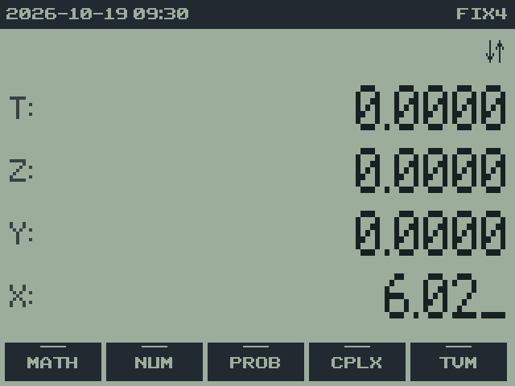
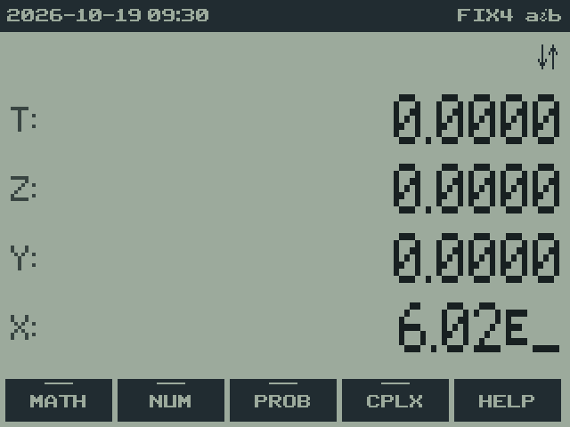
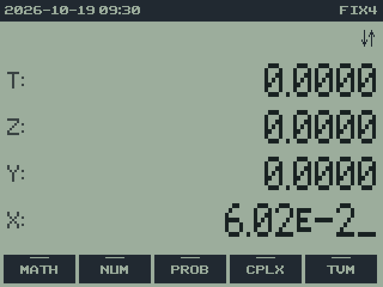
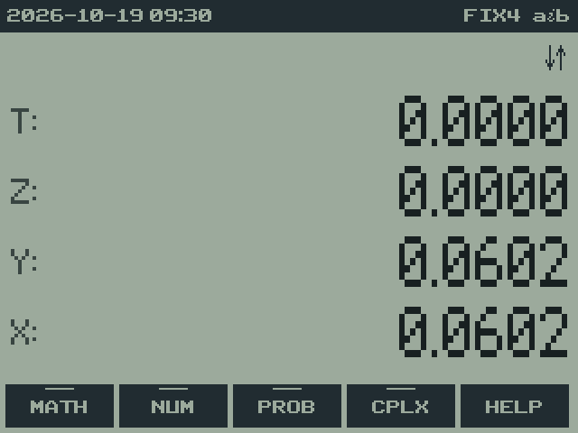

# 5. Entering numbers

rpnCE development build · User Guide

[Manual contents](../USER_GUIDE.md) · [Previous: 4. The screen](04-display.md) · [Next: 6. The RPN stack](06-stack.md)

**In this chapter**

- [How numbers are shown](#how-numbers-are-shown)
- [Number types](#number-types)
- [Complex entry](#complex-entry)
- [Example: entering a negative exponent](#example-entering-a-negative-exponent)
- [Precision and rounding](#precision-and-rounding)

| Keys | Effect |
| --- | --- |
| `0`-`9`, `.` | type a number into X |
| `2ND .` (`i`) | start or select rectangular complex entry |
| `2ND APPS` (`ANGLE`) | start polar entry in degrees; repeat to toggle radians/degrees |
| `,` | EE: start the exponent (`6.02 , 23` is 6.02 × 10²³); `2ND EE` does the same |
| `(−)` | change the sign: of the number, or of the exponent after EE |
| `DEL` | while typing: delete the last character; otherwise CLX (clear X) |
| `CLEAR` | Dismiss a visible message, preserving the stack; otherwise CLX: clear X to 0 (or abandon what's being typed) |
| `CLEAR CLEAR` | twice in a row: clear the whole stack ("Stack cleared") |
| `ENTER` | finish the number and push a copy up the stack |

A real component has up to 12 digits, plus a two-digit exponent from −99 to 99.
Typing ends as soon as you press anything other than an entry key: an
operation, `ENTER`, a menu key and so on all use the number you typed.

`(−)` changes the sign; `−` subtracts. Pressing `(−)` when you're not
typing negates X.

While typing a decimal number, the whole-number part is grouped
immediately: entering `1234567.89` shows `1,234,567.89_`. The fraction and
exponent are not grouped. These separators are display aids; DEL removes
typed characters, and the stored value is unchanged. MODE row 4 **,**
switches the same entry to `1.234.567,89_`; **.** restores the default.

## How numbers are shown

- Up to 12 significant digits are shown, with commas between thousands:
  `1,264.13604699`.
- A number too large or too small to show that way switches to scientific
  notation automatically, with up to 10 digits beside a small floating E:
  `6.02214076 ᴇ23`.
- The decimal point is always shown, as on HP calculators: `3.` and `0.`
- The calculator stores 14 significant digits; to see all of them, press
  `2ND ENTRY` (SHOW), which writes X in full on the message line.

The display format (FIX, SCI, ENG) changes only what you see, never the
stored value. See [chapter 9](09-settings.md#9-display-formats-and-mode-settings).

## Number types

Each stack level and ordinary register holds one complete value:

| Value | Example | How it is used |
| --- | --- | --- |
| Plain real | `3.`, `−2.5` | Real arithmetic, BASE words, statistics, TVM and numeric settings. |
| Complex | `3. i 4.` (3 + 4i) | Supported arithmetic and the CPLX functions; both components occupy one level. |
| Real with a unit | `12. ft` | Compatible-unit conversion and quantity arithmetic. |
| DATE object | `D{2024,3,14}` | Calendar, time-zone and duration operations. |

ENTER, stack movement, LASTX and ordinary STO/RCL copy the whole value,
including its kind and any unit. Arithmetic uses the operands' kinds:
supported real/complex operations promote the real operand, while DATE
and unit values follow the rules in their own chapters. Unsupported
combinations give `Err: Data Type` and keep the operands.

BASE word operations, statistics, TVM, register indices and size settings
require plain real values. Complex values cannot carry units. A complex
value with zero imaginary part is still complex; use **CPLX** → **REAL**
to extract a real component for a real-only function. **UNIT** → **UFCN** →
**UVAL** removes a unit, and DATE's conversion functions extract numbers
from DATE objects when needed. These are explicit operations: selecting
a display or result mode does not strip a value's type or unit.

## Complex entry

Choose BASE **DEC** before entering a complex value. Type
`3 2ND . 4 ENTER` for 3 + 4i, or `2ND . ENTER` for the imaginary unit.
Type `2 2ND APPS 90 ENTER` for magnitude 2 at 90 degrees. Pressing
`2ND APPS` a second time while editing switches the input angle to radians.
Each component has its own sign, decimal point and EE exponent; grouping
and the decimal-mark setting apply to both components.

For arithmetic examples, functions, LINK and mode choices, see the
[complex-number walkthrough](11-complex-numbers.md).

## Example: entering a negative exponent

**Starting settings:** DEC; FIX 4. This example enters 6.02 × 10⁻².

| Keys | Entry or result | Explanation | Screen |
| --- | --- | --- | --- |
| `6.02` | `6.02_` | Enter the mantissa. |  |
| `,` | exponent entry | The comma key acts as EE outside a DATE record. |  |
| `2 (−)` | exponent −2 | CHS changes the exponent's sign after EE. |  |
| `ENTER` | `0.0602` | Finish entry. |  |

Do not use the subtraction key to type a negative sign: subtraction
performs an operation on Y and X. If you enter the wrong digit, use DEL
while the entry is still open. Once you execute an operation, use LASTX
where appropriate or re-enter the operand.

## Precision and rounding

The input limit, arithmetic precision, and display width are different:
number entry accepts 12 mantissa digits; TI-OS real arithmetic carries
14 significant decimal digits; the ordinary display shows up to 12.
SHOW reveals the stored value, including guard digits hidden by the
normal display. Those extra digits help preserve accuracy, but repeated
operations and rounded conversion factors can still introduce rounding.
These limits apply separately to the two components of a complex value.

The supported nonzero range is 1 × 10⁻⁹⁹ through
9.9999999999999 × 10⁹⁹ in magnitude. Results outside it are rejected with
"Err: Underflow" or "Err: Overflow"; underflow is not silently replaced by
zero. A formula can also exceed the range in an intermediate step, even
when another formula could produce a representable answer.

"Err: Precision" means a detected loss of significant information makes
the calculation unreliable. This includes unequal stored operands
subtracting to zero and cancellation in variance calculations. The
operation is rejected and its operands are preserved. This detection does
not eliminate ordinary rounding or guarantee every stored guard digit.

A setting such as FIX 2 does not round a value to cents internally. If a
later calculation must use the rounded amount, select **NUM** → **RNDF**
after setting FIX 2, or use **RNDN** `2`. See
[Percentages and rounding](10-mathematics.md#percentages-and-rounding).

---

[Manual contents](../USER_GUIDE.md) · [Previous: 4. The screen](04-display.md) · [Next: 6. The RPN stack](06-stack.md)
