# 6. The RPN stack

RPNCE 0.7.0 · User Guide

[Manual contents](../USER_GUIDE.md) · [Previous: 5. Entering numbers](05-number-entry.md) · [Next: 7. The menus](07-menus.md)

**In this chapter**

- [The idea](#the-idea)
- [Stack lift](#stack-lift)
- [Moving things around](#moving-things-around)
- [A deeper stack](#a-deeper-stack)
- [Watching all four levels](#watching-all-four-levels)
- [Repeating a constant](#repeating-a-constant)
- [Correcting an operation with LASTX](#correcting-an-operation-with-lastx)

## The idea

The stack holds operands and intermediate results. Operations take their
inputs from its bottom levels and leave the result in X. The
four levels you see are named `X` (the bottom, where you type), `Y`, `Z`
and `T` (the top).

- A **one-number function** such as `x²`, `SIN` or `LN` replaces X with its
  result.
- A **two-number function** such as `+`, `×` or `^` uses Y and X, in that
  order, as you'd write them: `Y + X`, `Y − X`, `Y ÷ X`, `Y ^ X`. The
  result goes in X and the stack drops by one level: Z moves into Y, T into
  Z, and T keeps its value (so a constant in T stays available).
- `ENTER` finishes a number and copies X into Y, so you can type the next
  one.

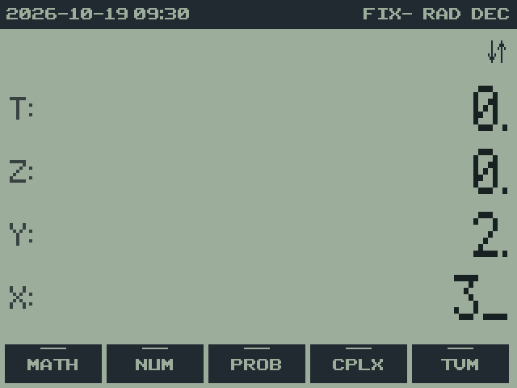 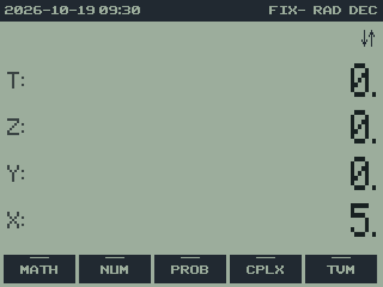 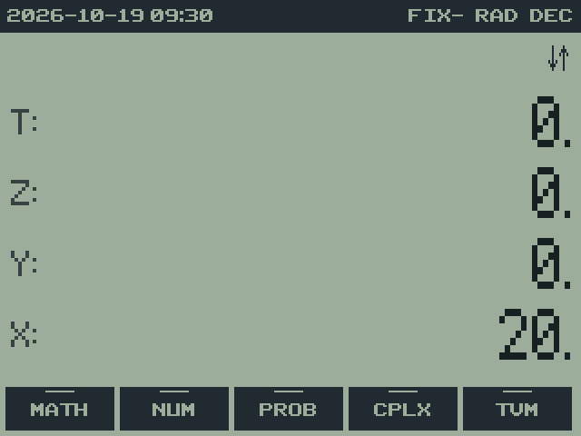

To work out (2 + 3) × 4: `2 ENTER 3 +` leaves 5, then `4 ×` gives 20. You
never need parentheses; you just do the inner parts first, and the stack
holds the pieces until you need them. A longer example, (3 + 4) × (5 + 6):

| Keys | X | Y | Notes | Screen |
| --- | --- | --- | --- | --- |
| `3 ENTER 4 +` | 7 | | first bracket | 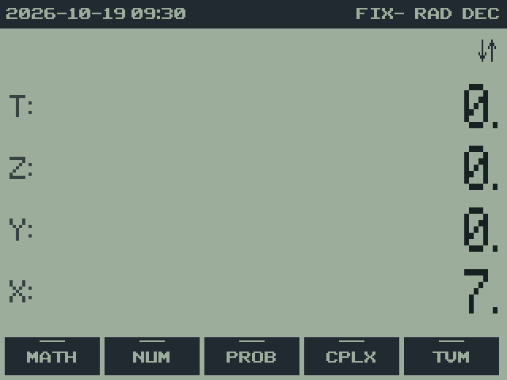 |
| `5 ENTER 6 +` | 11 | 7 | second bracket; 7 waits in Y | 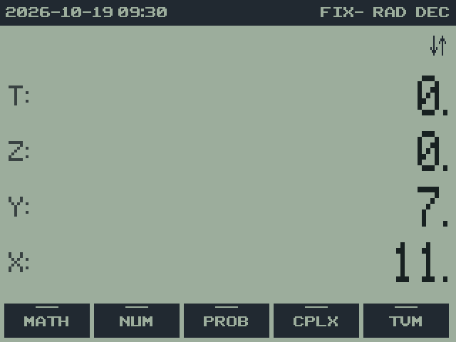 |
| `×` | 77 | | 7 × 11 | 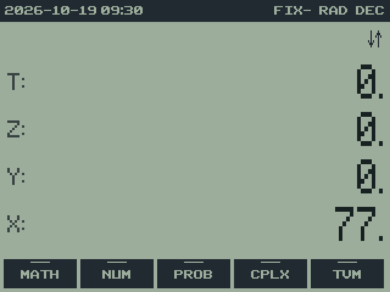 |

## Stack lift

RPNCE follows the standard HP rules about when a new number pushes the
stack up ("stack lift"):

- Typing a number after most operations pushes the old X up into Y, so
  results are kept: `5 x²` then `3 +` gives 28.
- After `ENTER` (and after CLX), the next number you type **replaces** X
  instead of pushing, because ENTER already made a copy. That's why
  `5 ENTER 6 ×` gives 30 and not 5 × 5 with 6 left over.
- `ENTER ENTER` is a quick way to fill the stack with copies of a number:
  `3 ENTER ENTER ENTER` puts 3 in every level, and `× ×` then gives 3³.
- STO, CHS (`(−)` on X), SHOW and mode changes leave the stack lift
  setting as it was.

## Moving things around

| Keys | Name | Effect |
| --- | --- | --- |
| `(` | R↓ (roll down) | X goes to the top; everything else moves down one |
| `)` | X⇄Y | swap X and Y |
| `2ND ANS` (on `(−)`) | LASTX | recall the X from before the last operation |
| `2ND INS` (on `DEL`) | DUP | copy X into Y (the same as ENTER) |
| `2ND }` (on `)`) | DROP | remove X; everything above moves down |
| **STK** menu | DUP, R↑, R↓, DROP, X⇄Y, and X<> (exchange X with a register) |

LASTX is useful for correcting mistakes and reusing a value. If you meant
`×` but pressed `÷`, press `2ND ANS ×` to undo the division (multiplying the
divisor back), then `2ND ANS ×` again to do the multiplication you meant.
It's also handy for using a number twice: `3 ENTER 4 + 2ND ANS ×` gives
(3 + 4) × 4 = 28.

## A deeper stack

The standard stack has 4 levels. `MODE`, row 3, **SSIZ** sets it from X,
from 4 to 12 (a value below 4 means 4): `8` **SSIZ**. The screen still
shows T, Z, Y and X; the extra levels sit above T, out of sight, and come
into view as the stack drops. Rolls move through every level, and on a drop
the top level is copied down, as with T on a 4-level stack. **SSZ?** puts
the current depth in X. CLEAR CLEAR and **CLST** clear every level.

## Watching all four levels

**Starting settings:** DEC, a four-level stack, FIX 4. Clear the stack
with `CLEAR CLEAR` before this exercise. Work out `(2 + 3) × 4`:

| Keys | T | Z | Y | X | What changed | Screen |
| --- | --- | --- | --- | --- | --- | --- |
| `2 ENTER` | 0 | 0 | 2 | 2 | ENTER makes a copy of X. | 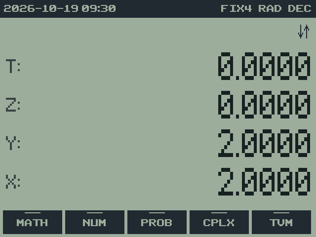 |
| `3` | 0 | 0 | 2 | 3 | Entry replaces X because ENTER disabled lift. | 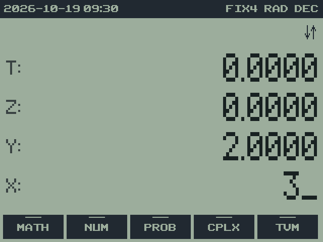 |
| `+` | 0 | 0 | 0 | 5 | Addition combines Y and X and drops the stack. | 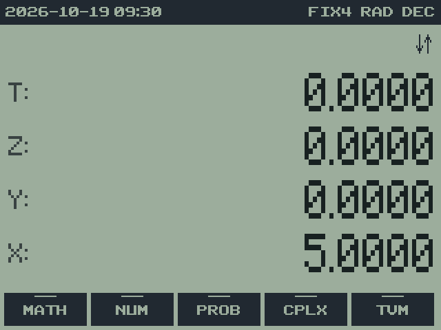 |
| `4` | 0 | 0 | 5 | 4 | A new entry lifts the previous result into Y. | 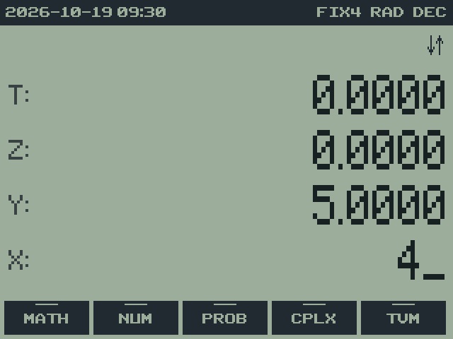 |
| `×` | 0 | 0 | 0 | 20 | Multiplication produces the answer. | 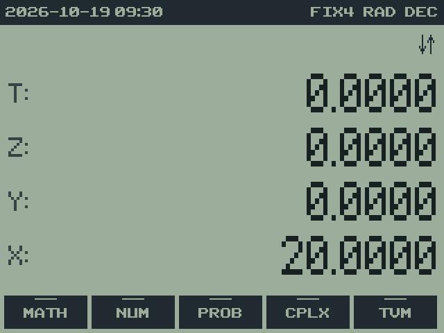 |

The table omits decimal zeros for readability. On the calculator, FIX 4
shows the final result as `20.0000`.

## Repeating a constant

On a four-level stack, a binary operation copies T down as the stack
drops. Fill all four levels with 2 using `2 ENTER ENTER ENTER`, then
press `×` repeatedly. X becomes 4, 8, 16, and so on; T continues to supply
2. An expanded stack has the same rule at its highest level.

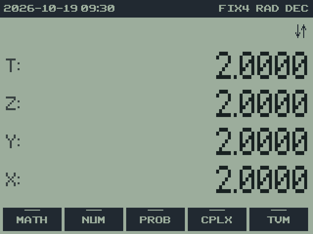  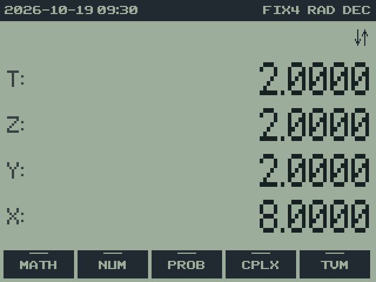 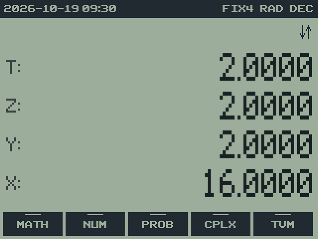

## Correcting an operation with LASTX

Suppose you entered `12 ENTER 3 ÷`, but intended multiplication. X is 4
and LASTX is 3. `2ND ANS ×` reconstructs 12. A second `2ND ANS ×` gives
36, the intended product. LASTX is an operand-recovery register, rather
than a complete undo history: it does not restore overwritten registers,
cleared statistics, or an earlier session.

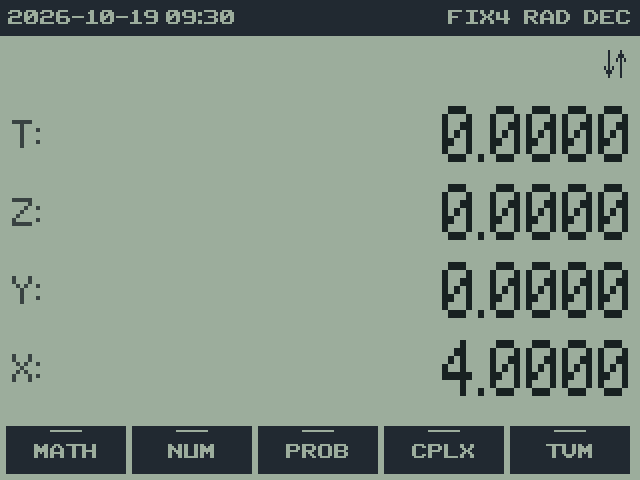 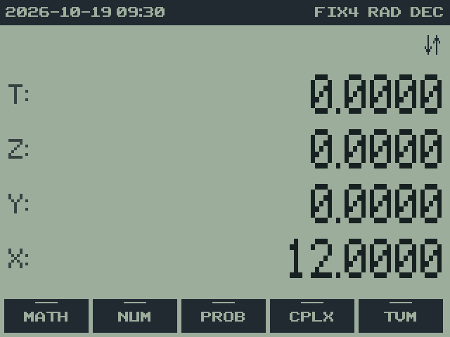 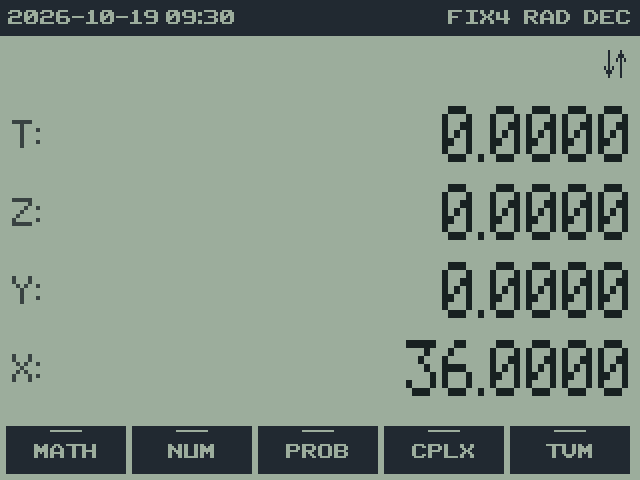

---

[Manual contents](../USER_GUIDE.md) · [Previous: 5. Entering numbers](05-number-entry.md) · [Next: 7. The menus](07-menus.md)
