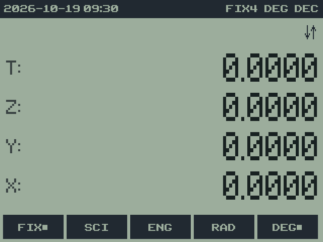
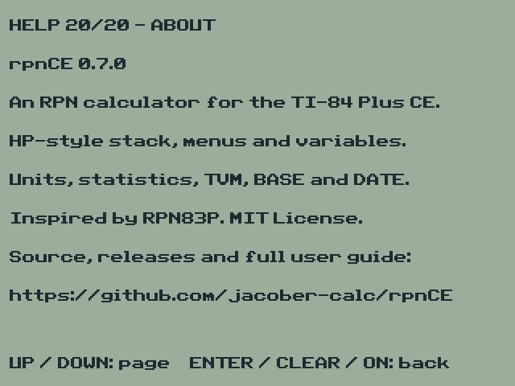

# 7. The menus

rpnCE 0.7.0 · User Guide

[Manual contents](../USER_GUIDE.md) · [Previous: 6. The RPN stack](06-stack.md) · [Next: 8. Registers](08-registers.md)

**In this chapter**

- [The menu tree](#the-menu-tree)
- [Using menus](#using-menus)
- [Menu shortcuts](#menu-shortcuts)
- [HELP](#help)

## The menu tree

Everything that isn't on the keyboard is in a tree of menus. `MATH` goes to
its top, **HOME**, which has three rows:

| Row | Menus |
| --- | --- |
| 1 | **MATH** **NUM** **PROB** **CPLX** **TVM** |
| 2 | **BASE** **HYP** **STAT** **CONV** **HELP** |
| 3 | **CLR** **MODE** **STK** **UNIT** **DATE** |

-  Row 1" width="320">
-  Row 2" width="320">
-  Row 3" width="320">

[Appendix B](19-reference.md#appendix-b-menu-map) lists every menu and item.

## Using menus

- **Menu keys:** the five keys under the screen choose the item above them.
  A submenu (a box with a short line across its top) opens that menu; a
  function runs at once.
- **More rows:** when the message line shows ↓↑ at its right end, the menu
  has more rows. Use the up and down arrow keys to move between them.
- **Back:** `ON` goes back one level, to the menu you came from. At HOME it
  does nothing.
- **Shortcuts:** some keys jump straight to a menu from anywhere (below).
- **The menu stays put.** After you choose a function, the same menu is
  still showing, so you can use it again. This makes repeated work fast:
  in UNIT, for example, you can convert one value after another.
- **Settings** show which choice is active with a ■: **FIX■**, **DEG■**,
  **BEG■**, **HEX■**.

## Menu shortcuts

| Key | Opens |
| --- | --- |
| `MATH` | HOME |
| `MODE` | MODE |
| `STAT` | STAT |
| `X,T,θ,n` | UNIT |
| `APPS` | BASE |
| `PRGM` | HYP |
| `2ND MEM` (on `+`) | CLR |
| `2ND LIST` (on `STAT`) | STK |
| `2ND CATALOG` (on `0`) | HELP |

Inside a STO or RCL prompt, and after `ALPHA`, these keys still give their
letters, so the shortcuts never get in the way of naming a register.
`2ND LINK` and `2ND ANGLE` are left unassigned on purpose: they're reserved
for complex numbers.

## HELP

**HELP** (HOME row 2, or `2ND CATALOG`) shows 19 quick-reference pages:
using HELP and the menus, the RPN stack, variables, key shortcuts, one page
per main menu, and About (the version and GitHub repository). The up and
down arrows change pages and wrap around; `UP` from the first page opens
About. `ENTER`, `CLEAR`, `DEL` or `ON` returns to the calculator.

 

---

[Manual contents](../USER_GUIDE.md) · [Previous: 6. The RPN stack](06-stack.md) · [Next: 8. Registers](08-registers.md)
