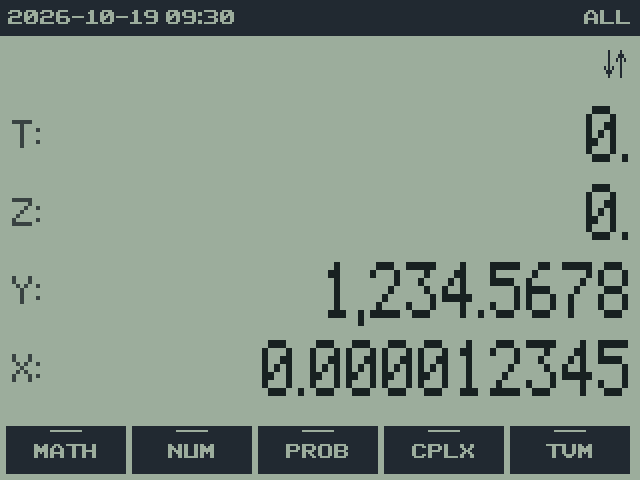
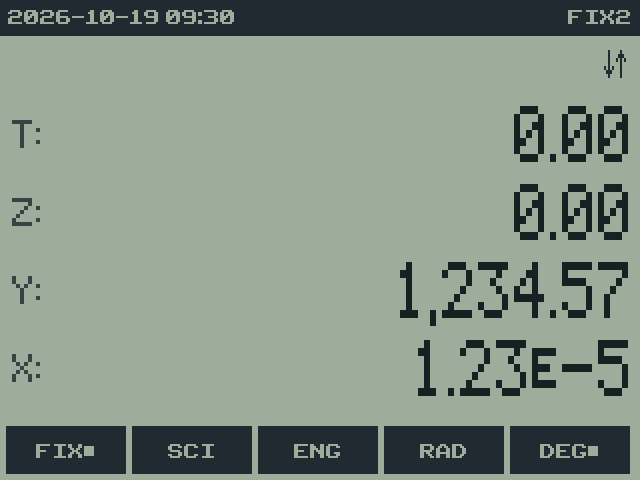
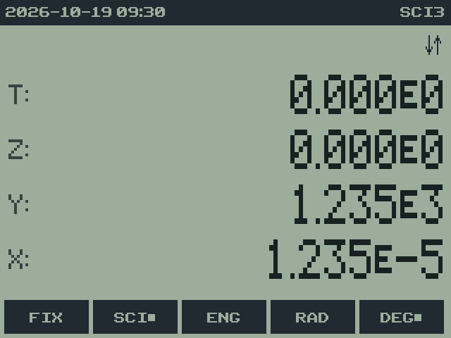
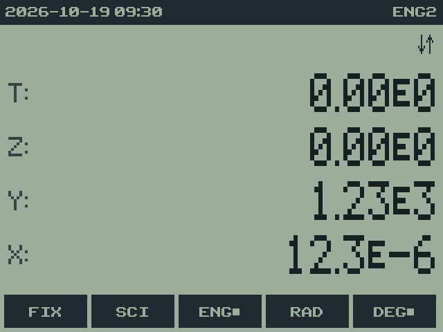
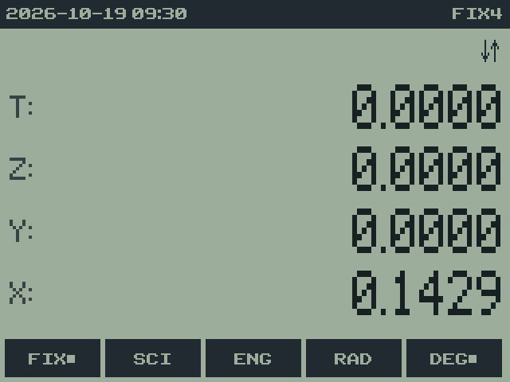
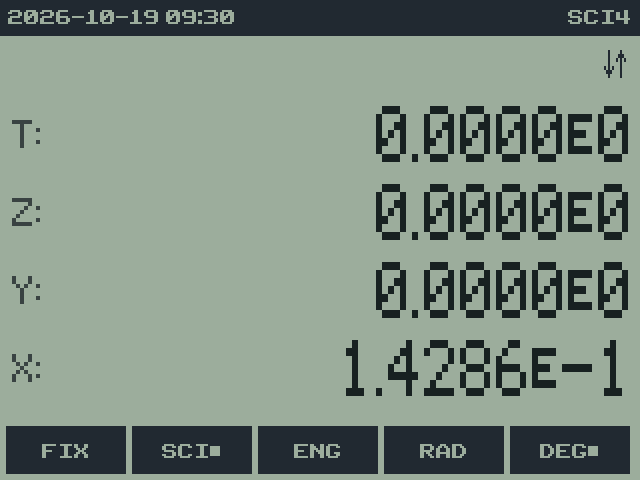
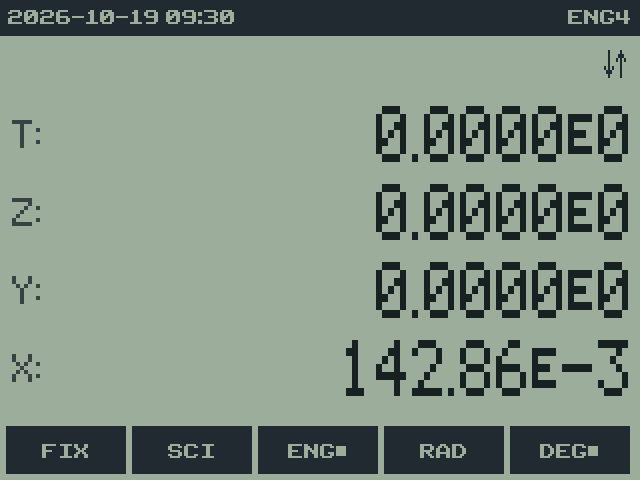
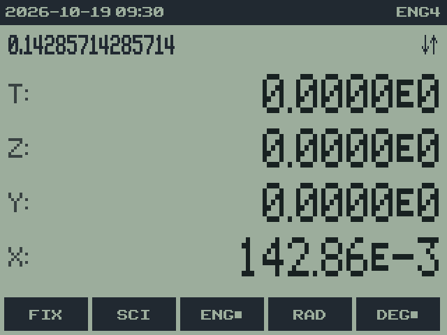
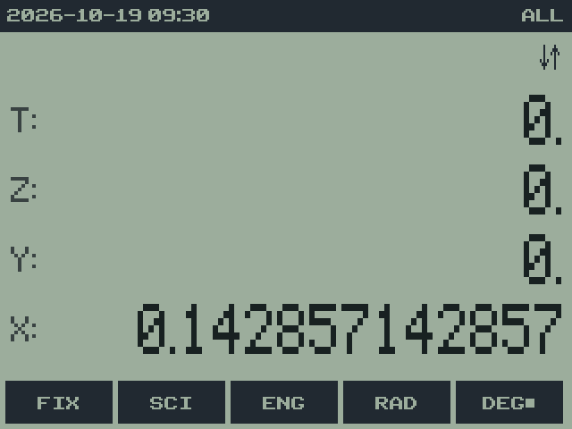

# 9. Display formats and MODE settings

rpnCE development build · User Guide

[Manual contents](../USER_GUIDE.md) · [Previous: 8. Registers](08-registers.md) · [Next: 10. Math functions](10-mathematics.md)

**In this chapter**

- [FIX, SCI and ENG](#fix-sci-and-eng)
- [Angle mode](#angle-mode)
- [Complex result and display modes](#complex-result-and-display-modes)
- [Sizes and tint](#sizes-and-tint)
- [DATE display](#date-display)
- [Decimal and grouping marks](#decimal-and-grouping-marks)
- [Example: changing presentation without changing the number](#example-changing-presentation-without-changing-the-number)

`MODE` opens the MODE menu.

| Row | Items |
| --- | --- |
| 1 | **FIX** **SCI** **ENG** **RAD** **DEG** |
| 2 | **RRES** **CRES** **RECT** **PRAD** **PDEG** |
| 3 | **RSIZ** **RSZ?** **TINT** **SSIZ** **SSZ?** |
| 4 | **{..}** **".."** (DATE display), **.** **,** (decimal mark) |

-  MODE" width="320">
    -  MODE > Row 1" width="320">
    -  MODE > Row 2" width="320">
    -  MODE > Row 3" width="320">
    -  MODE > Row 4" width="320">

Complex result mode (RRES/CRES) and display mode (RECT/PRAD/PDEG) are
independent of RAD/DEG. The status bar shows CRES and PRAD/PDEG when
active; RRES and RECT are implicit defaults. MODE marks every selection.
See [Complex numbers](11-complex-numbers.md)
for entry, LINK behavior and supported functions.

## FIX, SCI and ENG

Each asks for a number of digits: the prompt shows `FIX _`.

- A digit 0-9 completes it straight away: **FIX** `4` gives four decimal
  places.
- `.` then a digit means 10 to 19, as on the HP-32SII: **FIX** `. 1` is FIX
  11.
- 12 or more (`. 2` to `. 9`) means "as many digits as needed", shown in
  the status bar as `ALL` for FIX (`SCI-` or `ENG-` for those formats).
  FIX with all digits is the default, like ALL on an HP calculator.

| Format | 1234.5678 shows as | 0.000012345 shows as | Screen |
| --- | --- | --- | --- |
| ALL | `1,234.5678` | `0.000012345` |  |
| FIX 2 | `1,234.57` | `1.23 ᴇ-5` |  |
| SCI 3 | `1.235 ᴇ3` | `1.235 ᴇ-5` |  |
| ENG 2 | `1.23 ᴇ3` | `12.3 ᴇ-6` |  |

FIX switches to scientific notation by itself when a number is too large
for 12 digits, or so small that it would show as zero. ENG is like SCI but
keeps the exponent a multiple of 3, to match prefixes like kilo and micro.
The formats change only the display: the full value is kept, and SHOW
(`2ND ENTRY`) displays it.

## Angle mode

**RAD** and **DEG** set the unit for SIN, COS, TAN, their inverses, ATN2
and the polar conversions. DEG is the default for a fresh calculator.
The status bar shows **RAD** only in radian mode; no angle indicator means
DEG. The MODE menu marks either selection, and saved angle settings are
restored on startup. In DEG mode, exact quarter turns give exact answers:
`180 SIN` is exactly 0.

## Complex result and display modes

MODE row 2 has two independent groups:

| Group | Default | Alternatives |
| --- | --- | --- |
| Results from real inputs | **RRES**: real-domain rules | **CRES**: allow principal complex results for supported roots, logarithms and powers. |
| Complex presentation and LINK | **RECT**: real and imaginary components | **PRAD**: magnitude and radians; **PDEG**: magnitude and degrees. |

Explicit complex operands work in either result mode. Display settings
keep the rectangular components stored at full precision. DEG/RAD controls
CANG and real trigonometry, independently of PRAD/PDEG. Polar entry also
states its own angle unit. Selecting CRES does not extend trigonometric,
hyperbolic or other real-only functions to complex operands.

The status bar shows **CRES** and **PRAD**/**PDEG** when selected; **RRES**
and **RECT** are implicit. DEG and DEC are also implicit, so a fresh
calculator's only numeric status label is **ALL**. MODE marks each active
choice, and result/display modes are saved when you quit. Follow the
[worked examples](11-complex-numbers.md#rres-and-cres-choosing-result-behavior)
to compare RRES/CRES or join and split values with LINK.

## Sizes and tint

**RSIZ** and **RSZ?** set and show the number of registers
([chapter 8](08-registers.md#adding-registers)); **SSIZ** and **SSZ?** the stack depth
([chapter 6](06-stack.md#a-deeper-stack)); **TINT** cycles the screen colors
([chapter 4](04-display.md#screen-colors)).

## DATE display

**{..}** shows DATE objects as you'd type them, like `D{2024,3,14}`;
**".."** shows them as readable text, like `2024-03-14`. See
[chapter 16](16-date.md#16-date-dates-times-and-the-clock).

## Decimal and grouping marks

MODE row 4 has two numeric display choices:

| Selection | Decimal mark | Grouping mark | Example |
| --- | --- | --- | --- |
| **.** (default) | period | comma | `1,234,567.89` |
| **,** | comma | period | `1.234.567,89` |

The choice applies to numbers while typing, completed stack values, VARS,
and SHOW, including scientific and engineering mantissas. It is saved when
you quit. Grouping is inserted automatically; it does not round the value
or add characters to the underlying entry. DEL still removes one typed
character at a time.

The physical decimal-point key enters the decimal mark in either mode.
The comma key keeps its EE function outside a DATE record and separates
fields inside a record. DATE records, dates, times and menu labels retain
their established syntax. This prevents display preferences from changing
how stored values or DATE records are interpreted.

The examples in this manual use decimal-point mode unless stated otherwise.

## Example: changing presentation without changing the number

Enter `1 ENTER 7 ÷`, then perform these steps:

| Selection | Display or message | Meaning | Screen |
| --- | --- | --- | --- |
| **FIX** `4` | `0.1429` | Four places after the decimal point. |  |
| **SCI** `4` | approximately `1.4286 E−1` | Four places in the scientific mantissa. |  |
| **ENG** `4` | approximately `142.86 E−3` | Engineering notation uses an exponent divisible by three. |  |
| `2ND ENTRY` | approximately `0.14285714285714` | SHOW reveals the stored value. |  |
| **FIX** `. 2` | approximately `0.142857142857` | Return to all available display digits. |  |

The E notation in the table represents the display's small exponent
marker. The numerical value remains unchanged throughout. A later RNDF
would round according to the selected format; see the mathematics chapter.

---

[Manual contents](../USER_GUIDE.md) · [Previous: 8. Registers](08-registers.md) · [Next: 10. Math functions](10-mathematics.md)
