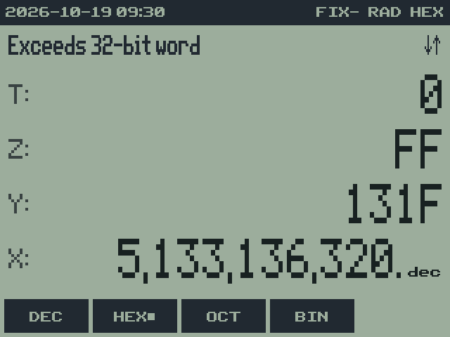
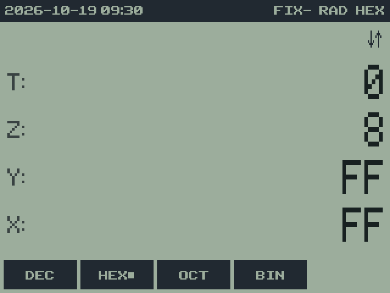
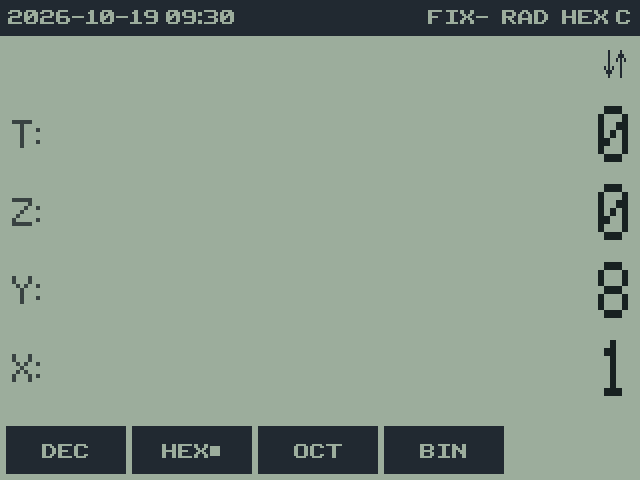
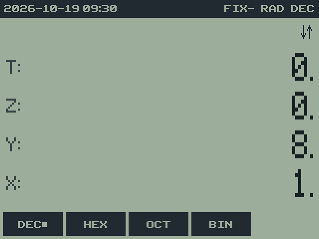
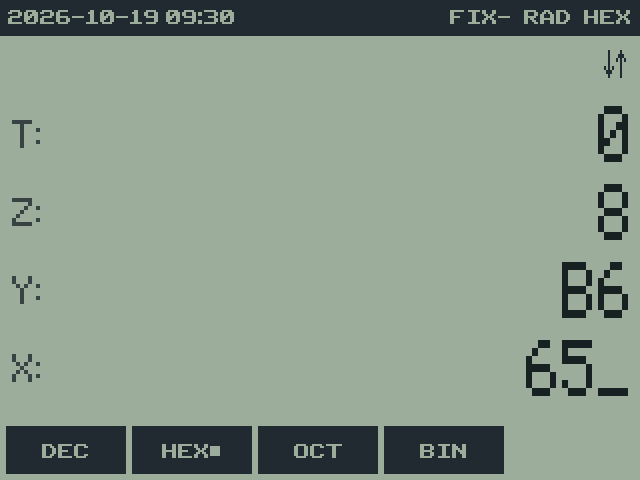
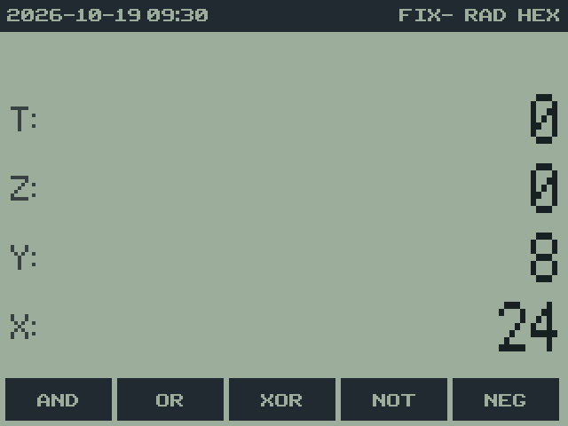
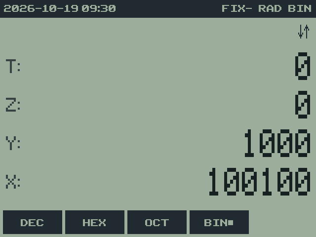
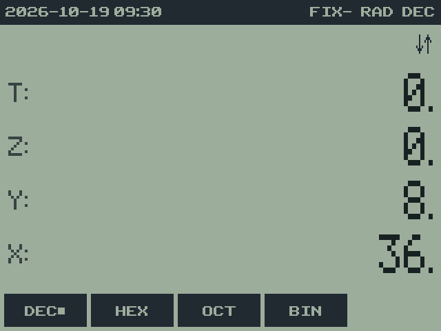
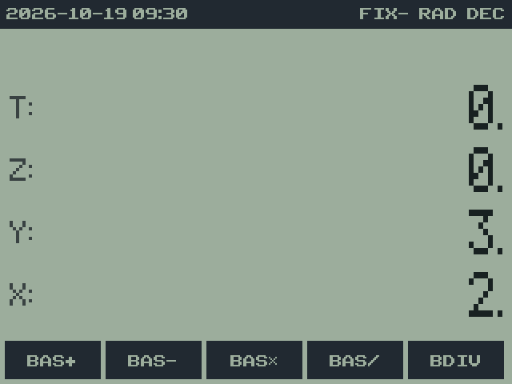

# 11. BASE: hexadecimal, octal and binary

RPNCE 0.7.0 · User Guide

[Manual contents](../USER_GUIDE.md) · [Previous: 10. Math functions](10-mathematics.md) · [Next: 12. STAT: statistics and curve fitting](12-statistics.md)

**In this chapter**

- [Choosing a base](#choosing-a-base)
- [Typing in a base](#typing-in-a-base)
- [Word size](#word-size)
- [Arithmetic](#arithmetic)
- [Operations](#operations)
- [Example: overflow in an eight-bit word](#example-overflow-in-an-eight-bit-word)
- [Example: a bit mask](#example-a-bit-mask)
- [Shift, rotate, and division details](#shift-rotate-and-division-details)

## Choosing a base

-  BASE" width="320">
    -  BASE > Row 1" width="320">
    -  BASE > Row 2" width="320">

**BASE** row 1 sets how whole numbers are shown and typed: **DEC**
(ordinary numbers), **HEX**, **OCT** or **BIN**. The status bar shows the
base. In HEX, OCT and BIN every stack value that's a whole number within the
word size is shown in that base; the values themselves don't change, so
switching back to DEC shows them as before.

## Typing in a base

- Only the digits of the current base can be typed; others are ignored.
- In HEX, type A to F with `ALPHA` and the key with that green letter:
  `ALPHA MATH` is A, `ALPHA APPS` B, `ALPHA PRGM` C, `ALPHA x⁻¹` D,
  `ALPHA SIN` E and `ALPHA COS` F. The status bar shows an **A** badge while
  ALPHA is pending.
- Digits that would make the number too big for the word size are ignored.

## Word size

Values are unsigned whole numbers ("words") of a fixed number of bits.
**BCFS** > **WSIZ** sets the word size from X, from 1 to 44 bits (the
default is 32), and **WSZ?** shows it. Results are kept within the word
size, wrapping around like an HP-16C: in an 8-bit word, FF + 2 is 01, with
the carry flag set.

A value that isn't a word of the current size (too big, negative, or not a
whole number) stays in decimal with a small `dec` beside it, and when it's
in X the message line says why:

| Message | Meaning |
| --- | --- |
| Exceeds 32-bit word | X needs more bits than the word size (the size is shown) |
| Negative: not a word | words are never negative |
| Not a whole number | words are whole numbers |

BASE operations on a value too big for the word size give "Err: Word Size";
raise WSIZ to work with it.

## Arithmetic

In HEX, OCT and BIN, the `+ − × ÷` keys do word arithmetic (the same as
**BAS+**, **BAS−**, **BAS×** and **BAS/** in **BFCN**), and `(−)` is
**NEG**, the two's complement. Division drops the remainder; **BDIV**
gives the quotient in Y and the remainder in X. Example in HEX:
`ALPHA MATH ALPHA MATH` (AA) `ENTER 1 +` gives AB.

## Operations

| Menu | Items |
| --- | --- |
| **LOGI** | **AND**, **OR**, **XOR** (of Y and X), **NOT**, **NEG** (of X) |
| **ROTS** | **SL**, **SR** shift X one bit; **ASR** shifts right keeping the top (sign) bit; **SLn**, **SRn** shift Y by X bits; **RL**, **RR** rotate; **RLC**, **RRC** rotate through the carry; **RLn**, **RRn**, **RLCn**, **RRCn** rotate Y X times |
| **BITS** | **CB**, **SB**, **B?**: clear, set or test bit X of Y (bit 0 is the lowest); **REVB** reverses the bits of X; **CNTB** counts the 1 bits |
| **BFCN** | **BAS+**, **BAS−** (carry on overflow or borrow), **BAS×**, **BAS/**, **BDIV** |
| **BCFS** | **CCF**, **SCF**, **CF?**: clear, set or test the carry flag; **WSIZ**, **WSZ?** |

-  BASE > LOGI" width="320">
    -  BASE > LOGI > Row 1" width="320">
-  BASE > ROTS" width="320">
    -  BASE > ROTS > Row 1" width="320">
    -  BASE > ROTS > Row 2" width="320">
    -  BASE > ROTS > Row 3" width="320">
-  BASE > BITS" width="320">
    -  BASE > BITS > Row 1" width="320">
-  BASE > BFCN" width="320">
    -  BASE > BFCN > Row 1" width="320">
-  BASE > BCFS" width="320">
    -  BASE > BCFS > Row 1" width="320">

Shifts and rotates set the carry to the last bit moved out, and the status
bar shows **CF** after the base while the carry flag is set, including in DEC.

## Example: overflow in an eight-bit word

**Setup:** Open **BASE** with APPS. Choose **DEC**, enter `8`, then use
row 2 **BCFS** → **WSIZ**. Return to **BASE** and select **HEX**.
Changing word size replaces the saved BASE word-size setting.

| Keys or selection | X | Carry | Explanation | Screen |
| --- | --- | --- | --- | --- |
| `ALPHA COS ALPHA COS ENTER` | FF | unchanged | Enter 255 and copy it into Y. |  |
| `2 +` | 1 | set | 255 + 2 wraps at 256. |  |
| **DEC** | 1 | set | The base changes how the same value is shown. |  |

The display does not pad a word with leading zeros. `1` is the eight-bit
result 00000001. Carry remains set until an operation changes it or you
choose **BCFS** → **CCF**. Logic operations do not all update carry; do
not interpret an old carry flag as the result of an unrelated operation.

## Example: a bit mask

**Setup:** Eight-bit words, HEX. Enter the hexadecimal digits A–F with
ALPHA plus their letter keys.

1. Enter `ALPHA APPS 6 ENTER 6 5` for B6 in Y and 65 in X.

   

2. Open **LOGI**, then press **AND**. X becomes 24 (hexadecimal).

   

3. Return to BASE and choose **BIN**: X is `100100`.

   

4. Choose **DEC**: X is 36.

   

Bit numbering begins with zero at the right-hand, least significant bit.
In **BITS**, **B?** uses the bit number in X and the word in Y, returning
0 or 1. It tests a bit; it does not preserve the original pair on the stack.

## Shift, rotate, and division details

A one-bit shift or rotate uses X. A function ending in `n` takes the word
from Y and count from X, and drops the stack after producing the result.
The count must be no greater than the word size. A zero count leaves the
word and carry unchanged. Logical shifts introduce zeros; ASR preserves
the highest bit, while still returning an unsigned word.

**RL** and **RR** move the outgoing bit back into the word. **RLC** and
**RRC** insert the previous carry bit and place the outgoing bit in carry.
Set carry deliberately with **SCF** or **CCF** when a procedure depends on
its starting state.

**BAS/** returns only the integer quotient. **BDIV** produces two results:
quotient in Y and remainder in X. In DEC, `17 ENTER 5`, followed by
**BASE** → **BFCN** → **BDIV**, gives Y = 3 and X = 2. The BFCN menu
functions explicitly perform word arithmetic even when DEC is selected.

After these exercises, restore **DEC** and, if desired, set **WSIZ** to
32. Selecting DEC returns the ordinary arithmetic keys to real arithmetic;
it does not reset the saved word size or carry.

---

[Manual contents](../USER_GUIDE.md) · [Previous: 10. Math functions](10-mathematics.md) · [Next: 12. STAT: statistics and curve fitting](12-statistics.md)
