# 11. Complex numbers

rpnCE development build · User Guide

[Manual contents](../USER_GUIDE.md) · [Previous: 10. Math functions](10-mathematics.md) · [Next: 12. BASE: hexadecimal, octal and binary](12-base.md)

**In this chapter**

- [Entering a complex value](#entering-a-complex-value)
- [Example: arithmetic with 3 + 4i](#example-arithmetic-with-3--4i)
- [Example: logarithms, exponentials and powers](#example-logarithms-exponentials-and-powers)
- [CPLX menu: components, conjugate, magnitude and angle](#cplx-menu-components-conjugate-magnitude-and-angle)
- [RRES and CRES: choosing result behavior](#rres-and-cres-choosing-result-behavior)
- [RECT, PRAD and PDEG: displaying the same value](#rect-prad-and-pdeg-displaying-the-same-value)
- [All six result and display states](#all-six-result-and-display-states)
- [Angle modes: polar display, entry and CANG](#angle-modes-polar-display-entry-and-cang)
- [Digits, decimal marks and SHOW](#digits-decimal-marks-and-show)
- [LINK: joining or splitting stack values](#link-joining-or-splitting-stack-values)
- [Storing and recalling complex values](#storing-and-recalling-complex-values)
- [Functions that accept complex operands](#functions-that-accept-complex-operands)

A complex value holds a real component and an imaginary component in one
stack level. For example, `3.0000 i 4.0000` means 3 + 4i. You can mix real
and complex operands in supported arithmetic, store the whole value in a
register, and recall both components with LASTX. Each component keeps the
same 14-digit decimal precision and range as a real number.

Start with rectangular entry and the first arithmetic example below. Then
use the display-state examples to choose how complex values look. Real
arithmetic and complex arithmetic share the same stack and registers.

- 
    - 

## Entering a complex value

**Setup for these examples:** BASE **DEC**; MODE **FIX** `4`, **DEG**,
**RRES**, **RECT**. The last two choices are on MODE row 2. Clear the stack
with `CLEAR CLEAR` after dismissing any visible message.

| Physical keys | Meaning |
| --- | --- |
| `3 2ND . 4` | Start 3 + 4i; `2ND .` inserts the imaginary separator. |
| `2ND . ENTER` | Enter the imaginary unit, 0 + 1i. |
| `3 2ND . 4 (−) ENTER` | Enter 3 − 4i. |
| `2 2ND APPS 90 ENTER` | Enter magnitude 2 at 90 degrees: 0 + 2i. |
| `2 2ND APPS 2ND APPS 0 ENTER` | Enter magnitude 2 at 0 radians: 2 + 0i. |

The calculator's printed names are `i` on the decimal-point key, `ANGLE`
on `APPS`, and `LINK` on `X,T,θ,n`. This manual writes these as
`2ND i`, `2ND ANGLE` and `2ND LINK` as well as giving the physical keys.
The `i` separator is different from the register named `i` in a STO/RCL
prompt; register selection keeps its usual meaning.

Each component has its own decimal point, sign and exponent. `(−)` changes
the component currently being entered, or its exponent after EE. `DEL`
removes the last typed character. While entering a pair, `2ND i` selects
rectangular input; repeated `2ND ANGLE` toggles degree and radian input.
The input angle unit is explicit and does not follow DEG/RAD or PRAD/PDEG.
Invalid entry stays open so you can repair it.

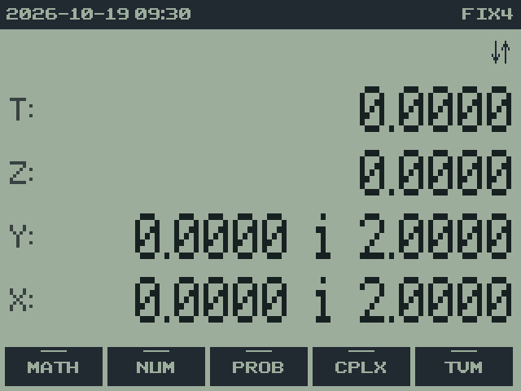

## Example: arithmetic with 3 + 4i

Start with the settings above. The rows continue one calculation.

| Keys | X | Explanation | Screen |
| --- | --- | --- | --- |
| `3 2ND . 4` | `3 i 4_` | Type both components in a single entry. | 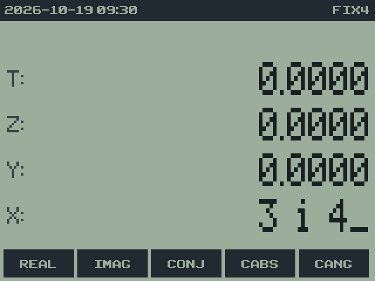 |
| `ENTER` | `3.0000 i 4.0000` | Finish entry; ENTER also copies the whole value into Y. | 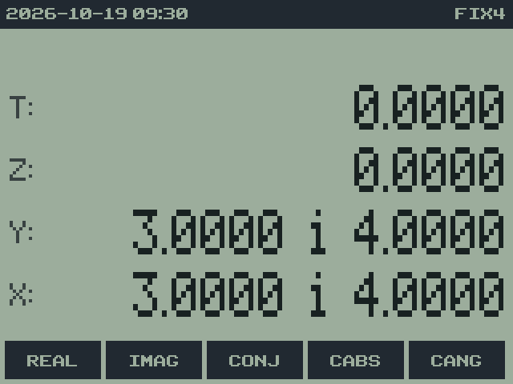 |
| `2 +` | `5.0000 i 4.0000` | A real operand joins the complex calculation. | 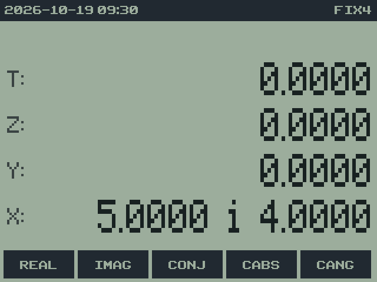 |
| `x²` | `9.0000 i 40.0000` | (5 + 4i)² = 9 + 40i. | 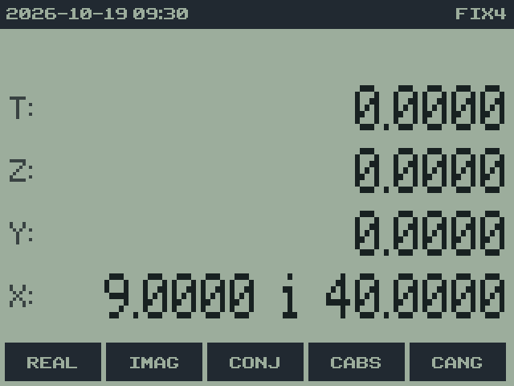 |
| `2ND ANS` | `5.0000 i 4.0000` | LASTX recalls both components of the previous operand. | 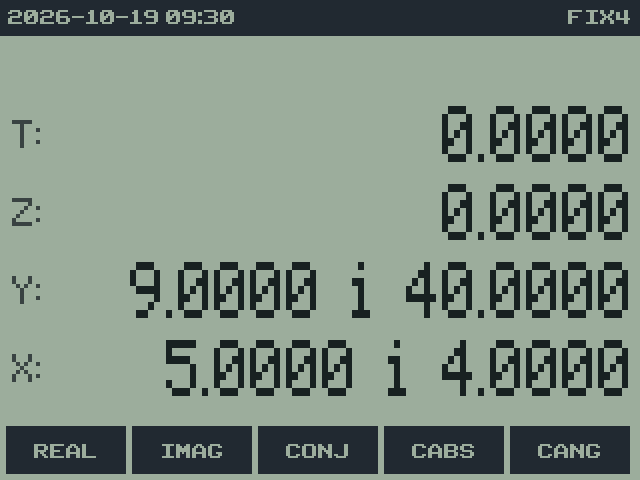 |

For binary operations, put the first operand in Y and the second in X as
usual. For example, `1 2ND . 2 ENTER 3 2ND . 4 ×` gives −5 + 10i.
`STO→ MATH` stores a complex value in A; `2ND RCL MATH` recalls it.
STO/RCL `+ − × ÷` use the same complex arithmetic as stack operations.

## Example: logarithms, exponentials and powers

Keep DEC, DEG, FIX 4, RRES and RECT selected. This example starts with an
explicit complex operand, so CRES is unnecessary. The rows continue from
one another.

| Keys | X, approximately | Explanation | Screen |
| --- | --- | --- | --- |
| `1 2ND . 1 LN` | `0.3466 i 0.7854` | ln(1 + i); its imaginary component is an angle in radians, even in DEG. | 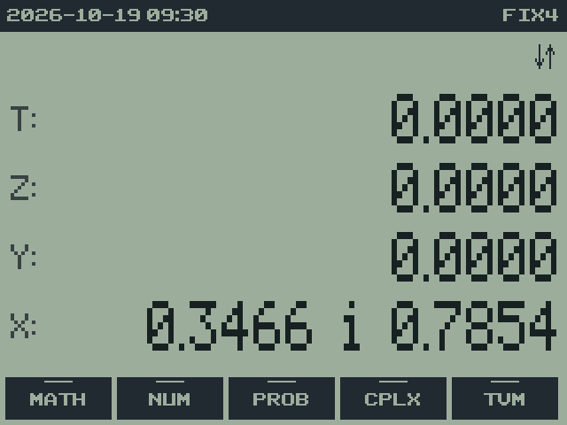 |
| `2ND LN` | `1.0000 i 1.0000` | Apply e^X to return to the original complex value. | 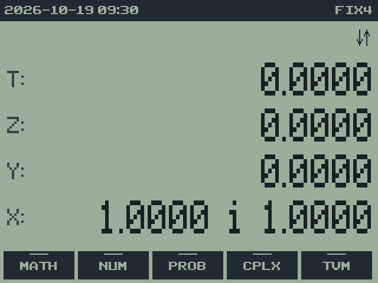 |
| `1 2ND . 1 ENTER 2 ^` | `0.0000 i 2.0000` | Re-enter the base, then use Y^X with real exponent 2 in X. | 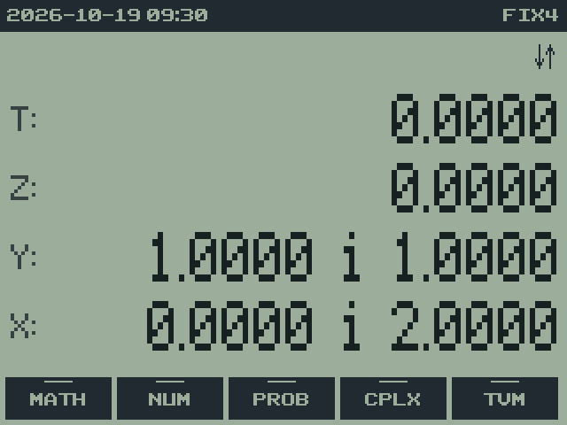 |

Finite precision can leave stored guard digits after the logarithm and
exponential round trip. The screenshots use FIX 4; SHOW reveals those
digits. The final row re-enters the base before squaring it.

## CPLX menu: components, conjugate, magnitude and angle

Open **HOME** → **CPLX**. Re-enter `3 2ND . 4 ENTER` before each row;
these functions replace X. Keep DEG selected for the stated angle.

| Function | Result from 3 + 4i | Meaning | Screen |
| --- | --- | --- | --- |
| **REAL** | 3 | Extract the real component as a real value. | 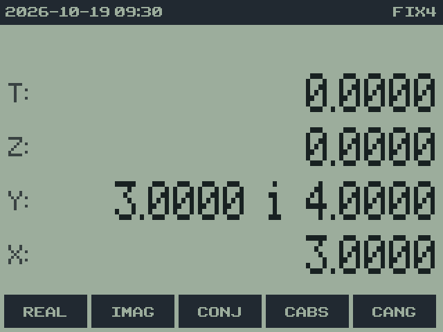 |
| **IMAG** | 4 | Extract the imaginary component as a real value. | 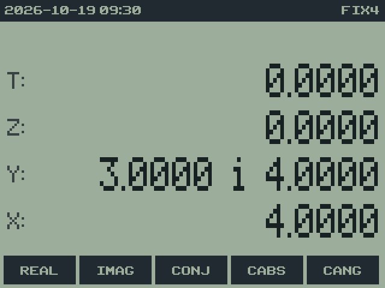 |
| **CONJ** | 3 − 4i | Negate the imaginary component. | 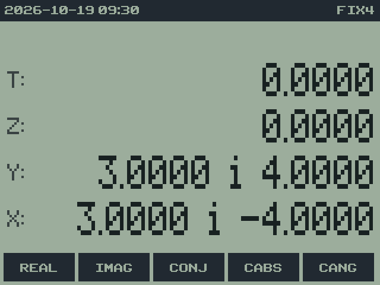 |
| **CABS** | 5 | Return the magnitude, √(3² + 4²). | 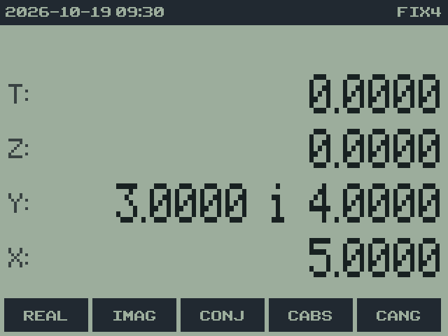 |
| **CANG** | approximately 53.1301 | Return the angle in the normal DEG/RAD setting. | 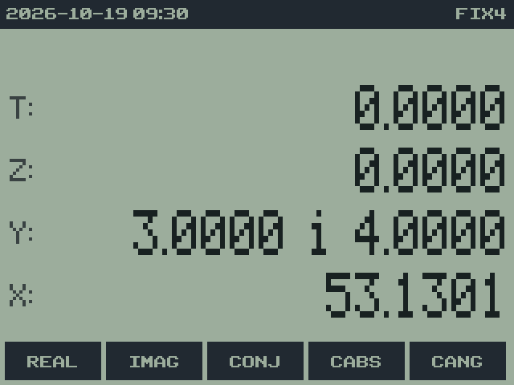 |

CANG uses DEG/RAD even if polar display uses a different angle unit. In
RAD, the same angle is approximately 0.927295218 radians. CANG of zero is
zero. With a real operand, REAL and CONJ preserve it, IMAG and CANG return
zero, and CABS gives its absolute value. CANG of a negative real also
returns zero, following the RPN83P convention; enter it explicitly as a
complex value with zero imaginary part to request a complex angle.

## RRES and CRES: choosing result behavior

MODE row 2 **RRES** (the default) keeps real-domain rules for real inputs.
For example, √(−4) reports `Err: Domain`. Select **CRES** to allow principal
complex results from negative real square roots, logarithms and applicable
powers or roots. The status bar then shows **CRES**. Both modes accept
explicit complex operands; switching to RRES keeps existing complex values.

| Keys or selection | X or message | Explanation | Screen |
| --- | --- | --- | --- |
| In RRES, `4 (−) 2ND √` | `Err: Domain`; X remains −4 | A real negative square root is outside the real domain. | 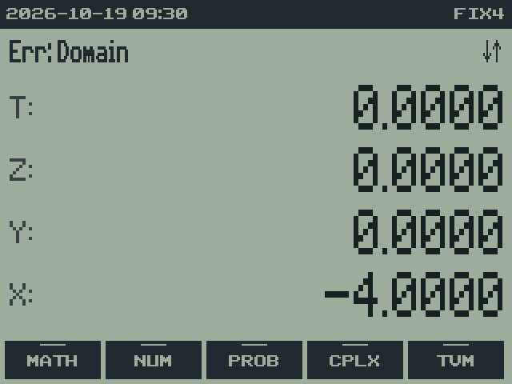 |
| `CLEAR`, MODE **CRES**, `2ND √` | `0.0000 i 2.0000` | CLEAR dismisses the message; the retained −4 is used after selecting CRES. | 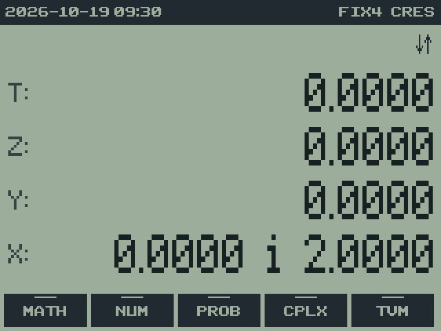 |
| `1 (−) LN` | approximately `0 i 3.1416` | ln(−1) is iπ; logarithm angles are radians in every angle mode. | 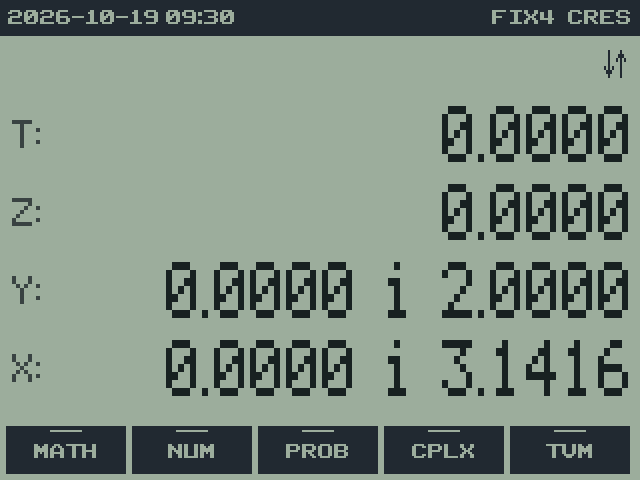 |

Powers, general roots and logarithms use the principal complex result
(the branch selected by the principal argument). In particular, in CRES
`8 (−) ENTER 3` **X√Y** gives approximately 1 + 1.7321i. RRES gives −2 for
that same pair of real operands. The real **³√X** function still gives the
real cube root of a negative real. Using an explicit complex operand
selects complex rules, including the principal complex cube root.

## RECT, PRAD and PDEG: displaying the same value

The remaining choices on MODE row 2 control presentation and LINK:

| Setting | Display of 3 + 4i in FIX 4 | LINK interprets real Y, X as |
| --- | --- | --- |
| **RECT** (default) | `3.0000 i 4.0000` | Real part, imaginary part. |
| **PRAD** | `5.0000 < 0.9273` | Magnitude, angle in radians. |
| **PDEG** | `5.0000 <d 53.1301` | Magnitude, angle in degrees. |

To change the display while keeping X:

1. Press `MODE`, then `↓` once to reach row 2.
2. Choose **RECT** (`ZOOM`), **PRAD** (`TRACE`) or **PDEG** (`GRAPH`).
3. Read the same stored value in its new presentation. Press `MATH` to
   return to HOME when finished.

You can repeat step 2 without re-entering X. Real values keep their normal
real display in every complex display mode.

The separator is `<` for radians and `<d` for degrees.
Changing presentation keeps the stored rectangular components and does not
round them. FIX/SCI/ENG and the decimal mark apply to both displayed
components. SHOW (`2ND ENTRY`) uses the selected complex presentation with
all 14 stored digits per component; use the left/right arrows to scroll a
long X value. Polar conversion itself is subject to numeric range limits.

Result mode, complex display mode and DEG/RAD are independent. For example,
DEG with PRAD displays polar angles in radians but makes CANG return
degrees. Only RAD, CRES and PRAD/PDEG need status indicators; DEG, RRES and
RECT are implicit. MODE marks all active choices.

## All six result and display states

**Setup:** DEC, DEG, FIX 4; enter `3 2ND . 4 ENTER`. Open MODE row 2.
Use **RRES** (`Y=`) or **CRES** (`WINDOW`) for the result group, and the
three keys to their right for presentation. The filled squares in the
menu mark both groups.

| Display | RRES: explicit complex input is accepted | CRES: real inputs may also produce complex results |
| --- | --- | --- |
| RECT: real and imaginary components | 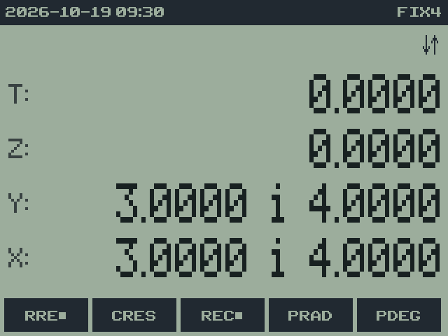 | 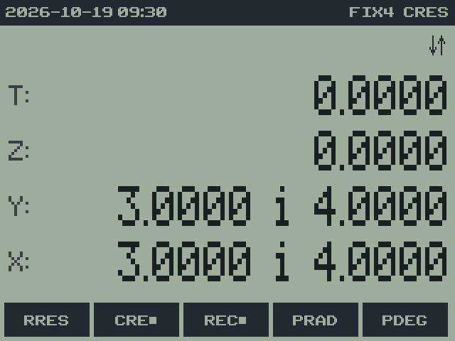 |
| PRAD: magnitude and radians | 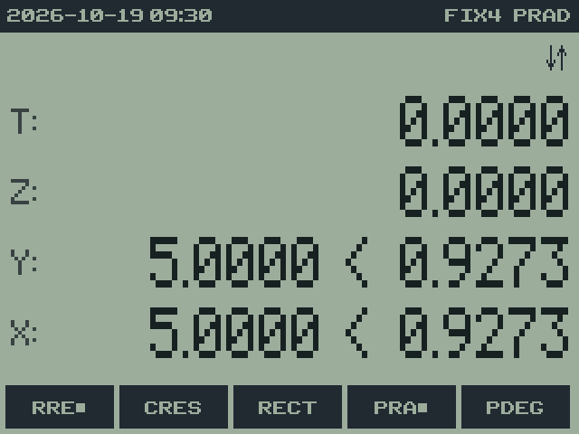 | 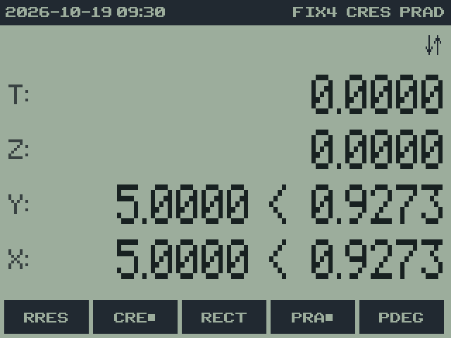 |
| PDEG: magnitude and degrees | 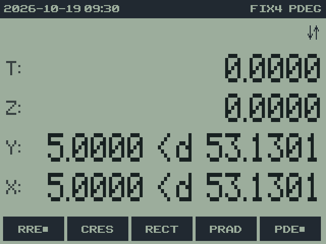 | 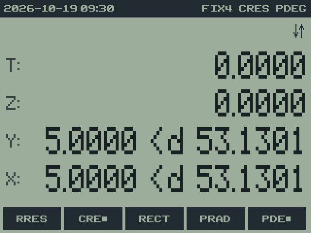 |

Every screen shows the same complex value. RRES/CRES controls whether a
calculation starting with real inputs may leave the real domain; it does
not convert, hide or clear an existing complex value. RECT/PRAD/PDEG changes
presentation and LINK's two-real interpretation. Changing result mode
alone leaves the displayed components unchanged.

In these DEG examples the numeric status labels are FIX4, plus CRES when
selected and PRAD or PDEG for polar display. DEG, RRES and RECT are
implicit. In RAD an additional RAD indicator appears. To return to the
fresh-state numeric settings, choose DEG, RRES and RECT, then FIX `. 2`
for ALL and BASE DEC. These selections preserve stack and register values.

## Angle modes: polar display, entry and CANG

Three angle choices serve different purposes:

| Choice | Controls | Example |
| --- | --- | --- |
| MODE DEG/RAD | CANG, real trig and CONV coordinate functions | CANG of 3 + 4i is about 53.1301 in DEG, or 0.9273 in RAD. |
| MODE PRAD/PDEG | Displayed polar angle and the angle used by LINK | PRAD always displays radians; PDEG always displays degrees. |
| Polar entry delimiter | The unit of the angle being typed | The first `2ND APPS` selects degrees; repeating it toggles radians/degrees. |

**Example 1:** select DEG and PRAD, enter `3 2ND . 4 ENTER`, then open
**HOME** → **CPLX** and choose **CANG**. The complex display used radians,
but CANG returns a real angle in degrees:

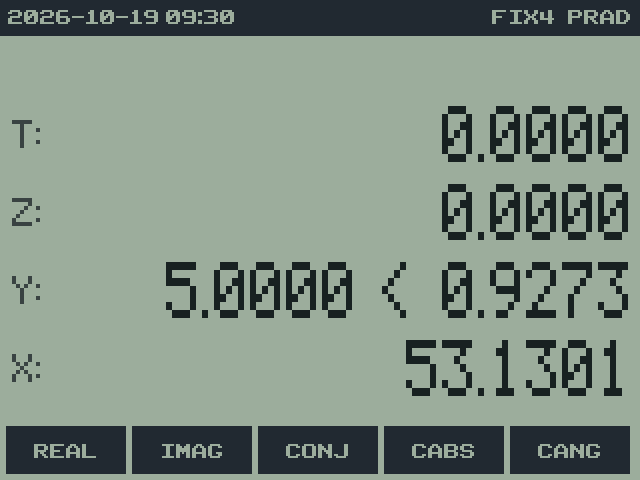

**Example 2:** select RAD and PDEG, re-enter `3 2ND . 4 ENTER`, and choose
**CANG** again. The complex display used degrees, but CANG now returns a
real angle in radians:

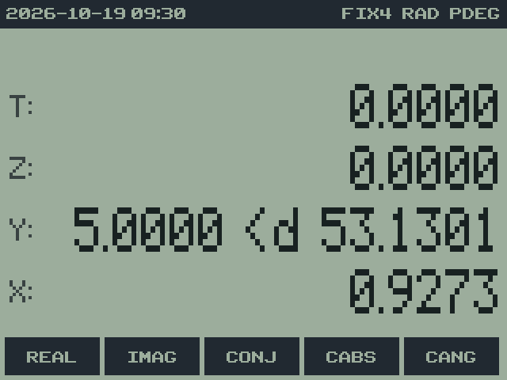

Polar input also keeps its explicit unit in either setup. For example,
`2 2ND APPS 90 ENTER` always enters magnitude 2 at 90 degrees, even with
RAD and PRAD selected. It will then be displayed as magnitude 2 at about
1.5708 radians. Complex logarithms and exponentials use radians regardless
of all three user angle choices.

## Digits, decimal marks and SHOW

The display format applies separately to the components being shown:
real/imaginary in RECT, or magnitude/angle in PRAD/PDEG. FIX controls
decimal places; SCI uses scientific notation; ENG uses exponents divisible
by three; ALL shows as many digits as needed. Formatting keeps the stored
value unchanged.

**Setup:** DEC, DEG, RRES, RECT. Enter
`12.3456 2ND . .0123456 ENTER`. Follow these selections in MODE:

| Selection | X, approximately | Screen |
| --- | --- | --- |
| **FIX** `2` | `12.35 i 0.01` | 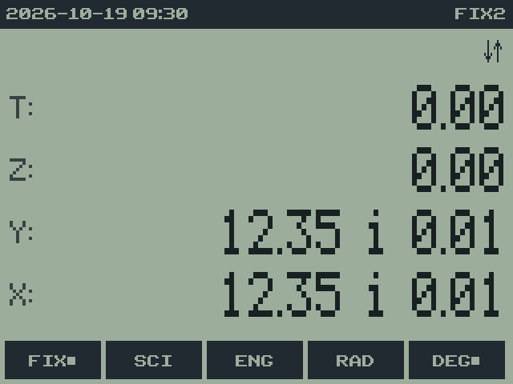 |
| **SCI** `2` | `1.23 E1 i 1.23 E−2` | 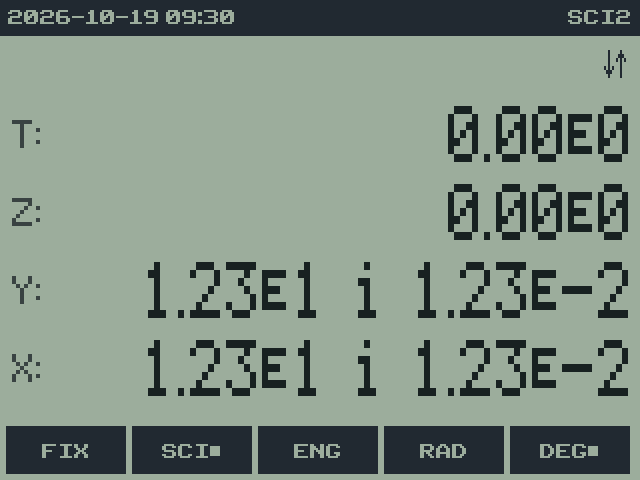 |
| **ENG** `2` | `12.3 E0 i 12.3 E−3` | 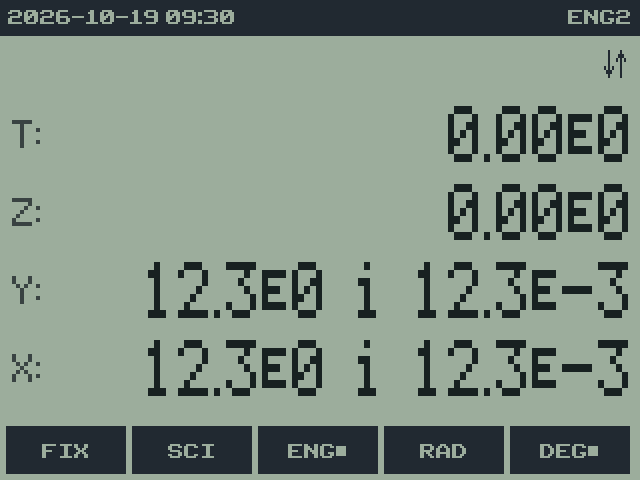 |
| **FIX** `. 2` | `12.3456 i 0.0123456` | 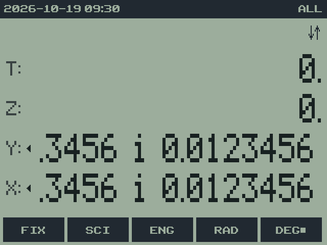 |

SCI 2 and ENG 2 show three significant digits per component. ENG moves
the decimal point to use an engineering exponent, so its mantissa does
not always have two digits after the decimal point.
The ALL example is wider than the stack line; its left arrow means the
beginning of the value is hidden. Press `←` to inspect those digits.

`2ND ENTRY` (SHOW) displays both components using all available stored
digits on the message line. It follows RECT/PRAD/PDEG rather than forcing
rectangular output. For example, with 3 + 4i in PRAD, SHOW gives magnitude
5 and the angle to stored precision:

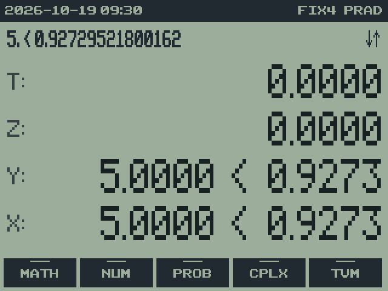

The physical decimal-point key works in either decimal-mark setting.
MODE row 4 **,** uses a comma decimal mark on both components; **.**
restores period decimal. The same example in comma mode reads
`12,3456 i 0,0123456`:

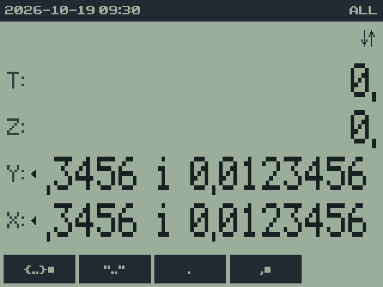

Long complex values stay on one stack line. A small arrow marks hidden
digits; use `←` and `→` to scroll X. Reducing displayed precision can make
a value fit, while SHOW lets you inspect the retained digits. Arithmetic
still uses the stored rectangular components, including while polar
display is selected.

## LINK: joining or splitting stack values

`2ND LINK` means `2ND X,T,θ,n`. With real X and Y it joins two levels into
one complex value and drops the stack. With complex X it splits the value
into two real levels, lifting the higher stack values. The order is always
the first component in Y and the second in X; the display mode chooses
what those components mean.

**Example in RECT:**

| Keys | Y | X | Screen |
| --- | --- | --- | --- |
| `3 ENTER 4` | 3 | 4 | 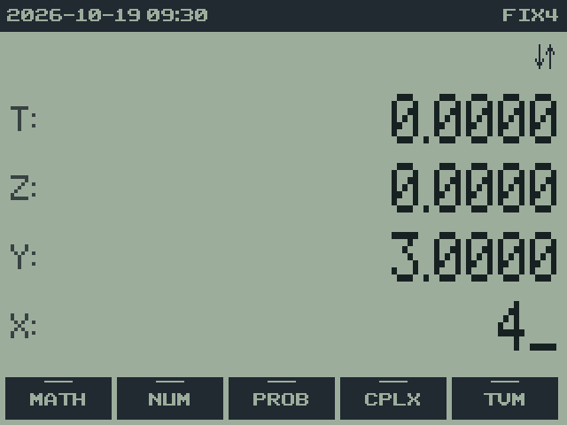 |
| `2ND LINK` | previous Z | 3 + 4i | 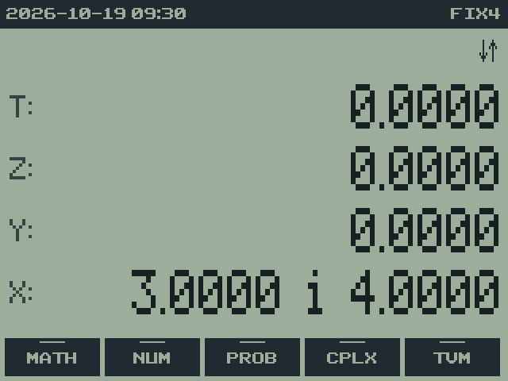 |
| `2ND LINK` | 3 | 4 | 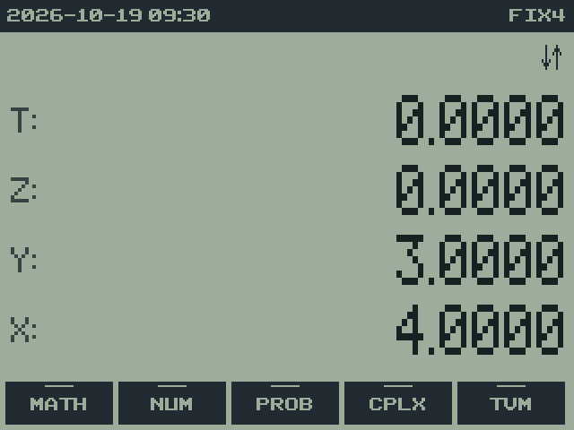 |

In PDEG, `2 ENTER 90 2ND LINK` joins magnitude 2 and angle 90° into 0 + 2i.
Splitting it returns magnitude 2 in Y and angle 90 in X. In PRAD the angle
is in radians. These units follow PRAD/PDEG even when DEG/RAD differs.
The CONV **→POL**/**→REC** functions use a different pair convention and
leave two real values; use their [operand table](10-mathematics.md#conv-menu).

## Storing and recalling complex values

Ordinary registers store both components in a single value. The index
register's name `i` remains a register name; it does not enter an imaginary
separator while a STO/RCL prompt is active.

**Setup:** DEC, DEG, FIX 4, RRES, RECT. Start a new calculation:

| Keys | Effect | Screen |
| --- | --- | --- |
| `3 2ND . 4 ENTER STO→ MATH` | Store 3 + 4i in A; X is kept. |  |
| `CLEAR`, then `2ND RCL MATH` | Recall both components from A. |  |
| `VARS` | Inspect A in the variable catalog. | 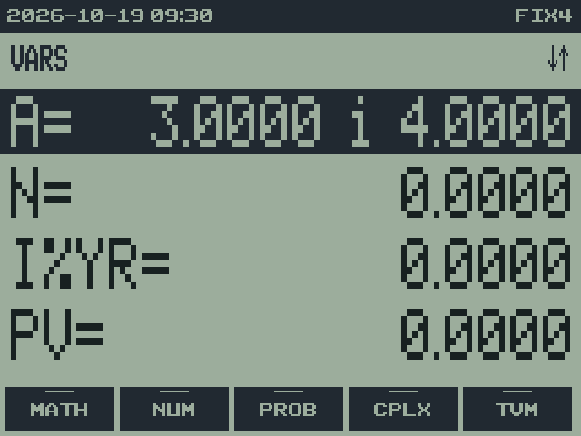 |

VARS and recalled values use the current complex presentation. STO/RCL
`+ − × ÷` share the stack's complex arithmetic. Stack values, LASTX and
ordinary registers retain their types and components after a normal
save/reopen; result and display modes are saved as well. Statistics
registers and shared TVM variables require plain real values.

## Functions that accept complex operands

| Functions | Behavior |
| --- | --- |
| `+ − × ÷`, `(−)`, `x⁻¹`, `x²`, **X^3** | Complex arithmetic; real operands are promoted when needed. |
| `2ND √`, **³√X**, `^`, **X√Y** | Principal complex square roots, cube roots, powers and general roots. |
| `LOG`, `LN`, **LOG2**, **LOGB**, `2ND LOG`, `2ND LN`, **2^X** | Complex logarithms and exponentials; their angles use radians. LOGB takes the argument in Y and base in X. |
| **REAL**, **IMAG**, **CONJ**, **CABS**, **CANG**, `2ND LINK` | The component, magnitude, angle and join/split operations described above. |
| SIN/COS/TAN, inverse trig, HYP, **E^X-**, **LN1+**, NUM rounding/ordering, probability, CONV | Require real operands; complex values give `Err: Data Type`. Use CABS for a complex magnitude; NUM ABS also requires a real value. |

An explicit complex value remains complex even if its imaginary component
becomes zero. For example, squaring `2ND i ENTER` gives −1 + 0i. A real-only
function still rejects it. Select **CPLX** → **REAL** when you intend to
extract the real component; do this only if discarding any imaginary part
is appropriate. CRES controls allowed results from real inputs; it does
not make real-only functions accept complex inputs.

For a concrete example, enter `2ND . ENTER x²` in RECT. X is the complex
value −1 + 0i. **NUM** → **ABS** reports `Err: Data Type` and keeps it.
Dismiss the message with CLEAR, then choose **CPLX** → **REAL** to obtain
real −1; real-only operations can now use that extracted component:

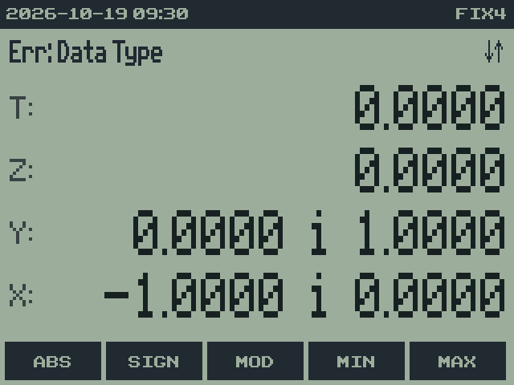 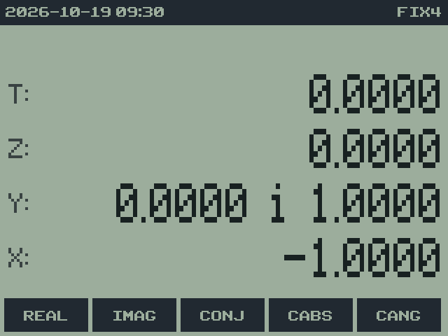

BASE word operations, statistics, TVM, register indices, size settings and
DATE's numeric arguments require plain real values. Complex quantities
with units are unsupported. See [Number types](05-number-entry.md#number-types)
for how values move between these features. Range and precision errors
apply to both components and required intermediate values; a failed
calculation preserves its operands and LASTX.

---

[Manual contents](../USER_GUIDE.md) · [Previous: 10. Math functions](10-mathematics.md) · [Next: 12. BASE: hexadecimal, octal and binary](12-base.md)
