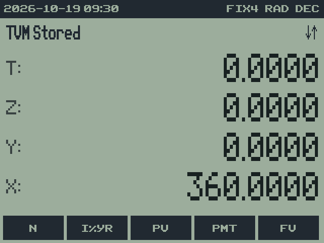
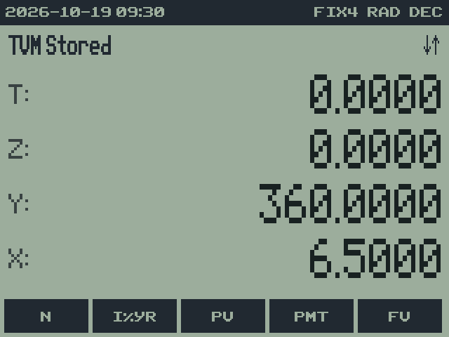
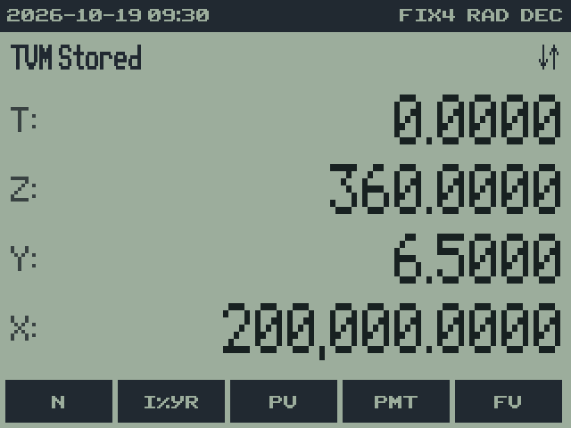
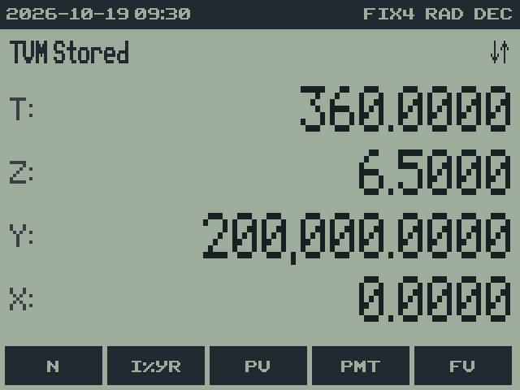
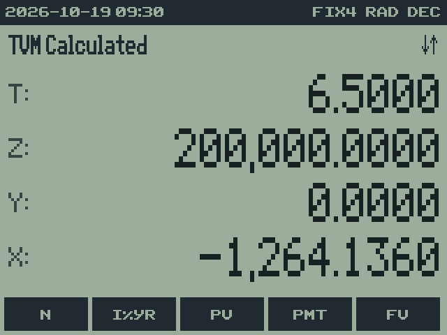
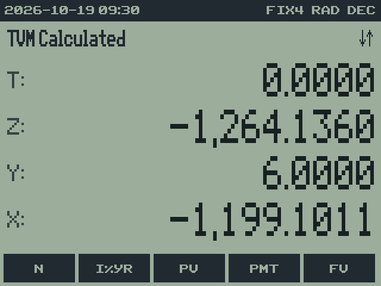
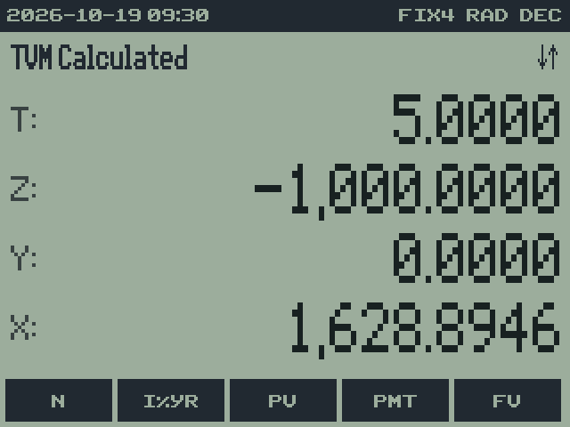
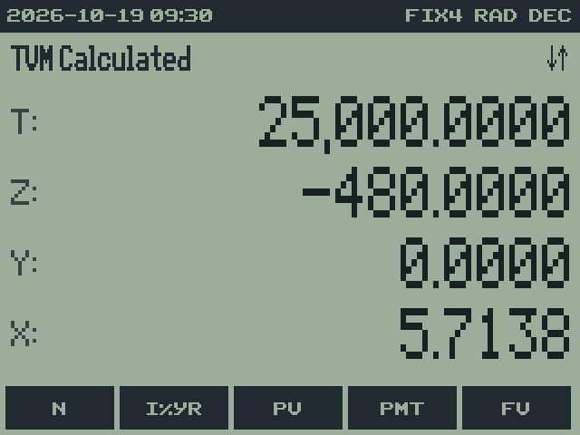

# 13. TVM: time value of money

rpnCE 0.7.0 · User Guide

[Manual contents](../USER_GUIDE.md) · [Previous: 12. STAT: statistics and curve fitting](12-statistics.md) · [Next: 14. UNIT: unit conversions](14-units.md)

**In this chapter**

- [Variables and cash-flow signs](#variables-and-cash-flow-signs)
- [Storing and solving](#storing-and-solving)
- [Starting a new problem](#starting-a-new-problem)
- [Example: monthly loan payment](#example-monthly-loan-payment)
- [Example: a single deposit grows](#example-a-single-deposit-grows)
- [Example: solve an interest rate](#example-solve-an-interest-rate)
- [Settings and solver controls](#settings-and-solver-controls)

**Menu location:** **HOME** row 1 → **TVM**.

-  TVM" width="320">
    -  TVM > Row 1" width="320">
    -  TVM > Row 2" width="320">
    -  TVM > Row 3" width="320">

TVM solves for an unknown in a series of equal payments with compound
interest: loan payments, a remaining balance, an investment's future value,
or the rate or number of periods implied by the other values.

## Variables and cash-flow signs

| Variable | Meaning | How to enter it |
| --- | --- | --- |
| **N** | Number of payment periods | Enter a count of payments, rather than years. |
| **I%YR** | Nominal annual interest rate, in percent | Enter `6.5` for 6.5%, rather than 0.065. |
| **PV** | Present value | The amount at the beginning. |
| **PMT** | Equal payment each period | The amount of each payment. |
| **FV** | Future value | The amount at the end. |
| **P/YR** | Payments per year | 12 for monthly payments; 1 for annual payments. |
| **C/YR** | Compounding periods per year | Select the compounding frequency for the problem. |

Use one consistent point of view. Money received is positive; money paid
out is negative. A borrower receives a positive PV and pays negative PMT.
A saver starts with a negative PV and receives a positive FV. Use `(−)`
for negative entry.

The seven values are TI-OS finance variables, shared with TI's TVM Solver.
Changing them in either program changes the other program's starting
values. They all appear in rpnCE's VARS catalog, even when zero. rpnCE's
BEG/END choice and its solver settings are saved separately by rpnCE.

## Storing and solving

1. Set the payment and compounding frequencies and the payment timing.
2. Type a value, then select its TVM variable to store it. Repeat for all
   known variables, including zeros such as FV = 0.
3. Immediately after the last TVM variable key, press the unknown variable
   key without entering a number. rpnCE solves for that variable.
4. Read the result in X. The solved TVM variable also holds that result.

`TVM Stored` confirms a store; `TVM Calculated` confirms a solution.
A solve depends on the preceding command being another TVM variable key,
with no new number being typed. If another operation intervenes, recall a
known variable with `2ND` plus its TVM softkey, then press the unknown
variable key to start the solve sequence again.

To inspect a value without solving, press `2ND` and its softkey, or recall
it from VARS. A recall does not reset the other variables. P/YR and C/YR
store when pressed normally; they are settings, not solve targets.

## Starting a new problem

**CLTV**, on TVM row 2, clears N, I%YR, PV, PMT, and FV; sets P/YR and
C/YR to 12; and selects END. It replaces the shared TVM values, so record
or back up any previous problem you need. **RSTV**, on row 3, resets the
interest-rate search guesses and iteration limit; CLTV does not do that.

Use **MODE** → **FIX** `4` and BASE **DEC** for the display examples below.
Each example begins with CLTV and RSTV and supplies its own known values.

## Example: monthly loan payment

Find the monthly payment on 200,000 at 6.5% annual interest over 30 years,
with monthly compounding, end-of-month payments, and no remaining balance.

**Setup:** **CLTV**, **RSTV**. Confirm P/YR = 12, C/YR = 12, END. Return
to TVM row 1. N is 30 × 12 = 360.

| Keys | Message or result | Explanation | Screen |
| --- | --- | --- | --- |
| `360` **N** | TVM Stored | Store the number of monthly payments. |  |
| `6.5` **I%YR** | TVM Stored | Store the annual percentage rate. |  |
| `200000` **PV** | TVM Stored | Money received by the borrower. |  |
| `0` **FV** | TVM Stored | The loan is fully repaid. |  |
| **PMT** | approximately −1,264.1360 | Solve immediately after FV. |  |

The negative sign means a payment made by the borrower. The stored answer
has more digits than the four displayed decimal places.

### Change an assumption

Keeping the other loan values, enter `6` **I%YR**, then press **PMT**
without typing another number. The payment is approximately −1,199.1011.
rpnCE replaces the rate and recomputes the unknown; there is no need to
re-enter N, PV, and FV.

## Example: a single deposit grows

Find the value after ten years of a 1,000 deposit at 5% annual interest,
compounded yearly, with no additional payments.

**Setup:** **CLTV**, **RSTV**. On row 2, store `1` **P/YR** and `1`
**C/YR**; leave END selected. Return to row 1.

| Keys | Result or meaning | Screen |
| --- | --- | --- |
| `10` **N** | Ten annual periods. | |
| `5` **I%YR** | 5% per year. | |
| `1000 (−)` **PV** | Deposit is an outflow. | |
| `0` **PMT** | No recurring payments. | |
| **FV** | approximately 1,628.8946, an inflow at the end. |  |

## Example: solve an interest rate

A loan advances 25,000 and requires 60 monthly payments of 480, with no
final balance. Find the annual rate for monthly compounding.

**Setup:** **CLTV**, **RSTV**. Confirm P/YR = C/YR = 12 and END.

| Keys | Result or meaning | Screen |
| --- | --- | --- |
| `60` **N** | Sixty payments. | |
| `25000` **PV** | Loan received. | |
| `480 (−)` **PMT** | Monthly outflow. | |
| `0` **FV** | No final balance. | |
| **I%YR** | approximately 5.7138 percent annually. |  |

Unlike the other variables, I%YR is found by iteration. `TVM Not Found`
means the current search did not find a valid rate; review the signs,
known values, period settings, guesses, and iteration limit.

## Settings and solver controls

| Item | Action |
| --- | --- |
| **P/YR**, **C/YR** | Store a positive number from X; use 2ND plus the key to recall. |
| **BEG**, **END** | Payments occur at the beginning or end of each payment period. |
| **CLTV** | Clear the five problem values and restore 12 periods/year and END. |
| **IYR1**, **IYR2** | Store the two starting annual-rate guesses; defaults are 0% and 100%. |
| **TMAX** | Store the iteration limit; default 50. |
| **RSTV** | Reset IYR1, IYR2, and TMAX without clearing the problem values. |

BEG/END affects recurring payments. Keep payment frequency distinct from
compounding frequency: N counts payment periods, while the annual rate is
converted using C/YR and P/YR. A Canadian-style semiannual-compounding
example can use C/YR = 2 with monthly P/YR = 12; do not divide I%YR by 12
before entering it.

TVM requires plain numbers. Unit-bearing amounts and DATE objects are
rejected. The calculator does not infer fees, irregular payment dates, or
a changing interest rate from these seven values.

---

[Manual contents](../USER_GUIDE.md) · [Previous: 12. STAT: statistics and curve fitting](12-statistics.md) · [Next: 14. UNIT: unit conversions](14-units.md)
