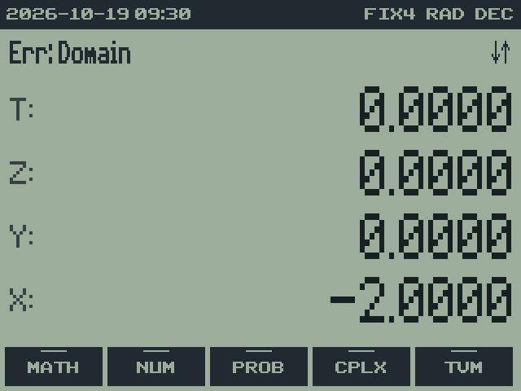
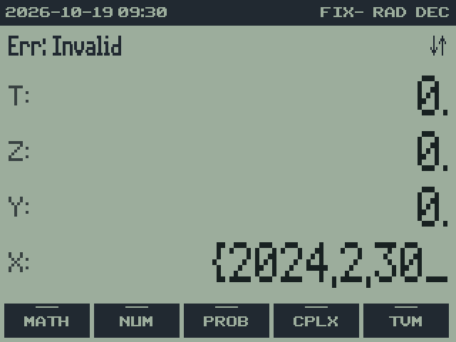
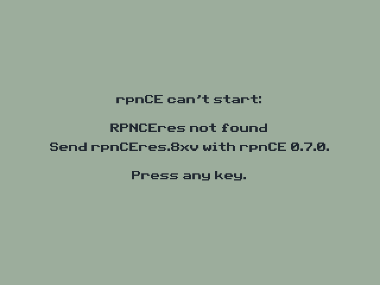

# 16. Messages and errors

RPNCE 0.7.0 · User Guide

[Manual contents](../USER_GUIDE.md) · [Previous: 15. DATE: dates, times and the clock](15-date.md) · [Next: 17. Saving, memory and files](17-memory.md)

**In this chapter**

- [Errors](#errors)
- [Notices](#notices)
- [BASE warnings](#base-warnings)
- [When RPNCE can't start](#when-rpnce-cant-start)
- [Choosing the next action](#choosing-the-next-action)
- [Recovering without clearing saved work](#recovering-without-clearing-saved-work)
- [Reporting a reproducible problem](#reporting-a-reproducible-problem)

Errors appear on the message line until a key is pressed. `CLEAR` dismisses
the message without changing the stack or an unfinished entry. Other keys
dismiss the message and perform their normal action. Routine notices fade
after about 1.5 seconds. A rejected arithmetic operation retains its operands
and LASTX, so you can inspect the inputs before trying again. An invalid
DATE entry remains open for correction with DEL; it is not a completed
stack object.

 

## Errors

| Message | Meaning |
| --- | --- |
| Err: Division By 0 | a division by zero: `÷` or `x⁻¹` of 0, **MOD** by 0, **%CH** from 0, a root with index 0 |
| Err: Domain | an input the function doesn't accept: √ or LN of a negative number, ASIN of 2, (−8)^0.4, a size out of range, and so on |
| Err: Overflow | a result beyond the calculator's range (about ±9.99 × 10⁹⁹) |
| Err: Underflow | a nonzero result or required intermediate value is too small for the supported range |
| Err: Precision | detected loss of significant digits makes the calculation unreliable |
| Err: Math | another math error reported by the calculator |
| Err: Stat | not enough data for a statistic, or a curve fit that doesn't apply to the data |
| Err: Data Type | the wrong kind of value: a DATE object where a number is needed, a number where a DATE object is needed, or an unsupported operation on unit values |
| Err: Unit Mismatch | units of different kinds, such as metres and kilograms |
| Err: Index | `(i)` names a register that doesn't exist |
| Err: Word Size | a BASE operation on a value too big for the word size |
| Err: Invalid | an impossible DATE record (February 30, 23:59:60) |
| Err: Syntax | a DATE record that can't be read |
| Err: Clock | the CE's clock can't be read |
| TVM Not Found | no interest rate fits the TVM values |
| Not available yet | a feature still to come (complex numbers) |

## Notices

| Message | After |
| --- | --- |
| TVM Stored, TVM Calculated | storing or solving a TVM value |
| TVM Cleared, TVM Reset | **CLTV**, **RSTV** |
| Stack cleared, Registers Cleared, Stats Cleared | `CLEAR CLEAR` or **CLST**, **CLRG**, **CLΣ** |
| Stack Size Set, Register Size Set, Word Size Set | **SSIZ**, **RSIZ**, **WSIZ** |
| Time Zone Set, Clock Set, Epoch Set | **ATZ** or **CTZ**, **SETC**, **EPC** |
| VARS | the VARS catalog is open |
| a tint name, such as LCD+ | **TINT** |

## BASE warnings

In HEX, OCT and BIN, the message line explains why X is shown in decimal:
"Exceeds 32-bit word" (with the current word size), "Negative: not a
word", or "Not a whole number". See [chapter 11](11-base.md#11-base-hexadecimal-octal-and-binary).

## When RPNCE can't start

If its resource appvar is missing or doesn't match the program, RPNCE shows
a notice instead of starting: "RPNCEres not found", "RPNCEres is damaged"
or "RPNCEres is the wrong version". Send `RPNCEres.8xv` from the same
release as `RPNCE.8xp`.

## Choosing the next action

| Symptom | Check | Corrective action |
| --- | --- | --- |
| SIN or a polar angle looks wrong | DEG/RAD in the status bar | Select the intended angle mode before the operation. |
| Ordinary arithmetic wraps or only whole digits can be entered | HEX/OCT/BIN in the status bar | Open BASE and select DEC. |
| A result looks rounded but later arithmetic differs | FIX/SCI/ENG display setting | Use SHOW to inspect it; use RNDF or RNDN only if the stored value should be rounded. |
| A STO/RCL key opens the wrong operation | A prompt is waiting for a letter or operator | Cancel with CLEAR, DEL, or ON; repeat the complete command. Use ALPHA for W, R, or M where needed. |
| A TVM softkey stores instead of solving | No TVM variable key immediately preceded it | Recall a known TVM variable with 2ND plus its key, then select the unknown variable. |
| TVM result has an unexpected sign or amount | Cash-flow signs, N, P/YR, C/YR, BEG/END | Enter all assumptions explicitly; N counts payments, not years. |
| A curve fit reports Err: Stat | Count, variation, ALLΣ/LINΣ, and positive-data requirements | Select the correct mode, clear the sums, and re-enter valid data if necessary. |
| A unit operation fails | Operand kinds and TEMP/FUEL restrictions | Use compatible quantities; review the operation table in the units chapter. |
| A stored quantity returns without its unit | Unit metadata was missing, damaged, or from different register values | Verify the numeric value and restore the correct unit; restore a matched backup if available. |
| No program starts from PRGM | Native-program support for this OS | Follow the launcher's current instructions; sending files alone does not enable native code. |

## Recovering without clearing saved work

First inspect the state: SHOW reveals the stored X; VARS reveals registers
and shared TVM values; the status bar reveals base, angles, and number
format. Returning to DEC or selecting FIX does not erase ordinary values.
Use the narrowest clear operation needed: CLX for X, CLΣ for statistics,
CLTV for a new finance problem. CLRG does not clear statistics or TVM.

If startup reports a resource problem, replace the matching program and
resource files first. Deleting saved-data appvars does not repair a
mismatched resource. Before an intentional reset, follow the
[backup procedure](17-memory.md#backing-up-your-work).

## Reporting a reproducible problem

Include the RPNCE version, calculator model and OS, starting settings,
exact keys in order, expected result, and displayed result or error. For
units, include the full menu path: kW under PWR and kWh under ENER are not
interchangeable. For TVM, include all seven values and BEG/END; for BASE,
include word size and carry if relevant.

Report problems through the [project issue tracker](https://github.com/jacober-calc/rpnce/issues).
A short sequence from known settings is more useful than an isolated
screen value. Avoid resetting a problem state before recording it if it
contains the only copy of the inputs.

---

[Manual contents](../USER_GUIDE.md) · [Previous: 15. DATE: dates, times and the clock](15-date.md) · [Next: 17. Saving, memory and files](17-memory.md)
