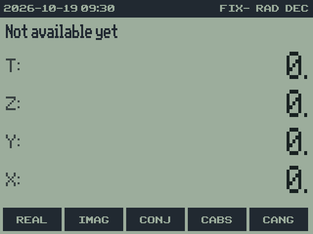

# 18. Limits and differences

RPNCE 0.7.0 · User Guide

[Manual contents](../USER_GUIDE.md) · [Previous: 17. Saving, memory and files](17-memory.md) · [Next: Reference tables](19-reference.md)

**In this chapter**

- [Limits](#limits)
- [Compared with HP calculators](#compared-with-hp-calculators)
- [Compared with RPN83P](#compared-with-rpn83p)
- [Complex-number placeholders](#complex-number-placeholders)
- [Supported quantity operations](#supported-quantity-operations)
- [Scope of the documentation](#scope-of-the-documentation)

## Limits

| Item | Limit |
| --- | --- |
| Numbers | 14 significant digits; up to about ±9.99 × 10⁹⁹ |
| Typing | 12 digits, and an exponent from −99 to 99 |
| Stack | 4 to 12 levels |
| Registers | 40 to 140 |
| BASE words | 1 to 44 bits, unsigned |
| **PRIM** | 2 to 4,294,967,295 |
| **N!** | 0 to 69 |
| Dates | years 1 to 9999; time zones within ±23:45, in 15-minute steps |

## Compared with HP calculators

RPNCE follows the HP-32SII and DM32 for the stack, LASTX, stack lift,
registers and display formats. Some differences:

- **Roots and powers of negative numbers** follow the HP rule: a negative
  Y needs a whole-number exponent for Y^X, and an odd whole-number index
  for X√Y.
- **ALL** is FIX with "as many digits as needed" (`FIX-`), set with
  **FIX** `. 2` through `. 9`.
- **No equations or programs:** RPNCE is a calculator, not a programmable
  one.

## Compared with RPN83P

RPNCE's menu tree, DATE objects, units and BASE operations follow RPN83P.
Some differences:

- **Registers** are lettered and numbered as on the HP-32SII (A to Z, i,
  and numbered extras) rather than R00 to R99, and all of them, including
  A to Z, can hold DATE objects and values with units.
- **The keyboard** follows the HP-32SII more closely: most keys do what
  their labels say, including their 2ND functions.
- **Roots and powers of negative numbers** follow the HP rule above.
- **BASE words** go up to 44 bits.
- **Not yet available:** complex numbers.

## Complex-number placeholders

The following visible menu items are reserved for a later implementation:

| Location | Items | Version 0.7.0 behavior |
| --- | --- | --- |
| **HOME** → **CPLX** | REAL, IMAG, CONJ, CABS, CANG | Reports `Not available yet`. |
| **MODE** row 2 | RRES, CRES, RECT, PRAD, PDEG | Reports `Not available yet`; does not enable complex calculation. |
| Keyboard | 2ND LINK, 2ND ANGLE | Unassigned; does not enter or combine complex values. |

A menu label is not evidence that the corresponding function is available.
For example, a negative square root remains a real-domain error rather
than producing a complex result. Do not follow RPN83P complex-entry
examples on this version of RPNCE.

## Supported quantity operations

Unit conversion is within a dimension. Compatible linear quantities can
be added or subtracted, multiplied by a plain number, divided by a plain
number, or divided by one another for a ratio. Products of quantities,
inverse units, derived-unit construction, and general dimensional algebra
are not implemented. Temperature and reciprocal fuel units have additional
restrictions described in [Units](14-units.md).

## Scope of the documentation

This guide describes 0.7.0. Check the ABOUT help page for the installed
version. The reference tables follow the program's menu and unit
definitions. Future plans are maintained in the
[roadmap](../ROADMAP.md), rather than presented as current capabilities.

---

[Manual contents](../USER_GUIDE.md) · [Previous: 17. Saving, memory and files](17-memory.md) · [Next: Reference tables](19-reference.md)
